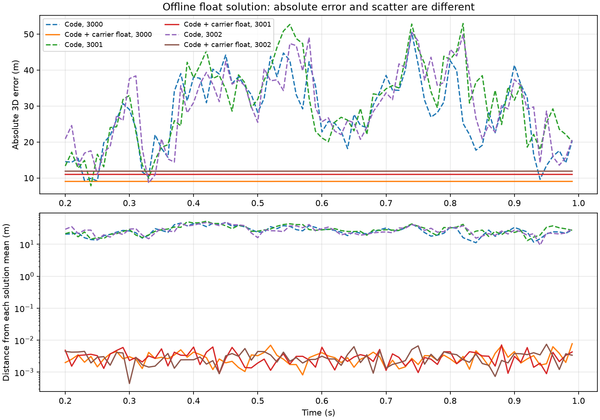

# 单天线 GPS L1 码与载波联合浮点解验证

2026-09-11。已实现多历元码/载波联合浮点定位，未固定整周数。

## 方法与范围

复用单天线 SPP 归档的3组1秒 RF/DFE/独立PRN跟踪结果，不重新生成信号，不修改源、环路或观测数据。仍是 GPS L1、无外加干扰、无多径、时间辅助、合成接收时刻 ECEF 卫星状态。只重新处理200～990 ms的80个公共时刻。

`positioning.py` 增加 `carrier_range` 和 `solve_code_carrier_float`；`audit_code_carrier_float.py` 提供对照入口。载波距离来自真实累计NCO相位和块起点频率，在覆盖公共时刻的块内计算，依照源信号符号取 `L=-lambda*phase/(2*pi)`。不再对累计相位unwrap或取整。

联合模型（米）：

```
P[t,i] = norm(s[t,i] - x[t]) + b[t] + code_noise
L[t,i] = norm(s[t,i] - x[t]) + b[t] + B[i] + phase_noise
```

每个时刻独立估计3维位置和钟差，每颗卫星在连续段内共用一个实数偏差。80历元、8卫星时共328个未知数和1280个标量观测。使用伪距SPP初始化，SciPy带列主元的QR最小二乘迭代求解；不使用真实位置初值，不施加接收机静止先验，不提供真实模糊度。

为避免大数相消，按每颗卫星首个观测的 `P-L` 平移载波数值原点，再估计偏差；同时保存原始相位坐标下的偏差。此平移完全来自观测，不是整周固定。当前NCO的起始相位/时刻约定也进入B，因此B是有效浮点相位偏差，不能直接将B/lambda取整就宣称整周模糊度已解。

这是一种**整段离线回看解**：早期位置也使用了后续观测，不是实时逐历元输出。默认权重尺度为伪距30 m、载波0.01 m，是预先设置的工程值，未校准历元间相关性，不输出有统计保证的置信区间。理论背景见 [ESA码/载波联合定位](https://gssc.esa.int/navipedia/index.php/Code_and_Carrier_Based_Positioning_%28PPP%29) 与 [模糊度固定的条件](https://gssc.esa.int/navipedia/index.php/Carrier_Phase_Ambiguity_Fixing)；本实现不等同于完整PPP产品。

## 同一组观测的结果

| 种子 | 原SPP三维RMS（m） | 联合浮点三维RMS（m） | 原SPP去均值三维RMS（m） | 联合解去均值三维RMS（mm） |
|---|---:|---:|---:|---:|
|3000|30.011|9.047|28.615|3.206|
|3001|32.549|10.995|30.636|3.366|
|3002|31.613|11.897|29.289|3.270|

三组均接受80/80历元，联合载波残差RMS分别为1.229、1.193、1.169 mm。这是后验拟合残差，不是独立观测精度测量。



**改善主要来自减少位置抖动，绝对位置仍有9～12 m偏差。** 三组联合解的位置均值与原SPP位置均值基本一致：当前卫星主要沿视线径向运动，1秒内几乎没有视线方向变化，因此载波约束不能有效消除被模糊度吸收的固定位置误差。

本场景接收机真实静止，“去均值三维RMS”是位置相对自身均值的散布。不能把3.2～3.4 mm写成毫米级绝对定位，也不能将整段回看散布等同于实时动态定位精度。在这个静态场景，简单对SPP位置求整段均值也能得到接近的绝对误差；载波联合解额外提供连续时刻间的精细变化约束。移动接收机合成测试用于确认算法没有隐含强制静止。

## 控制实验与已知失败边界

1. **相位原点改变**：对8颗卫星分别加 -123.456～456.789 m 的常数相位距离。位置最大变化9.3e-9 m，模糊度变化与加入常数的差异≤2.2e-9 m。表明位置没有依赖人为相位原点。
2. **固定伪距偏差**：给各卫星加入与ECEF X方向20 m位置变化一致的固定码偏差，载波不变。联合解平均偏移 `[20.000003, -0.000008, -0.000005] m`。因此毫米级抖动不能排除米级固定位置偏差。
3. **一周相位突变反例**：种子3000的PRN1在0.6秒起额外加一个L1周（0.190294 m），不改变码观测。联合解最大改变0.09723 m，最大载波残差仅0.02454 m，**未被当前0.05 m后验残差门限拒绝**。这个门限不是有效的完整周跳检测方案，当前结果只支持无周跳连续段。

输入有无效公共观测/时间断点时，会拆为不同连续段、重新估计各段偏差。当前保守地要求段内所有输入卫星都有效；不足2个历元的段不解算，不跨缺测插值。已知分段和粗残差检查不能替代独立周跳检测。

尚未完成长时间/视线变化下的模糊度收敛、整数搜索与验证、实时递推、真实星历/大气模型，以及可靠周跳检测。不得由本结果推断一般场景可获得厘米级绝对位置。

## 验证与复现

新增5个测试覆盖：移动接收机的无误差位置/钟差/浮点偏差恢复，相位原点不变性，缺测/退化几何拒绝，NCO公共时刻与符号，有噪码观测时的运动恢复，以及断点分段。全目录107项测试通过（61.81 s）；随后补充的真实记录一周突变控制已由完整审计入口重新运行验证。

```powershell
python python_sim_simplified/audit_code_carrier_float.py
python -m pytest python_sim_simplified/tests -q
```

默认读 `docs/reports/data/2026-09-11-gps-spp/`，核对输入哈希。默认输出 `python_sim_simplified/results/code_carrier_float`，已存在时用 `--output` 指定新目录，拒绝覆盖。正式归档使用包含一周突变控制的复验结果，位于 `docs/reports/data/2026-09-11-code-carrier-float/`。

归档包括输入和源码哈希、参数、每历元码/载波观测、位置、钟差、浮点偏差、残差、控制实验、统计和对照图。SPP原始归档保留不变。

独立复核通过7个归档文件哈希、原始输入哈希及全部240个联合位置的误差统计、观测残差和加权最小二乘梯度检查。复核命令：`python docs/reports/data/2026-09-11-code-carrier-float/verify.py`。最后定向复测5项通过（0.99 s）。
