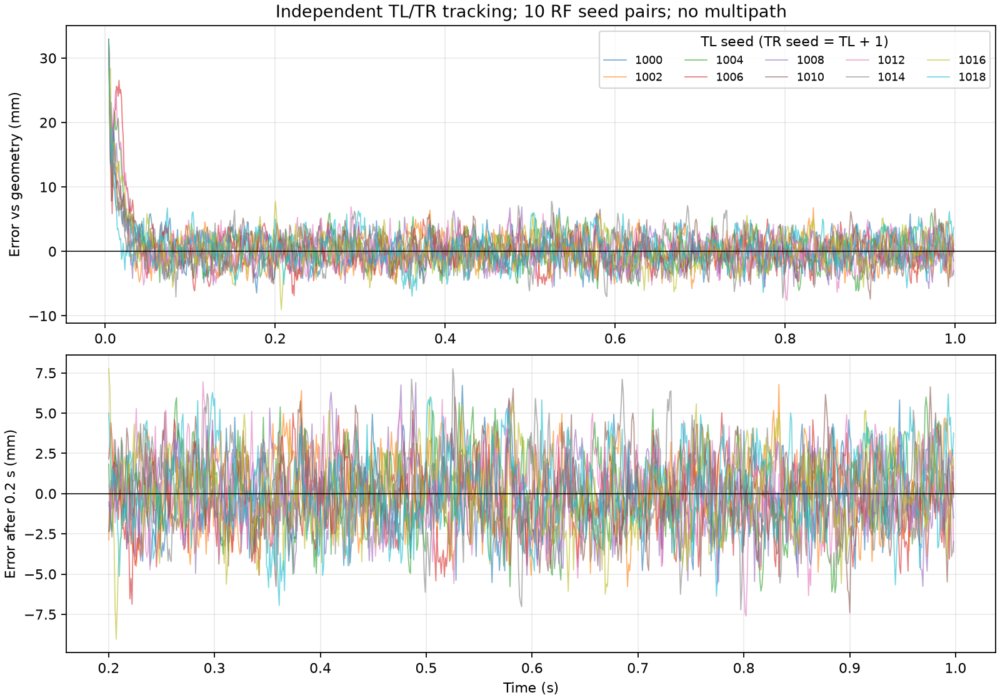

# 双独立跟踪链路：1 秒 × 10 组无多径基线

## 本轮结论

10 组均完成独立捕获及跟踪计算。每组 995 个共同时间点，200 ms 后每组 799 点。在固定 LOS、信号功率、理想同源时钟及现有量化/环路参数下，200 ms 后的通道间路径差误差标准差为 **1.981～2.386 mm**，跨记录中位数 **2.176 mm**。这是有限条件下的经验基线，不是通用相位精度或多径判决门限。

上次单次 100 ms 的最后 30 点标准差 3.07 mm，不能代表本轮较长窗口的典型水平；本轮没有更改环路参数，记录长度、窗口和噪声样本不同，不能把差异表述为算法提升。

## 条件与统计定义

- TL/TR 接收同一颗 GPS L1 C/A 卫星，各自 RF/ADC、DFE、捕获和 DLL/FLL/PLL，未合并天线数据。
- 信号功率 −128.5 dBm；LOS 方位角 30°、仰角 60°；多普勒 1500 Hz；默认矩形信号源/本地码和默认环路参数。
- 干扰、多径及人为通道时延全部为零；保留 RF 热噪声和 ADC/DFE 量化。两链共用理想时钟/本振参考，不含独立时钟漂移。
- 10 组不重叠 RF 种子：1000/1001 至 1018/1019。每次输入 1000 ms，跟踪上限同步提高到 1000 历元。
- 比较同一物理时刻的载波 NCO 相位，不比较 Prompt 残余相位；两路起点不一致时按对应积分块内 NCO 频率对齐。
- TR−TL 理论几何等效路径差为 −0.032865664 m。误差为相位差减几何真值后取主值并按波长换算，真值仅用于事后评估，不送入环路。
- 全部历元、200 ms 后、500 ms 后及逐 100 ms 窗口在运行前固定。后段窗口不等于已通过正式锁定判据。
- 表中是每组统计量在 10 组间的最小/中位/最大值，不把相关的逐毫秒样本假定为独立样本，也不声称置信区间。

## 200 ms 后结果（毫米）

| TL/TR 种子 | 平均误差 | 标准差 | RMS 误差 | 绝对误差最大值 |
|---|---:|---:|---:|---:|
| 1000/1001 | −0.173 | 1.981 | 1.989 | 6.715 |
| 1002/1003 | 0.104 | 2.160 | 2.162 | 6.783 |
| 1004/1005 | 0.018 | 2.190 | 2.190 | 6.159 |
| 1006/1007 | −0.381 | 1.991 | 2.027 | 6.874 |
| 1008/1009 | −0.072 | 2.162 | 2.163 | 6.902 |
| 1010/1011 | 0.118 | 2.297 | 2.300 | 7.403 |
| 1012/1013 | 0.010 | 2.116 | 2.116 | 7.610 |
| 1014/1015 | 0.215 | 2.308 | 2.318 | 7.756 |
| 1016/1017 | 0.032 | 2.297 | 2.298 | 9.044 |
| 1018/1019 | 0.184 | 2.386 | 2.393 | 6.942 |

| 跨组汇总 | 最小值 | 中位数 | 最大值 |
|---|---:|---:|---:|
| 200 ms 后平均误差（mm） | −0.381 | 0.025 | 0.215 |
| 200 ms 后标准差（mm） | 1.981 | 2.176 | 2.386 |
| 200 ms 后绝对误差最大值（mm） | 6.159 | 6.922 | 9.044 |
| 500 ms 后标准差（mm） | 1.899 | 2.227 | 2.454 |
| 全时段标准差（mm） | 2.867 | 3.018 | 3.738 |

## 启动过程和异常检查

0～100 ms 分窗标准差为 5.609～8.373 mm；100～200 ms 分窗降至 1.969～2.511 mm。此后各 100 ms 窗口的标准差大致保持在 1.5～2.7 mm，没有观察到随时间持续增大的标准差趋势；这只是本次曲线及分窗统计的描述，尚未定义精确收敛时间或长期稳定性。

全时段最大绝对误差约 32.94 mm，主要受启动过程影响。10 组均无捕获失败或非有限跟踪输出；相邻相位差跳变超过 90°的计数为零。种子 1008 和 1012 的 TL 各在启动段出现一次鉴相误差超过 90°；200 ms 后两路该计数均为零。

以上 90° 标记是预先声明的异常诊断，不是完备的周跳或失锁检测。相位按整周取模，不能据此排除所有整周错误；`tracking` 状态只表示计算完成。因此结论不写作“10/10 已可靠锁定且无周跳”。

## 对多径研究的意义和剩余工作

当前无多径条件下已经能出现约 2 mm 的后段标准差和约 9 mm 的单点绝对误差。因此，相位差变化或单点超出标准差本身不足以判定多径；还需要面向目标虚警率的独立门限校准、模型失配测试以及有多径对照。

本轮只完成延长时间和多噪声种子验证；无噪声时 DFE 全零的量化问题沿用上轮失败结论，没有通过更改增益/量化来绕过。后续再核查量化缩放、LOS 导向和通道相位误差。仍未验证其他信号强度、真实天线、独立时钟漂移或长期失锁率。

## 代码、数据与复核

```powershell
python python_sim_simplified/audit_dual_tracking_stability.py
python -m pytest python_sim_simplified/tests -q
```

默认输出为 `python_sim_simplified/results/dual_tracking_stability_1s/`，目录已存在时拒绝运行，避免混用旧记录。再次运行应通过 `--output` 指定新的目录。数据包含逐历元相位和环路状态、逐种子统计、汇总、图，以及生成时全部主目录 Python 源码的 SHA-256。

长期保存副本：[数据目录](data/2026-09-11-dual-tracking-stability/summary.json)，[运行配置和源码校验和](data/2026-09-11-dual-tracking-stability/manifest.json)，[数据文件校验和](data/2026-09-11-dual-tracking-stability/sha256.json)。单组文件名为 `seed_1000.json` 至 `seed_1018.json`（步长 2）。

复核已检查 20 个 RF 种子互不重叠、每组 >990 个共同历元、数据生成前后的源码散列一致，并从逐点相位独立重算全部 30 个主统计窗口（全时段/200 ms 后/500 ms 后）的均值、标准差、RMS 和最大误差。精简版 **91 项测试通过**。


