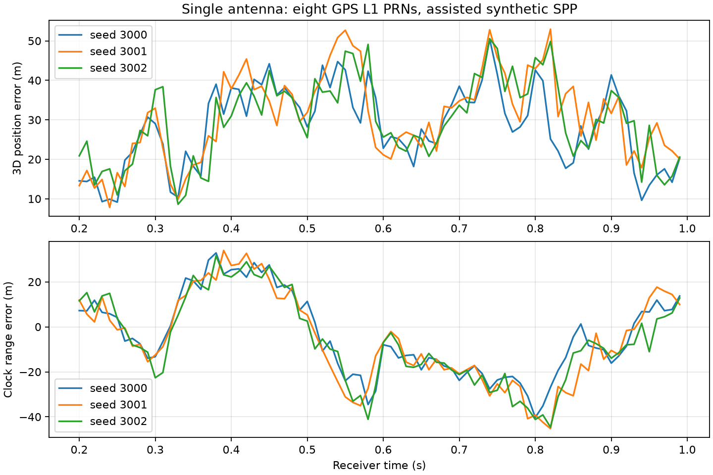

# 单天线 GPS L1 仿真定位框架验证

日期：2026-09-11。

已打通单天线的多星信号 → RF/ADC → DFE → 逐 PRN 捕获/跟踪 → 伪距 → ECEF 位置和接收机钟差解算。第一版使用外部时间辅助和合成卫星状态，尚未实现导航电文/广播星历解码。没有加入多天线、外部干扰、多径或 SDCP 降权。

## 当前实现

- `python_sim_simplified/run_gps_spp.py`：8 个 GPS L1 C/A PRN（1～8）信号在 RF 前相加，一次 RF 和一次 DFE 处理，每个 PRN 分别运行现有 acquire/track。每次运行只有一个天线通道。
- `python_sim_simplified/positioning.py`：公共接收时刻的码 NCO 观测转换，以及位置/钟差四未知数的迭代最小二乘解算。复用 NumPy，不增加依赖。
- `tracking.py`：记录块起点、反馈更新前的码相位与码率。空跟踪历元、全零/非有限输入及无效相关输出明确失败；不把 `success` 解释成锁定认证。双通道旧审计入口同步处理跟踪失败。
- 默认多天线研究主流程不改为定位流程；定位入口直接复用底层函数。

## 时间、几何与辅助信息

受控参考天线位于 WGS84 北纬31°、东经121°、椭球高30 m，接收机钟差以距离表示为75000 m。此真值只用于生成及事后评估，不用于定位初值或修正 DLL 误差。解算从地心和零钟差初值开始。

8颗卫星的初始地心半径为26560 km，使用分散的方位/仰角。卫星坐标定义在**接收时刻 ECEF 坐标系**，因此本场景不再次施加地球自转修正。轨迹是相对参考接收机的短时直线径向运动，Doppler 为 -1500、-1000、-500、0、500、1000、1500、2000 Hz；码率、传播距离变化和载波多普勒一致。这是合成状态接口验证，不是实际GPS星历或真实轨道传播。未来接入发射时刻广播星历坐标时必须增加相应坐标旋转和钟差改正。

每颗卫星的粗略伪距辅助为 t=0 伪距四舍五入到10 km，只用于选择 1 ms 码周期分支。它必须与实际伪距相差小于半个码周期（约150 km）。第一版辅助值由仿真生成、并非接收机自行获得；错误码周期辅助可能导致错误定位，当前未实现自主模糊周期恢复。

对公共时间 t，在覆盖该时刻的 NCO 块内，用块起点码相位和码率计算本地码相位。以 nominal code clock × t 减去本地码相位，模1023后换算成距离，再由粗略辅助选择完整周期。**没有将真实几何距离加到“真实码误差”上冒充伪距。** 测试确认粗辅助±10 km不改变细观测，而本地码相位增加0.1 chip使伪距减少约29.3 m。

RF与DFE保留默认热噪声、增益、量化及滤波：16.368 MHz RF、4.092 MHz DFE、矩形源和本地码、原始DLL/FLL/PLL增益。没有通过修改环路或关闭量化来改善本次结果。卫星钟差、大气延迟及外加硬件延迟在本受控场景中均为零，接收机钟差由解算器估计。

## 试验与结果

先运行300 ms连通检查：种子3000，8颗卫星均捕获，200～290 ms的10次定位全部成功。随后在同一合成星座上，使用独立RF热噪声种子3000、3001、3002分别运行1秒。

正式统计窗口固定为200～990 ms，每10 ms定位一次，共每组80个历元、总计240个历元。每颗卫星的基本筛选为：有效跟踪覆盖当前时刻、有限伪距、相位锁定指标≥0.8且当前PLL鉴相误差绝对值<π/2。这只是基础质量筛选，不是完整失锁/周跳认证。少于4颗有效卫星、几何秩不足或不收敛时记录失败原因。

| RF种子 | 定位成功/总历元 | 每历元使用卫星 | 水平RMS（m） | 三维RMS（m） | 三维95%分位（m） | 三维最大值（m） |
|---|---:|---:|---:|---:|---:|---:|
|3000|80/80|8|19.537|30.011|42.718|50.486|
|3001|80/80|8|20.167|32.549|48.883|52.960|
|3002|80/80|8|18.891|31.613|47.422|50.558|

平均东/北/天误差（m）分别为：3000 `[4.749, 2.888, -7.139]`；3001 `[4.410, 3.934, -9.271]`；3002 `[3.937, 3.824, -10.555]`。接收机钟差估计的平均距离误差分别为 -3.882、-5.678、-6.336 m。



这些结果证明框架闭环可运行，**不代表定位精度已达标**。三组曲线形状接近，说明只改变热噪声种子没有覆盖全部误差来源；目前未通过分离实验确定矩形码采样、环路误差、PRN互相关各占多少。下一步应先分析逐星伪距误差，再决定是否调整码观测或环路，不宜把30 m直接归因于热噪声。

240个历元来自3条短记录，时间相关且共用星座；本次100%成功率不能推广为一般定位可用率。未验证真实星历、导航电文、长时间钟漂、大气建模、动态接收机、多径改善或真实设备精度。

## 验证与复现

基础测试覆盖：已知位置/钟差恢复；不足4星、退化几何和NaN拒绝；码周期跨越、公共时刻、细码误差响应；无效跟踪返回失败；多星源在RF前相加；距离变化与Doppler一致。

全目录测试102项通过（73.00 s）；随后补充同一测试内的细码误差响应和Doppler检查、兼容双通道失败状态后，定位与双跟踪定向测试10项通过（2.81 s）。

```powershell
python python_sim_simplified/run_gps_spp.py
python -m pytest python_sim_simplified/tests -q
```

默认输出目录为 `python_sim_simplified/results/gps_spp`，已存在时拒绝覆盖。重新运行请指定新目录：

```powershell
python python_sim_simplified/run_gps_spp.py --output python_sim_simplified/results/gps_spp_repeat
```

归档位于 `docs/reports/data/2026-09-11-gps-spp/`：manifest记录卫星状态、时间辅助、参数和运行时源码哈希；3个seed文件记录码/载波NCO历史、公共时刻伪距、位置、钟差、ENU误差、残差、可用状态；summary与图记录统计结果。运行时源码哈希包含目录内全部Python文件，因此也会记录不被定位调用的旧审计脚本版本。

独立归档复核已通过：7个文件哈希、全部240个位置的三维误差统计、观测残差及最小二乘正规方程一致性。可运行 `python docs/reports/data/2026-09-11-gps-spp/verify.py` 重验。

## 参考

- ESA Navipedia，[Code Based Positioning (SPS)](https://gssc.esa.int/navipedia/index.php/Code_Based_Positioning_%28SPS%29)：伪距位置/钟差最小二乘。
- GNSS-SDR，[Observables](https://gnss-sdr.org/docs/sp-blocks/observables/)：统一接收时刻与伪距生成。

相关方案、状态与证据对应见 [验证导航](../validation/README.md)。
