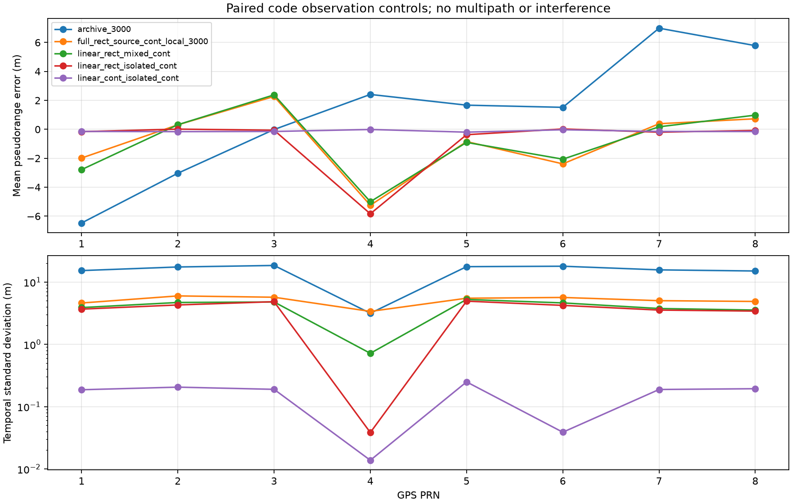

# 单天线逐星伪距偏差诊断

2026-09-11。目标：解释原SPP的约30 m三维RMS及联合浮点解仍有的9～12 m固定偏差。只做诊断和可选对照，未切换默认副本、默认信号源或调整环路/定位权重。

## 结论

1. **矩形本地码副本是原来大幅伪距波动的重要原因。** 同一批RF/DFE样本，仅切换已有连续本地副本，SPP三维RMS从30～33 m降为8.5～9.7 m，联合浮点解从9～12 m降为1.6～2.8 m。
2. **残余还有源端离散化/带宽表示的影响。** 在线性、单PRN、连续本地副本条件下，矩形源仍有3.4～4.9 m波动，零Doppler的PRN4有约-5.8 m固定偏差。换成已有连续带限源后，这些误差显著减小。
3. **多PRN互相关也可产生额外偏差。** 连续源、连续副本、相同线性DFE下，多PRN与隔离PRN对照仍不同。但它不能解释原矩形副本的全部大波动，因为隔离单PRN时大波动依然存在。
4. **200 ms并非所有配置的稳态保证。** 连续源/连续副本的隔离控制仍有随时间衰减的残余，不能把整个200～990 ms窗口的统计当成最终精度底限。

## 对照设计

保持单天线、GPS L1、同一8颗合成卫星、1秒时长、默认DLL/FLL/PLL增益、无多径、无外加干扰。统一评估200～990 ms，共80个公共观测时刻。真值只用于源生成和事后误差统计，接收机不接受真实码误差修正。

伪距误差为观测伪距减去同一时刻的几何距离和75000 m接收机钟差。不能使用去均值后的量替代绝对偏差。

- **原始归档：** RF种子3000、3001、3002。
- **完整RF对照：** 相同信号逐种子重新通过RF/DFE，在同一DFE数组上运行已有连续1.8 MHz本地副本；不启用初始相位细化。种子3000的原矩形副本重算与归档伪距最大差为0 m，确认比较起点一致。
- **线性对照：** 跳过RF/ADC，关闭DFE输出量化，保留原FIR。它联合移除了热噪声、RF限幅和量化，不是纯热噪声单因素，也不是现实接收机的无噪声精度承诺。
- **隔离PRN对照：** 每颗卫星单独经过同样的线性DFE和跟踪；只用于排查互相关，不代表同时接收8星的性能。
- **连续源对照：** 使用已有归一化功率、1.8 MHz理想带限的连续源。该对照同时改变源端采样表示和频谱，不能进一步声称已单独定量分离采样栅格与带宽失配。

合计12类保存记录：3组原始归档、3组完整RF连续本地副本，以及6类线性/隔离/源端对照。线性隔离记录的8列来自8次独立的单PRN试验。

## 完整RF上的直接收益

| RF种子 | 原SPP三维RMS（m） | 连续本地副本SPP（m） | 原联合浮点三维RMS（m） | 连续本地副本联合浮点（m） |
|---|---:|---:|---:|---:|
|3000|30.011|9.726|9.047|2.798|
|3001|32.549|8.487|10.995|1.610|
|3002|31.613|9.650|11.897|1.878|

每组仍有80个可用定位历元。连续本地副本联合解去均值三维RMS为2.992、3.155、3.222 mm，最大后验载波残差分别为4.803、4.347、3.661 mm。

这是配对诊断收益，不是已上线默认行为。联合解仍是整段离线回看浮点解，未固定整周数；此前周跳漏判边界仍成立。结果来自3个噪声种子、同一短时星座，不是一般定位精度保证。

## 逐星结果与机制

种子3000原始误差与只更换本地副本的对照（m）：

| PRN | 原平均误差 | 原标准差 | 连续副本平均误差 | 连续副本标准差 |
|---|---:|---:|---:|---:|
|1|-6.469|15.254|-1.982|4.602|
|2|-3.032|17.422|0.312|5.978|
|3|-0.013|18.423|2.273|5.695|
|4|2.411|3.150|-5.247|3.374|
|5|1.670|17.627|-0.847|5.489|
|6|1.519|17.913|-2.386|5.647|
|7|6.987|15.656|0.387|5.014|
|8|5.781|15.020|0.729|4.873|

不能说每颗卫星的固定偏差都改善：例如PRN4的绝对平均误差反而增大，进一步对照显示它有明显源端表示偏差。

原始非零Doppler七颗卫星在种子3000/3001之间的误差时序相关系数为0.878～0.968；PRN4的Doppler为零，相关系数为-0.088。更换热噪声种子没有消除主要波形，提示明显的可重复成分，但仅凭相关性不能完成误差来源归因。

`_sample_code` 的默认矩形模式使用floor取样。在名义4 samples/chip的局部码网格上，将相位分别偏移0.01与0.24 chip，4092个本地样点完全相同。连续副本可响应这些亚采样相位变化。4.092 MHz和16.368 MHz对应的传播距离采样间隔分别为73.263 m和18.316 m；**它们是采样间隔，不是不可突破的测距精度下限**。

线性对照提供了更直接的证据：

| 源 / PRN组织 / 本地副本 | 非零Doppler七颗卫星标准差范围（m） | PRN4平均误差（m） |
|---|---:|---:|
|矩形 / 混合 / 矩形|14.988～19.145|3.097|
|矩形 / 隔离 / 矩形|15.983～18.413|2.301|
|矩形 / 混合 / 连续|3.546～5.249|-5.000|
|矩形 / 隔离 / 连续|3.412～4.929|-5.835|
|连续 / 混合 / 连续|0.135～2.262|0.773|
|连续 / 隔离 / 连续|0.039～0.249|-0.011|

隔离PRN后，矩形副本仍有十几米波动；因此不能优先把全部问题归因于多PRN互相关。连续源与副本下，混合PRN的均值为 `[-2.779, 0.203, 2.314, 0.773, -0.724, -2.161, 0.230, 0.920] m`，隔离PRN均值为 `[-0.145, -0.160, -0.147, -0.011, -0.194, -0.030, -0.146, -0.151] m`，确认当前特定信号组合下存在额外的PRN交互影响。

在连续源/连续副本隔离控制中，另看800～990 ms诊断窗口，均值绝对值降为0.00062～0.01117 m，标准差为0.00023～0.00416 m。这是补充观察到的衰减现象，主统计窗口没有因此改选；尚未用初始化单因素实验把衰减全部归因于捕获初始误差或DLL积分状态。



## 下一步及限制

优先将连续本地副本作为定位研究的候选配置，经过更多场景验证后再决定是否改默认值。然后应针对连续源/副本，验证初始化和更长时间收敛；对真实同时接收条件下的PRN交互、大气与周跳问题另作验证。

本次没有提高信号功率、没有用真值修正观测，也没有调整定位权重来取得完整RF对照收益。线性控制不含RF噪声/量化，使用共同数学源和副本的控制属于数值一致性证据，不能据此宣称真实硬件达到毫米级绝对定位。

无噪声控制中现有C/N0估计器出现零/浮点负噪声功率的运行警告；本次不使用C/N0作为指标或筛选条件，不修改该独立问题。有效码/相位观测和定位统计均另行验证。

## 文件、检查和复现

- 实验入口：`python_sim_simplified/audit_pseudorange_bias.py`。
- 信号构造仅增加默认关闭的 `code_bandwidth_hz` 可选参数，已有调用保持原行为。
- 保存目录：`docs/reports/data/2026-09-11-pseudorange-bias/`，包含逐星码/相位观测、误差、完整RF定位结果、输入/源码哈希和对照图。
- 基础检查6项通过；全目录109项测试通过（82.36 s）。
- 独立归档复核通过：16个文件哈希、输入归档哈希、12类记录共7680个逐星观测误差及完整RF定位统计。复核命令：`python docs/reports/data/2026-09-11-pseudorange-bias/verify.py`。

```powershell
python python_sim_simplified/audit_pseudorange_bias.py
python -m pytest python_sim_simplified/tests -q
```

默认输出 `python_sim_simplified/results/pseudorange_bias`，存在时拒绝覆盖；重跑用 `--output` 指定新目录。该脚本会重新运行完整RF和线性对照，不修改原SPP与联合浮点归档。
