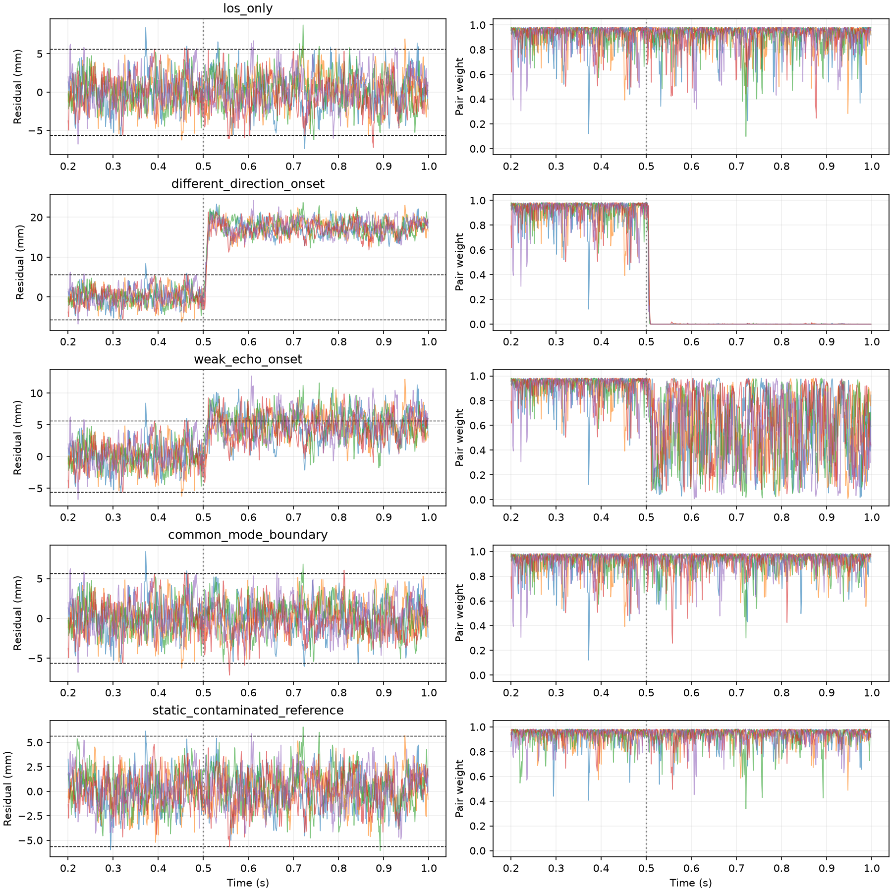

# Trimble 单频双天线 SDCP：实现与验证

## 原文定位

已阅读 [US20240219581A1](https://patents.google.com/patent/US20240219581A1/en)，并下载 [A1 PDF](../references/US20240219581A1.pdf) 与 [USPTO B2 PDF](../references/US12656504B2.pdf)。A1 实体 PDF 第 18～20 页（说明书页 5～7）段落 [0047]～[0060]、流程 400、式 (1)/(2) 是本次单频依据。B2 PDF 第 25～26 页的独立权利要求描述多星、多频组合，本次不把单频试验称为全部授权方法的复现。

原文单频机制：同星同频两天线载波观测作单差，短基线及公共时钟下保留几何项、整周常数、多径差和噪声。扣除几何并处理常数后，残差用于降低这对观测的权重，不能确定哪根天线出错；后续定位还需要多星。原文允许 sigmoid 或硬门限，但未给本项目可直接套用的数值门限。

## 本次工程选择与计划（不是专利给定参数）

1. 保留 TL/TR 的 75.9 mm 基线、GPS L1、双独立 RF/DFE/捕获/跟踪及理想公共时钟；不人为改成图示 10 cm，不加入干扰。
2. 几何补偿用外部假定 LOS 方向和已知阵元位置，按现有代码相位符号计算 `g=−(r_TR−r_TL)·u`。不是从生成器 truth 读取几何用于检测。真实位置/方向在主试验中等于假定值，属于明确的理想前提。
3. NCO 相位单位为弧度，乘波长/2π变为米再减 g。采用 200～400 ms 的固定参考段中位数去除常数，并冻结到后续时段；不能用整个含多径记录去中心化再宣称检出静态偏差。
4. 用此前 10 条独立 H0 记录（RF 种子 1000～1019）600～1000 ms 的绝对残差 99% 经验分位数定门限，冻结后评估。sigmoid 宽度为门限/4；硬权重为残差绝对值不超过门限时 1、否则 0。两根天线使用相同权重。99% 是逐历元经验标定，不是记录级 CFAR 保证，时间样本相关。
5. 新 RF 种子 2000/2001 至 2008/2009，五组配对。每组评估无反射、500 ms 后出现的 −6 dB 异方向反射、−18 dB 弱反射、同方向零时延共同偏差边界、从记录开始即存在的静态反射。反射开通过程为 10 ms 余弦幅度渐入，作用在 RF 输入前；其余共用既有完整延迟反射生成。
6. 固定参考段、事件时刻和 600 ms 后评价窗口在看结果前确定；这是一轮 25 记录的机制试验，不是大样本检测率认证。测试单位换算、几何符号、常数不变性、静态盲区、对称降权和共模消除；运行完整回归。

已知限制：参考段干净是额外工程假设。若静态反射已污染参考段，其固定分量可能被吸收到常数；共同多径误差可能单差相消。独立时钟/通道相位漂移、姿态误差也可能制造残差。本阶段不解算整周整数、不估计 IMU 姿态、不实现多星 RTK/PVT，不宣称观测降权已经改善定位。原有无噪声量化失败仍保留。

## 代码计算关系

以本仓库 TR−TL 符号记相位单差为 Δφ（弧度），波长为 λ。外部给定的基线向量 b 和 LOS 单位向量 u 给出 `g=−b·u`（米，与本仓库阵列指数符号一致）。处理为：

```text
sdcp(t) = λ/(2π) × Δφ(t)
q(t) = sdcp(t) − g(t)
b_ref = median(q(t), 0.2 ≤ t < 0.4 s)
r(t) = q(t) − b_ref
w_soft(t) = 1 / (1 + exp((|r(t)| − threshold)/(threshold/4)))
w_hard(t) = 1 if |r(t)| ≤ threshold else 0
```

两天线的输出权重相同。`b_ref` 是实值参考常数，不是整数模糊度解算。参考段只用于初始化，后续没有继续去均值或按多径真值修正权重。动态 g(t) 的消除用合成观测单元测试验证；端到端案例的真实几何固定，不代表已验证运动 IMU/卫星几何。

旧 `compare_phases` 会选择连续的相位分支，整周信息没有被本模块重新恢复。本次只验证段内变化和观测权重。相位 NCO 的符号约定与专利距离观测记号需统一后再接 PVT；此处已用无多径几何测试核对单位和符号。

## 25 条端到端结果

冻结门限为 **5.634760 mm**，标定使用 3990 个历元，来自 10 条独立 H0 记录。评估为 5 个场景各 5 条新记录，每条 1 秒；全部完成双路捕获/跟踪计算，600 ms 后每条 399 个共同历元。各场景共享同一组 RF 种子以作配对，不把不同场景视为相互独立实验。

| 场景 | 各记录残差均值范围（mm） | 硬权重为零的历元比例（合计） | 平均软权重 |
|---|---:|---:|---:|
| 无反射 | −0.415～0.562 | 1.454%（29/1995） | 0.9115 |
| 500 ms 后 −6 dB 异方向反射 | 17.087～17.817 | 100%（1995/1995） | 0.0005 |
| 500 ms 后 −18 dB 异方向反射 | 4.561～5.411 | 38.145%（761/1995） | 0.5768 |
| 同方向、零时延共同偏差边界 | −0.350～0.507 | 0.351%（7/1995） | 0.9282 |
| 参考段起已存在的静态反射 | −0.014～0.487 | 0.251%（5/1995） | 0.9353 |

这些比例都是逐历元硬降权比例，不是记录级检测率。H0 中29个历元被误降权，不能声称1%虚警目标已获验证；样本间有环路相关性，不套用独立二项区间。每场景只有5个噪声实现，不能外推为通用性能。

### 得到的结论

1. 单频 SDCP 前端已接入现有两套 RF/DFE/捕获/跟踪，不是直接由反射真值生成检测分数。主试验说明：有干净参考、准确几何及共同理想时钟时，反射引起的天线间差异能触发降权。强反射导致约17 mm的差异，与此前约2 mm的正常波动可明显区分；弱反射与噪声发生重叠。
2. 单差不能检测共同偏差。共同偏差边界中，相对配对 H0，两天线各自相位偏差约 **13.96～14.19 mm**，但两者相减接近零，权重仍高。同方向零时延是刻意设置的不可辨识边界，不是普遍真实反射几何的性能代表。
3. 本实现的参考常数估计会吸收参考段已有的静态污染。静态反射与强反射使用相同功率/时延/方向，却因参考段受污染而未持续降权。这是“参考段去常数”实现的限制，不能扩大解释为专利所有实现都无法处理静态多径；外部模糊度/偏置约束属于未实现能力。
4. 观测降权不等于修复载波相位，也不等于定位精度提高。未执行多星 RTK/PVT，尚不能评价定位误差、可用卫星数量减少的代价或定位连续性。本次也没有复制专利多星、多频或长时实测曲线。

## 复现、原始记录与下一步

```powershell
python python_sim_simplified/audit_trimble_sdcp.py
python -m pytest python_sim_simplified/tests -q
```

默认输出目录 `python_sim_simplified/results/trimble_sdcp/` 已存在时拒绝运行；重复研究可用 `--output` 指定新目录。门限在打开评估记录前写入再读回，末尾检查字节未改变。生成阶段的反射开关在 RF 输入之前施加，不用输出端相位注入替代真实接收链。

- [逐场景汇总](data/2026-09-11-trimble-sdcp/summary.json)
- [冻结门限、种子、校准文件与代码校验和](data/2026-09-11-trimble-sdcp/threshold.json)
- [全部28个结果文件校验和](data/2026-09-11-trimble-sdcp/sha256.json)
- 同目录保留25个逐记录 JSON，包含场景参数、原始 NCO 相位/频率/时间戳、残差、两天线相同的权重和事后对照。
- 专利来源和文件散列：[引用记录](../references/trimble_sources.json)。申请文本第19页公式与段落已逐页核对。

数据复核已独立重算25条记录的参考常数、残差、sigmoid权重和硬降权比例，检查校准/评估RF种子分离及生成源码散列一致。不得重用本轮评估结果去调门限后再把它称为独立测试。

最终精简版全量回归 **98 项通过**。新增测试覆盖几何符号/单位、动态几何补偿、整周常数不变性、参考污染盲区、两天线对称权重、共模抵消，以及反射开通确实发生在 RF 输入之前。28 个归档结果文件的 SHA-256 均已核对。

下一步应先研究没有可信干净参考段时的常数/模糊度处理，以及几何和通道差分偏差的稳定性。增加多星定位前，不报告定位改善。单频研究继续与外加干扰分开。


