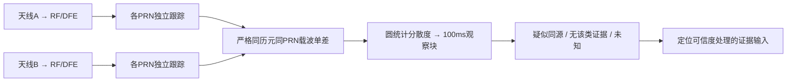
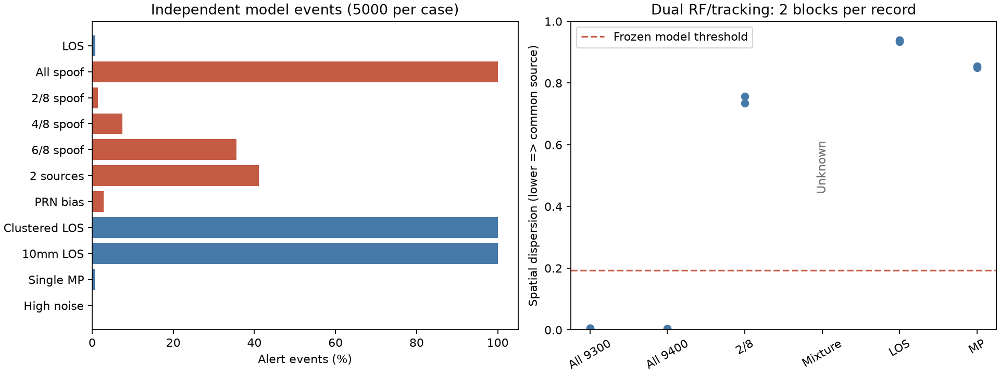

# 双天线空间一致性抗欺骗：首轮实现与验证

2026-09-12。结论：已完成双独立 RF/DFE/跟踪观测上的共同来源检测原型；对本批全部替代场景有效，但部分欺骗漏检、真假混合失去覆盖。适合作为一层防御证据，尚不能独立保障导航可信，也未实现空间零陷或可信位置恢复。

## 1. 为什么选择这个方案

公开双天线研究已有实船依据，且当前工程能输出同星双通道载波。本轮选择这一技术路线的简化圆统计实现，不声称完整复现原论文、NovAtel 专利或商业接收机。详细来源、公司专利比较和商用限制见[调研报告](2026-09-12-antenna-spoofing-survey.md)。

与此前多径 SDCP 的区别：不减正常方向的几何项，也不减各星启动均值；比较的是不同 PRN 的天线间相位差是否同时集中。单星多径通常改变个别相位差，同源全星替代则改变整组空间结构。

## 2. 检测原理与实际输入

同频载波波长为 λ，天线A/B对第j颗PRN的米制相位为 L_Aj、L_Bj：

\[
d_j=(L_{Bj}-L_{Aj})/\lambda,\quad
z_j=\exp(i4\pi d_j),\quad S=1-\left|\frac1{8}\sum_{j=1}^{8}z_j\right|.
\]

S接近0表示各PRN空间相位响应集中；较大表示分散。4π使整数和半周差在指数中消失，对应适应潜在半周分支的简化；代价是相差λ/2的路径投影也相同。共同硬件相位偏置只旋转全部z，不改变S；逐星偏置不具备这种不变性。



固定8颗集合，每10ms取一次相位，10个观测取S平均。任何星缺测、非有限值或块内时间不连续都使该块未知。当前不处理任意星数、自适应子集或滑动窗；避免把另一个统计分布硬套同一门限。首次标签时间为记录0.29秒，第二次0.39秒；这是观测块最后历元标记，不包括实际计算、缓存和接口延迟，也不是动态接管检测延迟测量。

输出1为疑似共同来源，0为未发现该类证据，−1为未知。没有“信号已认证”状态。RF脚本保留未防护定位，提供上述标签及拒绝认证的策略说明；尚未接管默认PVT输出或实现部署状态机，不能宣称已经在实时系统阻止错误位置发布。

## 3. 门限与独立模型验证

5000个LOS标定事件，种子9100；每事件独立随机天空方向、75.9mm基线姿态、10历元×8PRN，差分相位噪声标准差3mm。仰角按sin仰角在15～90度范围均匀采样。不是完整轨道约束GPS星座，也不是实机统计；3mm是本轮模型假设。

取标定S下1%分位并冻结：**0.1932816351**。11类留出场景各5000独立事件，种子9200～9210；不据RF结果调门限。

| 场景 | 告警/5000 | 比例 | 含义 |
|---|---:|---:|---|
| 标称LOS | 42 | 0.84% | 模型误报；95% Wilson约0.622%～1.133%，不能保证≤1% |
| 全8星同源替代 | 5000 | 100% | 指定模型检出；95%下界约99.923% |
| 2/8星替代 | 69 | 1.38% | 基本不能发现部分欺骗 |
| 4/8星替代 | 375 | 7.50% | 仍有明显漏检 |
| 6/8星替代 | 1779 | 35.58% | 不能推论多数受骗就一定检出 |
| 两个来源，各4星 | 2053 | 41.06% | 多来源不符合单源假设 |
| 全替代加20mm标准差逐星固定偏差 | 141 | 2.82% | 观测域失配压力，不是共同硬件偏差 |
| 高度集中方向的LOS | 5000 | 100% | 几何反例；不是宣称真实GPS必有该星座 |
| 10mm基线LOS，沿用75.9mm门限 | 5000 | 100% | 标定不可跨基线直接迁移 |
| LOS单星加入±30mm均匀相位扰动 | 35 | 0.70% | 观测模型压力，不能证明所有多径均不误报 |
| 全替代，逐历元差分噪声20mm | 0 | 0% | 噪声将共同结构打散，不能忽略低质量情况 |

条件区间不包含随机天空模型错误、门限估计不确定性或真实设备变化。单星扰动场景低误报不能用来认证其测距无多径。

## 4. RF验证如何实现

复用 `build_scene → process_rf → process_dfe → acquire → track → carrier_range`。GPS L1、RF 33MHz、DFE抽取5、跟踪6.6MHz；每条400ms记录在200～390ms产生20个载波历元。两个天线分别经过独立RF噪声、DFE和各自8颗PRN的环路；不是复制一条跟踪相位后加常数。

共生成8条新RF通道记录：全替代两组噪声对、部分替代一组、等功率真假混合一组。另复用3条已归档控制记录组成正常及单星多径两组。新记录共64次PRN捕获尝试，其中真假混合A的PRN7、B的PRN5未捕获；其余获得记录中的有效跟踪观测。

全替代在源端给八颗PRN同样的B−A路径差−35mm（75.9mm基线可实现的投影），并按东偏100m的错误位置构造自洽码距离与初始载波相位。其他发射参数保留短记录设定。接收机没有读取错误位置；仍用原有仿真卫星状态和粗时间辅助解算。没有导航电文解码、完整物理发射设备、动态拖引过程或真实信号连续接管。

部分替代只换前两颗；混合场景在RF前叠加等功率真/假波形，交给接收机自行捕获。控制多径只在B的PRN1加入历史−6dB、0.25chip静态反射，无欺骗。

## 5. RF结果与定位意义

| 场景 | 有效块/总块 | 告警块 | 未知块 | 未防护A码定位3D RMS/m |
|---|---:|---:|---:|---:|
| 全替代，种子9300/9301 | 2/2 | 2 | 0 | 102.344 |
| 全替代，种子9400/9401 | 2/2 | 2 | 0 | 101.739 |
| 2/8星替代，9500/9501 | 2/2 | 0 | 0 | 14.043 |
| 等功率真假混合，9600/9601 | 0/2 | 0 | 2 | 49.383 |
| 归档正常LOS | 2/2 | 0 | 0 | 4.993 |
| 归档B单星多径 | 2/2 | 0 | 0 | 4.993 |

最后两行使用相同A记录，因此A定位数值相同；并不是说B的多径没有影响。全替代S约0.0045～0.0053，正常S约0.934～0.939；本批区分明显。部分替代S约0.735～0.757，不触发，是实际漏检反例。混合时缺星导致全部块未知；未知可以要求上层停止信任，但不应计入欺骗检出数。

每条仅两个非重叠块，仍共享同一星座、启动和跟踪噪声过程，不是独立事件检测率。源端设定东偏100m，实际位置出现约102m误差，说明确实形成错误定位，不是只给检测器人工塞一个异常值。

本轮没有恢复真实导航。报警或未知时拒用只是保守策略接口，代价是无可采信GPS位置；不能把没有输出的位置计作零误差。部分受骗仍可能带着错误位置通过这层检查，因此该原型不能独立提供安全保证。



## 6. 文件、复现与检查

- [模型数据与参数](data/2026-09-12-spoofing-model/summary.json)：含全部标定/事件NPZ和哈希。
- [RF逐块结果](data/2026-09-12-spoofing-rf/summary.json)、[RF场景清单](data/2026-09-12-spoofing-rf/manifest.json)：同目录保存8条实际跟踪记录及哈希。
- [独立统计与完整性核查](data/2026-09-12-spoofing-checks/checks.json)：重新计数事件及RF标签，重新计算门限；23项快照哈希一致；从原始NCO独立重建10个有效块分散度，与报告一致。当前149项测试通过，保留1条既有无噪声C/N0除零警告。
- [设计与实施计划](../validation/2026-09-12-antenna-spoofing-plan.md)。

从项目根目录执行，输出目录必须为新的路径，防止覆盖历史证据：

```powershell
python -m pytest -q python_sim_simplified/tests
python python_sim_simplified/audit_spoofing_model.py --output python_sim_simplified/results/spoofing_model_repeat
python python_sim_simplified/audit_spoofing_rf.py --output python_sim_simplified/results/spoofing_rf_repeat --model python_sim_simplified/results/spoofing_model_repeat/summary.json
```

## 7. 当前判断与后续优先级

选中的路线值得保留为共同来源检测基线，但本次简化实现已经明确不够全面。若推进下一轮，优先研究部分PRN共同来源的受控子集假设与正常几何一致性，而不是先追求更多全替代场景的100%。必须控制子集搜索带来的整体误报，再验证真实星座/姿态、跨噪声、方向图、多径和动态接管。

在此之前不接默认定位权重、不宣布商用可用。空间抑制需要在真信号仍存在时证明可靠来源判别、估计方向和抑制后跟踪/PVT收益，不能用真值方向人为零陷替代。
