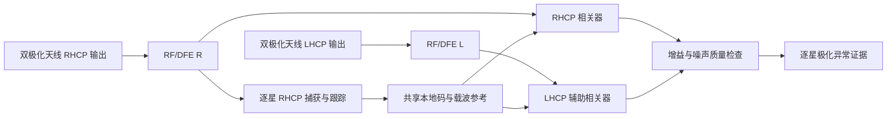

# 双极化 GNSS 多径研究：原理、首轮验证与商用边界

> 阶段状态更新：用户决定后续不沿极化分集推进。本文保留已完成的理想相关器模型证据；第7节后续计划暂停，尚无 RF/跟踪/PVT 闭环验证。

## 1. 本轮结论与工作范围

双极化值得继续研究：它引入了当前同极化双天线没有的极化信息，首轮模型中能明显区分部分反射条件。但它不能单独覆盖同极化反射，也不能直接把极化比解释为载波误差或 NLOS 确证。

本轮完成：复用现有 antenna.jones_vector，建立两个极化端口的有噪声相关器观测模型；独立 LOS 标定、七类保留场景评估、事件区间统计和原始数据存档。**未完成：RF/DFE、PLL/DLL 闭环接入、真实双极化天线测量、多星定位或商用性能验证。** 不把理想相关器结果称为实机/完整接收机结果。

## 2. 方案原理

卫星发射信号通常以右旋圆极化 RHCP 为主。反射会改变极化，结果取决于材质、入射角及反射次数，可能是 LHCP、椭圆极化，也可能保留较强 RHCP。因此不能预设“反射必然变成左旋”。

接收端提供 RHCP、LHCP 两个输出，分别测量同一颗卫星的相关量 z_R、z_L。理想同极化 LOS 在 RHCP 较强，LHCP 主要是泄漏；出现 LHCP 成分较强的反射后，两端口的比例可能明显变化。

本轮指标为

`RLR = 10 log10(P_R/P_L) = 20 log10(|z_R|/|z_L|)`。

只在两端积分时间、增益和噪声处理口径可比较时，这个比例才有意义。本轮直接使用有噪声相关器幅度，不扣噪声功率。弱 LHCP 时会受噪声底影响，后续需测量这一偏差。

判决为 RLR 低于独立 LOS 分布的下分位门限时，输出“极化异常”。它既可能由反射造成，也可能由方向图变化、通道增益错误等造成，所以不能直接输出“确定 NLOS”，更不是抗欺骗结论。

### 与 GF 的区别

GF 比较天线间与频率间载波差，面临整数分支和相位偏置解释；这里比较两个极化端口的强度响应。极化比本身不需要解算两端整数周，但依赖相同相关参考、端口增益标定和天线极化响应。它降低了对毫米级跨天线相位解释的依赖，并没有消除标定需要。

## 3. 计划采用的接收结构

LHCP 通道不要求独立锁定。RHCP 的码和载波参考驱动两个端口的相关器，否则弱 LHCP 失锁可能造成观测缺失或比较不同信号路径。两个输出可以来自一副双极化天线，不是简单将现有 A/B 普通天线改名。

工程参考：[Egea-Roca 等，Sensors 2018, 18, 4483，FANTASTIC](https://spcomnav.uab.es/docs/journals/Egea_sensors-18-04483.pdf)，其 2.2 节描述修改接收软件，以 RHCP 跟踪结果驱动 LHCP 相关并积分。该论文的实验结构是参考，不表示我们已复现其硬件和性能。

RHCP 不可跟踪的纯 NLOS 可能根本不能提供主参考。后续必须计入“无有效极化观测”的覆盖损失，不能只统计成功输出的事件。

## 4. 首轮数学模型

复用归一化 Jones 向量 e_R、e_L，端口响应设为

`h_R=(e_R+epsilon e_L)/sqrt(1+epsilon^2)`，
`h_L=(e_L+epsilon e_R)/sqrt(1+epsilon^2)`，
`epsilon=10^(-XPD/20)`。

观测 `z=[h_R^H E,h_L^H E]+n`。标称 XPD=20 dB。两个端口噪声独立复高斯，归一化总复噪声方差为 `1/(10^(45/10)*0.1)`，对应理想 100 ms 相干相关与 45 dB-Hz 参考信号。

LOS 为单位 RHCP；混合多径为 LOS 加电压比 0.5 的反射，延迟 0.25 C/A 码片，用理想三角相关函数 R(0.25)=0.75，所以相关后反射系数为 0.375。每个事件的反射相位独立均匀分布，窗口内保持固定。没有模拟动态相关时间、真实材质 Fresnel 系数、方向图、ADC 或环路偏移。

NLOS 两项仅使用单个纯 LHCP/RHCP 单位输入来比较极化，理想参考对齐该输入。没有模拟额外路径导致的伪距偏差，也没有证明 RHCP 主环能捕获弱交叉极化端口。其相关器相位不代表相对缺失 LOS 的多径误差。

## 5. 验证步骤及数据隔离

1. 固定标称模型参数；1000 个独立 LOS 噪声事件，种子 8100。
2. 取 RLR 下 1% 分位（lower 方法），得到冻结门限 **17.794553 dB**。这是本模型的极化异常门限，不是 NLOS 的通用门限。
3. 七类评估各生成 2000 个独立事件，种子 8200–8206。每类噪声独立，混合反射相位也独立；评估结果不反向修改门限。
4. 统计异常事件数、比例及 Wilson 95% 区间，并保存全部事件。区间仅条件于本模型及本次冻结门限，不包含模型误差或标定门限估计不确定性。
5. 最后两类是故意不更新标定的失配压力；用于检验固定标称门限的失效，不表示实际所有设备必然如此。

## 6. 结果与解释

| 场景 | 异常数/2000 | 异常比例 | RLR 中位数/dB |
|---|---:|---:|---:|
| 标称 LOS | 18 | 0.90% | 19.957 |
| LOS + LHCP 反射 | 2000 | 100% | 8.253 |
| LOS + RHCP 反射 | 44 | 2.20% | 19.935 |
| 纯 LHCP NLOS 模型 | 2000 | 100% | -19.911 |
| 纯 RHCP NLOS 模型 | 23 | 1.15% | 20.009 |
| LOS，实际 XPD 降至 10 dB | 2000 | 100% | 10.002 |
| LOS，未上报 LHCP 增益 +3 dB | 1556 | 77.80% | 16.959 |

标称 LOS 虚警 0.90%，Wilson 区间约 0.57%–1.42%，不能严格宣称虚警不超过 1%。两项 2000/2000 的下界约 99.81%，也只对应指定理想场景。

**收益来自不同极化的信息。** LHCP 反射增强辅助端口，极化比显著降低。它不是普适的多径探测能力：RHCP 反射与直达叠加时两个端口大致同比例变化，极化比接近不变。

RHCP 混合反射中，无噪声主端口相位绝对值最大约 0.3844 rad，但异常比例仅 2.20%；这直接表明极化比不能等同于相位误差计。该相位是模型相关器相位，不是 PLL 跟踪实测。

**极化纯度和增益失配可以模拟多径异常。** XPD 降低或 LHCP 增益上升都会减小 RLR。若直接使用标称固定门限，会产生严重误报。后续必须明确方向/频率/安装条件下的基线响应，而不是默认一条 20 dB 水平线适用所有卫星。

## 7. 商用可能性与下一步

保留方向：以逐星极化异常证据辅助定位质量控制，先面向 LHCP 成分明显的反射/NLOS。暂不承诺全部多径识别、受污染伪距修正或毫米级载波误差估计。

商用前需验证：可获得的双极化天线与端口方向图、频率/仰角相关 XPD、安装/手握影响、两链增益与噪声标定、共享参考接口、主环失锁时的行为，以及额外端口功耗和供应/许可条件。本轮没有真实成本或硬件数据。

下一步按顺序：

1. 在当前 RF/DFE 与跟踪代码接入 LHCP 共参考相关，核验采样时刻、NCO、数据位与积分方式，不用真值本地码辅助。
2. 用 LOS、启动 LHCP 反射、RHCP 反射、主端口弱信号/失锁、增益失配做配对记录；同时报告异常比例与有效观测覆盖。
3. 扩展混合/椭圆极化与方向响应后，再冻结新的独立标定，不能沿用本轮理想模型门限。
4. 最后评估多星定位与可用性；不要直接恢复 GF 阶段已经失败的同星统一码降权假设。

## 8. 文件与复现

- 脚本：python_sim_simplified/audit_dual_polarization.py；直接运行，固定输出，拒绝覆盖旧目录。
- [结果和参数](data/2026-09-12-dual-polarization-model/summary.json)
- [全部事件 NPZ、标定数据与哈希](data/2026-09-12-dual-polarization-model/)
- 数据规模：1000 标定事件、14000 评估事件。非连续 1500 秒 RF 仿真，事件没有模拟接收机启动耗时。
