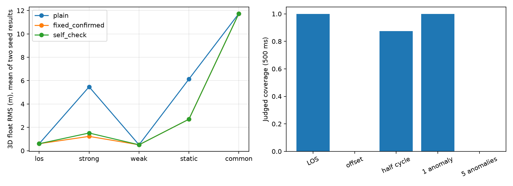
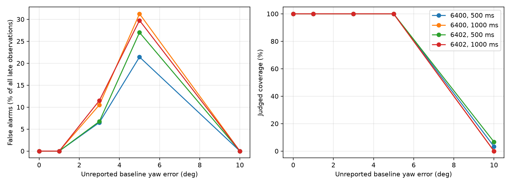

# SDCP 自检、压力测试与定位对照

## 结论应如何阅读

这是一轮单频双天线研究验证，不是实机可用性认证。研究按自检实现、无多径压力测试、独立 RF 多径验证、探索性定位对照执行。系统没有把多径检测与外部干扰混在一起。

低误报必须与可判断覆盖率一起看：输出“不可可靠判断”不等于排除了多径。多星共同偏移、噪声或状态质量超限时，自检可以停止强制判决，但没有自动确定异常来自硬件还是多径。

最终两组新RF记录、两种窗长的结果范围如下（不是事件检测概率）：

- los：误报历元比例 0.00%～0.00%；可判断覆盖 100.00%～100.00%。
- strong：检出历元比例 100.00%～100.00%；可判断覆盖 100.00%～100.00%。
- weak：检出历元比例 0.00%～0.00%；可判断覆盖 100.00%～100.00%。
- static：检出历元比例 100.00%～100.00%；可判断覆盖 100.00%～100.00%。
- common：检出历元比例 0.00%～0.00%；可判断覆盖 100.00%～100.00%。

## 1. 原理与实际接口

输入是每历元每星的校准取余 SDCP 残差、共同时间轴、通道时间偏差、有效性标志、几何误差上界和固定标定下限。残差沿用已有每历元 TL SPP 几何补偿及零硬件偏差仿真假设；检测函数不接收多径标签、真实位置或受污染卫星编号。

输出 state=0（未发现异常）、1（疑似多径）、-1（不可可靠判断），同时保存 score_m、threshold_m 和 reason。0 不能解释为保证无多径，1 不能决定哪根天线受到污染。

1. 首先检查观测有限性、完整性、时间步长、通道对齐、调用方提供的锁定/半周有效性以及几何不确定性。
2. 对可见的大于40 mm的相邻取余相位变化建立隔离状态，直到外部 phase_reset_valid 证明新相位分支有效。单纯等一个窗口不会恢复。整数周期跳变在取余后不可见，仍依赖跟踪器。
3. 使用完整的后向500 ms或1 s圆周均值，每10 ms更新，不拟合每星参考常数。窗口内部按100 ms分块，以块均值相对整体均值的圆周偏差标准差除以块数平方根构造噪声代理量。
4. 候选阈值 T=T_floor+3×noise_proxy+geometry_bound；超过2×T_floor时停判，不无限抬高阈值。这个噪声量没有独立样本假设或CFAR概率保证。
5. 完整窗口可用卫星少于6颗时停判；至少一半可用卫星同时超过各自阈值时，标记公共异常不可辨识。这里没有自动扣除公共偏移，也没有估计姿态。
6. 单星异常连续10个更新历元才确认。100 ms为按更新数约定的确认长度，首次越限至第10个更新实际间隔90 ms；下表的延迟按真实时间戳计算。

几何不确定性最大允许5 mm，通道时差最大1微秒。它们都是首轮工程设定，不代表已证明1微秒对任意动态条件都足够。调用方隐瞒或低估几何误差时，自检无法保证识别。

## 2. 开发诊断、冻结与独立数据

第一版在6300/6302旧记录上暴露半周跳变窗口到期后误报，第二版修正为持续隔离。因此6300/6302只作开发数据。两版完整结果均保留，不能将第二版在开发数据上的重跑称为独立验证。

最终评估使用新生成6400/6402两组RF噪声种子；每组含LOS双通道、TR强/弱/启动多径，以及双通道共模多径，共14条3秒单通道记录，每条独立跟踪8颗GPS卫星。每组两个天线在相同时间轴上形成观测，程序顺序计算，非复用一条环路。

旧6200/6202/6204三组LOS仅用于阈值下限的99%分位数标定；最终数据不用于调参。新RF沿用既有星座几何、信号功率和采样配置，独立性只涉及噪声种子，不代表已经覆盖环境分布迁移。

|窗口|标定下限|阈值上限|
|---|---:|---:|
|500 ms|4.081835 mm|8.163671 mm|
|1000 ms|3.700139 mm|7.400278 mm|

LOS诊断中，三组标定记录的SPP几何补偿相对仿真真实几何的最大差均为约0.000030 mm，远小于毫米级逐星残差均值。因此本组条件下SPP几何计算误差不足以解释该偏差；这不等于已经确定跟踪偏差的全部根因。噪声和每星均值统计见开发诊断数据。

## 3. 评分口径

最终统计区间为1.5秒及以后；完整记录覆盖率另存JSON，包含窗口预热。误报/检出均按卫星×历元计数，既报告全区间比例，也报告可判断子集比例。没有可判断样本时显示“—”，不是0。

每个受影响PRN单独记录有无确认报警及延迟；静态多径起点为0秒，其他RF多径从0.5秒起、10 ms渐入。重叠窗口、同组卫星、同一LOS上衍生的注入场景不作为独立重复试验。两组种子不能给出可靠事件检测概率。

固定阈值对照包括立即越限和相同10历元持续确认两个版本，均使用同一圆周均值与标定下限。自检没有通过使用不同测试记录获得优势。

## 4. 新 RF 多径验证结果

强/启动多径：TR侧PRN1、-6 dB、超额时延0.25 L1码片、反射相位π/2；弱多径改为-18 dB；共模为两天线PRN1相同相对反射。其他卫星没有注入多径。

|种子|窗口ms|场景|可判断覆盖|全区间误报|可判断内误报|PRN1检出|可判断内检出|固定持续误报|固定持续检出|
|---|---:|---|---:|---:|---:|---:|---:|---:|---:|
|6400|500|los|100.00%|0.00%|0.00%|—|—|0.00%|—|
|6400|500|strong|100.00%|0.00%|0.00%|100.00%|100.00%|0.00%|100.00%|
|6400|500|weak|100.00%|0.00%|0.00%|0.00%|0.00%|0.00%|0.00%|
|6400|500|static|100.00%|0.00%|0.00%|100.00%|100.00%|0.00%|100.00%|
|6400|500|common|100.00%|0.00%|0.00%|0.00%|0.00%|0.00%|0.00%|
|6400|1000|los|100.00%|0.00%|0.00%|—|—|0.00%|—|
|6400|1000|strong|100.00%|0.00%|0.00%|100.00%|100.00%|0.00%|100.00%|
|6400|1000|weak|100.00%|0.00%|0.00%|0.00%|0.00%|0.00%|0.00%|
|6400|1000|static|100.00%|0.00%|0.00%|100.00%|100.00%|0.00%|100.00%|
|6400|1000|common|100.00%|0.00%|0.00%|0.00%|0.00%|0.57%|0.00%|
|6402|500|los|100.00%|0.00%|0.00%|—|—|0.00%|—|
|6402|500|strong|100.00%|0.00%|0.00%|100.00%|100.00%|0.00%|100.00%|
|6402|500|weak|100.00%|0.00%|0.00%|0.00%|0.00%|0.00%|0.00%|
|6402|500|static|100.00%|0.00%|0.00%|100.00%|100.00%|0.00%|100.00%|
|6402|500|common|100.00%|0.00%|0.00%|0.00%|0.00%|0.00%|0.00%|
|6402|1000|los|100.00%|0.00%|0.00%|—|—|0.00%|—|
|6402|1000|strong|100.00%|0.00%|0.00%|100.00%|100.00%|0.00%|100.00%|
|6402|1000|weak|100.00%|0.00%|0.00%|0.00%|0.00%|0.00%|0.00%|
|6402|1000|static|100.00%|0.00%|0.00%|100.00%|100.00%|0.00%|100.00%|
|6402|1000|common|100.00%|0.00%|0.00%|0.00%|0.00%|0.00%|0.00%|

### 逐记录确认延迟

|种子|窗口ms|场景|是否确认|起点至确认秒|
|---|---:|---|---|---:|
|6400|500|strong|True|0.540|
|6400|500|weak|False|—|
|6400|500|static|True|0.780|
|6400|500|common|False|—|
|6400|1000|strong|True|1.000|
|6400|1000|weak|False|—|
|6400|1000|static|True|1.280|
|6400|1000|common|False|—|
|6402|500|strong|True|0.540|
|6402|500|weak|False|—|
|6402|500|static|True|0.780|
|6402|500|common|False|—|
|6402|1000|strong|True|1.000|
|6402|1000|weak|False|—|
|6402|1000|static|True|1.280|
|6402|1000|common|False|—|

## 5. 观测域压力测试

下列压力施加在新LOS记录的残差或元数据上，不重新经过RF/DFE/DLL/PLL：公共10 mm偏置、0.5秒后10 mm/s漂移、附加12 mm标准差独立相位噪声、-15至15 mm逐星方向相关误差代理、已知15 mm几何不确定性、0.8至1.2秒失锁标志/缺测、半周跳变、100微秒通道时间偏差、1/3/5/8颗星25 mm恒定异常、漂移与单星异常组合、未报告的整周跳变。

其中noise_x3只是场景标识，实际注入为12 mm白噪声，不保证总噪声恰为三倍，也不等于真实C/N0变化。geometry_unreported是逐星误差代理而非新的天线姿态RF仿真。半周/整周场景检验的是观测接口盲点，不能代表真实失锁重捕流程。

表中未注入多径的半周/几何/漂移场景报警算误报；人工25 mm异常视为待检测差分异常，不能据此声称真实多径检出率。

|种子|窗口ms|压力场景|可判断覆盖|全区间误报|可判断内误报|全区间检出|可判断内检出|
|---|---:|---|---:|---:|---:|---:|---:|
|6400|500|los|100.00%|0.00%|0.00%|—|—|
|6400|500|offset_10mm|0.00%|0.00%|—|—|—|
|6400|500|drift_10mm_s|0.00%|0.00%|—|—|—|
|6400|500|noise_x3|0.00%|0.00%|—|—|—|
|6400|500|geometry_unreported|0.00%|0.00%|—|—|—|
|6400|500|geometry_reported|0.00%|0.00%|—|—|—|
|6400|500|loss_flag|98.42%|0.00%|0.00%|—|—|
|6400|500|missing|98.33%|0.00%|0.00%|—|—|
|6400|500|half_cycle|87.50%|0.00%|0.00%|—|—|
|6400|500|skew|0.00%|0.00%|—|—|—|
|6400|500|one_static_25mm|100.00%|0.00%|0.00%|100.00%|100.00%|
|6400|500|three_static_25mm|100.00%|0.00%|0.00%|100.00%|100.00%|
|6400|500|five_static_25mm|0.00%|0.00%|—|0.00%|—|
|6400|500|all_static_25mm|0.00%|—|—|0.00%|—|
|6400|500|combined|0.00%|0.00%|—|0.00%|—|
|6400|500|integer_jump_unreported|100.00%|0.00%|0.00%|—|—|
|6400|1000|los|100.00%|0.00%|0.00%|—|—|
|6400|1000|offset_10mm|0.00%|0.00%|—|—|—|
|6400|1000|drift_10mm_s|12.33%|0.17%|1.35%|—|—|
|6400|1000|noise_x3|0.00%|0.00%|—|—|—|
|6400|1000|geometry_unreported|0.00%|0.00%|—|—|—|
|6400|1000|geometry_reported|0.00%|0.00%|—|—|—|
|6400|1000|loss_flag|94.25%|0.00%|0.00%|—|—|
|6400|1000|missing|94.17%|0.00%|0.00%|—|—|
|6400|1000|half_cycle|87.50%|0.00%|0.00%|—|—|
|6400|1000|skew|0.00%|0.00%|—|—|—|
|6400|1000|one_static_25mm|100.00%|0.00%|0.00%|100.00%|100.00%|
|6400|1000|three_static_25mm|100.00%|0.00%|0.00%|100.00%|100.00%|
|6400|1000|five_static_25mm|0.00%|0.00%|—|0.00%|—|
|6400|1000|all_static_25mm|0.00%|—|—|0.00%|—|
|6400|1000|combined|7.67%|0.00%|0.00%|4.00%|46.15%|
|6400|1000|integer_jump_unreported|100.00%|0.00%|0.00%|—|—|
|6402|500|los|100.00%|0.00%|0.00%|—|—|
|6402|500|offset_10mm|0.00%|0.00%|—|—|—|
|6402|500|drift_10mm_s|0.00%|0.00%|—|—|—|
|6402|500|noise_x3|0.00%|0.00%|—|—|—|
|6402|500|geometry_unreported|0.00%|0.00%|—|—|—|
|6402|500|geometry_reported|0.00%|0.00%|—|—|—|
|6402|500|loss_flag|98.42%|0.00%|0.00%|—|—|
|6402|500|missing|98.33%|0.00%|0.00%|—|—|
|6402|500|half_cycle|87.50%|0.00%|0.00%|—|—|
|6402|500|skew|0.00%|0.00%|—|—|—|
|6402|500|one_static_25mm|100.00%|0.00%|0.00%|100.00%|100.00%|
|6402|500|three_static_25mm|100.00%|0.00%|0.00%|100.00%|100.00%|
|6402|500|five_static_25mm|0.00%|0.00%|—|0.00%|—|
|6402|500|all_static_25mm|0.00%|—|—|0.00%|—|
|6402|500|combined|0.00%|0.00%|—|0.00%|—|
|6402|500|integer_jump_unreported|100.00%|0.00%|0.00%|—|—|
|6402|1000|los|100.00%|0.00%|0.00%|—|—|
|6402|1000|offset_10mm|0.00%|0.00%|—|—|—|
|6402|1000|drift_10mm_s|13.42%|0.42%|3.11%|—|—|
|6402|1000|noise_x3|0.00%|0.00%|—|—|—|
|6402|1000|geometry_unreported|0.00%|0.00%|—|—|—|
|6402|1000|geometry_reported|0.00%|0.00%|—|—|—|
|6402|1000|loss_flag|94.25%|0.00%|0.00%|—|—|
|6402|1000|missing|94.17%|0.00%|0.00%|—|—|
|6402|1000|half_cycle|87.50%|0.00%|0.00%|—|—|
|6402|1000|skew|0.00%|0.00%|—|—|—|
|6402|1000|one_static_25mm|100.00%|0.00%|0.00%|100.00%|100.00%|
|6402|1000|three_static_25mm|100.00%|0.00%|0.00%|100.00%|100.00%|
|6402|1000|five_static_25mm|0.00%|0.00%|—|0.00%|—|
|6402|1000|all_static_25mm|0.00%|—|—|0.00%|—|
|6402|1000|combined|11.67%|0.10%|0.83%|9.33%|70.00%|
|6402|1000|integer_jump_unreported|100.00%|0.00%|0.00%|—|—|

### 补充：真实基线补偿公式的方向误差回放

使用同一新RF LOS观测，将75.9 mm基线在局部ENU水平面旋转0/1/3/5/10度，以逐历元TL SPP重新计算几何补偿。上报误差界时使用新旧基线向量差的范数。这是物理几何补偿公式的误差回放，不是运动天线仿真。该补充不修改冻结检测参数。

|种子|窗口ms|方向偏差°|上报误差界|基线误差界mm|实际补偿最大差mm|覆盖率|误报比例|
|---|---:|---:|---|---:|---:|---:|---:|
|6400|500|0|False|0.000|0.000|100.00%|0.00%|
|6400|1000|0|False|0.000|0.000|100.00%|0.00%|
|6400|500|0|True|0.000|0.000|100.00%|0.00%|
|6400|1000|0|True|0.000|0.000|100.00%|0.00%|
|6400|500|1|False|1.325|1.224|100.00%|0.00%|
|6400|1000|1|False|1.325|1.224|100.00%|0.00%|
|6400|500|1|True|1.325|1.224|100.00%|0.00%|
|6400|1000|1|True|1.325|1.224|100.00%|0.00%|
|6400|500|3|False|3.974|3.659|100.00%|6.50%|
|6400|1000|3|False|3.974|3.659|100.00%|10.50%|
|6400|500|3|True|3.974|3.659|0.00%|0.00%|
|6400|1000|3|True|3.974|3.659|0.00%|0.00%|
|6400|500|5|False|6.621|6.075|100.00%|21.42%|
|6400|1000|5|False|6.621|6.075|100.00%|31.25%|
|6400|500|5|True|6.621|6.075|0.00%|0.00%|
|6400|1000|5|True|6.621|6.075|0.00%|0.00%|
|6400|500|10|False|13.230|12.009|3.33%|0.00%|
|6400|1000|10|False|13.230|12.009|0.00%|0.00%|
|6400|500|10|True|13.230|12.009|0.00%|0.00%|
|6400|1000|10|True|13.230|12.009|0.00%|0.00%|
|6402|500|0|False|0.000|0.000|100.00%|0.00%|
|6402|1000|0|False|0.000|0.000|100.00%|0.00%|
|6402|500|0|True|0.000|0.000|100.00%|0.00%|
|6402|1000|0|True|0.000|0.000|100.00%|0.00%|
|6402|500|1|False|1.325|1.224|100.00%|0.00%|
|6402|1000|1|False|1.325|1.224|100.00%|0.00%|
|6402|500|1|True|1.325|1.224|100.00%|0.00%|
|6402|1000|1|True|1.325|1.224|100.00%|0.00%|
|6402|500|3|False|3.974|3.659|100.00%|6.75%|
|6402|1000|3|False|3.974|3.659|100.00%|11.50%|
|6402|500|3|True|3.974|3.659|0.00%|0.00%|
|6402|1000|3|True|3.974|3.659|0.00%|0.00%|
|6402|500|5|False|6.621|6.075|100.00%|27.00%|
|6402|1000|5|False|6.621|6.075|100.00%|29.75%|
|6402|500|5|True|6.621|6.075|0.00%|0.00%|
|6402|1000|5|True|6.621|6.075|0.00%|0.00%|
|6402|500|10|False|13.230|12.009|6.67%|0.00%|
|6402|1000|10|False|13.230|12.009|0.00%|0.00%|
|6402|500|10|True|13.230|12.009|0.00%|0.00%|
|6402|1000|10|True|13.230|12.009|0.00%|0.00%|

上报不确定性后停判是主动放弃判断，不是消除了误差；未上报的中等方向偏差可能表现为少数星异常，从而被误报为疑似多径。

### 补充：输入信号降低6 dB的真实RF链路对照

在无多径、无外部干扰的TR源信号进入RF前乘以10^(-6/20)，再实际执行RF、DFE和8颗卫星独立跟踪。保持噪声种子6401，配对同一TL正常记录；共新增一条3秒RF记录。它检验真实输入信号质量下降，比相位域加白噪声更接近接收链路，但只有一个配对条件，不构成跨C/N0范围验证。

|窗口ms|原始有效观测|可判断覆盖|全区间误报|可判断内误报|固定持续误报|
|---|---:|---:|---:|---:|---:|
|500|100.00%|100.00%|0.00%|0.00%|0.00%|
|1000|100.00%|100.00%|0.00%|0.00%|0.00%|

补充数据：[几何压力结果](data/2026-09-12-sdcp-geometry-stress/summary.json)、[低信号RF结果](data/2026-09-12-sdcp-low-signal/summary.json)。

## 6. 接入定位的探索性对照

只使用原始RF记录，观测层压力注入不进入定位，避免相位与伪距不一致。使用已知基线、GPS卫星状态和既有粗伪距时间辅助；不是自主导航电文定位。原始3秒观测每50 ms取一个历元，四种方法采用完全相同历元。码定位逐历元解算；码/载波联合浮点定位为全记录离线解算，每星实数偏差自由估计，没有整周固定，也不是实时定位性能。

权重方式：plain=1；fixed为立即越限后0.1；fixed_confirmed为持续越限后0.1；self_check仅在state=1时0.1。每星同一权重施加于两天线的码与载波，sigma按1/sqrt(weight)放大。不可判断回退权重1并显式保留风险，不做强制剔除。

表内为1.5秒后3D位置误差RMS（米），不是标准差；不能把同一数值同时解释成精度与抖动。

|种子|场景|方法|码位置RMS/m|浮点位置RMS/m|浮点去均值RMS/m|
|---|---|---|---:|---:|---:|
|6400|los|plain|3.925320|0.401894|0.001548|
|6400|los|fixed|3.929709|0.393924|0.001550|
|6400|los|fixed_confirmed|3.925320|0.401894|0.001548|
|6400|los|self_check|3.925320|0.401894|0.001548|
|6400|strong|plain|9.004713|5.475510|0.001523|
|6400|strong|fixed|4.904502|1.060848|0.001969|
|6400|strong|fixed_confirmed|4.904502|1.163086|0.001969|
|6400|strong|self_check|4.904502|1.306700|0.001969|
|6400|weak|plain|4.156954|0.301527|0.001571|
|6400|weak|fixed|4.156954|0.301527|0.001571|
|6400|weak|fixed_confirmed|4.156954|0.301527|0.001571|
|6400|weak|self_check|4.156954|0.301527|0.001571|
|6400|static|plain|8.997838|6.089729|0.001524|
|6400|static|fixed|4.913474|2.566501|0.001968|
|6400|static|fixed_confirmed|4.913474|2.574662|0.001968|
|6400|static|self_check|4.913474|2.574662|0.001968|
|6400|common|plain|15.535633|11.780395|0.001536|
|6400|common|fixed|15.646896|11.804182|0.001537|
|6400|common|fixed_confirmed|15.535633|11.780395|0.001536|
|6400|common|self_check|15.535633|11.780395|0.001536|
|6402|los|plain|3.622309|0.799342|0.001587|
|6402|los|fixed|3.622309|0.799342|0.001587|
|6402|los|fixed_confirmed|3.622309|0.799342|0.001587|
|6402|los|self_check|3.622309|0.799342|0.001587|
|6402|strong|plain|8.655764|5.468050|0.001624|
|6402|strong|fixed|4.259924|1.313320|0.001920|
|6402|strong|fixed_confirmed|4.259924|1.293064|0.001920|
|6402|strong|self_check|4.259924|1.725169|0.001920|
|6402|weak|plain|3.847501|0.711759|0.001617|
|6402|weak|fixed|3.847501|0.711759|0.001617|
|6402|weak|fixed_confirmed|3.847501|0.711759|0.001617|
|6402|weak|self_check|3.847501|0.711759|0.001617|
|6402|static|plain|8.654174|6.176059|0.001623|
|6402|static|fixed|4.254787|2.943313|0.001921|
|6402|static|fixed_confirmed|4.254787|2.819164|0.001921|
|6402|static|self_check|4.254787|2.819164|0.001921|
|6402|common|plain|15.391538|11.707796|0.001617|
|6402|common|fixed|15.391538|11.707796|0.001617|
|6402|common|fixed_confirmed|15.391538|11.707796|0.001617|
|6402|common|self_check|15.391538|11.707796|0.001617|

## 7. 能证明与不能证明的内容

本轮实现了三态观测质量控制、有限阈值变化、公共异常停判及持久相位隔离，并在新噪声记录上进行检验。它仍依赖外部硬件偏差和几何可信度，不能称为免标定、自主估计姿态或在线公共漂移校准。

一个不能回避的反例是：one_static_25mm中的同一组残差，既可以解释为单星差分多径，也可以解释为未上报的单星25 mm几何补偿偏差。检测器接收的数字完全相同，输出必然相同。将其解释为后者时，报警就是误报。这是可辨识性限制，不能通过换噪声种子或增加平均窗消除；必须由外部误差界或其他观测提供区分信息。

可观察的单星持续强异常能否检测，以新RF表为准；弱多径和两天线共同误差仍须看漏检，不可用“未报警”证明干净。多个卫星异常导致停判是覆盖率损失，不是成功检测所有多径。原理上，同样的差分残差可以来自几何偏差、通道偏差或多径；单靠SDCP不能唯一确定原因。

除一个仿真输入降低6 dB条件外，未完成实机C/N0变化、基线姿态变化、数据符号半周恢复、真实失锁重捕和跨场地标定迁移验证；两组种子与一个固定星座不足以证明普适性。检测尚未获得部署验收，定位仅为探索性结果，不据此替换默认定位流程。

下一阶段应优先接入真实锁定/半周有效性与几何不确定性来源，再做跨信号强度、跨几何的RF矩阵；对弱/共模多径需要增加独立观测信息，不能靠继续抬高或降低阈值解决。


本轮判断：强多径下自检降权相对不处理有明显定位收益，但没有优于相同持续确认的固定阈值。新LOS条件下，两者均未出现持续误报，所以不能据此宣称自检的额外复杂度已经带来普遍收益。自检的主要新增行为是观测失效/公共异常时拒绝强制判决，这必须以覆盖率损失一并评价。

500 ms与1 s在两组RF记录上的强/弱/共模检出结果相同，而后期强多径确认延迟分别约0.54秒与1.00秒；本轮没有发现延长到1秒的检测收益。后续可优先以500 ms作研究基线，但不将两组记录推广为通用最佳窗长。

几何压力表说明：未上报的3度误差已造成6.5%～11.5%误报，5度为21.42%～31.25%；10度误报降至0仅因覆盖率降至0%～6.67%。因此“误差一大自检就能识别”的假设不成立，中等且集中在少数卫星的误差尤其危险。

弱多径个别记录的位置RMS可能低于LOS，这不能证明无污染或算法有收益；比较方法必须使用相同受污染记录，不能把偏差偶然抵消当作检测成功。

验证记录：124项测试通过，保留一条既有无噪声C/N0计算除零警告；测试日志与最终文件核验见结果目录中的validation_checks.json和test_output.txt。未修改默认SDCP/定位入口，未把探索性自检作为已经验收的生产流程。

## 8. 文件与复现

- [冻结设计](../validation/2026-09-12-sdcp-self-check-design.md)、[冻结代码哈希](../validation/2026-09-12-sdcp-freeze.json)。
- [首轮结果](data/2026-09-12-sdcp-self-check/summary.json)、[修正版开发结果](data/2026-09-12-sdcp-self-check-v2/summary.json)。
- [LOS均值诊断](data/2026-09-12-sdcp-self-check-v2/los_bias_diagnostics.json)、[几何误差对照](data/2026-09-12-sdcp-self-check-v2/geometry_diagnostic.json)。
- [新RF记录](data/2026-09-12-sdcp-fresh-rf/manifest.json)、[最终评估清单](data/2026-09-12-sdcp-self-check-final/manifest.json)。
- [最终检测汇总](data/2026-09-12-sdcp-self-check-final/summary.json)、[定位汇总](data/2026-09-12-sdcp-self-check-final/pvt_summary.json)。逐历元状态、原因、阈值与位置也在同目录。

从项目根目录运行，输出目录必须不存在，避免覆盖证据：

```powershell
python -m pytest -q python_sim_simplified/tests
python python_sim_simplified/generate_sdcp_self_check_rf.py --output python_sim_simplified/results/self_check_rf_repeat
python python_sim_simplified/audit_sdcp_self_check.py --source python_sim_simplified/results/self_check_rf_repeat --seeds 6400 6402 --output python_sim_simplified/results/self_check_repeat
```

RF生成需要较长时间。每份结果目录中的sha256.json用于校验文件字节；校验通过不代替算法有效性验证。

## 结果图




