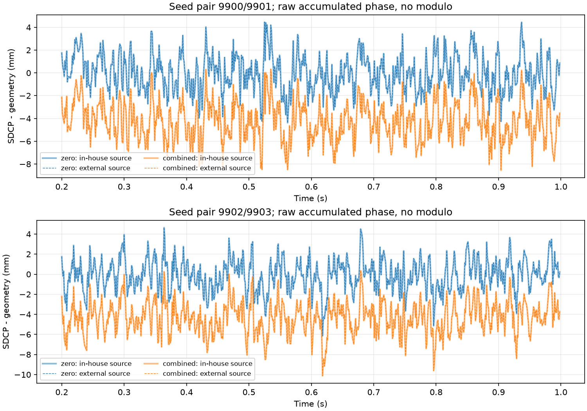

# GNSSSimulator.jl 外部双天线信号源接入与验证

## 结论

已实际运行 GNSSSimulator.jl，并把其原生码、载波和阵列生成结果接入本项目双 RF/DFE/独立跟踪链。外部源上游测试 **137 项通过**，本轮新增的源端六项数值检查全部通过；随后完成六场景×两噪声对、每场景 1 秒的接收验证。

在本轮固定方向、L1 C/A、单 PRN、理想短基线条件下，统一明确的符号约定后，外部源与本地源得到的两通道跟踪累计 NCO 相位、频率、积分起点及所比较的质量数组完全一致。几何残差均值仅有浮点几何常数计算顺序带来的约 1e-14 mm 差异。

这支持本项目当前简单信号源的实现一致性。它不是真实硬件精度认证，也没有验证任意动态场景、所有整周/半周状态、完整导航电文定位或实际欺骗检测。

## 软件来源与可复现环境

上游：[JuliaGNSS/GNSSSimulator.jl](https://github.com/JuliaGNSS/GNSSSimulator.jl)。通过公开 CDN 获取 master 的 34 文件快照，各文件先与 CDN 清单中的 SHA-256 核对，再保存本地内容哈希。未取得 Git commit ID，故记录为内容固定的快照，不能声称锁定了某个 Git 提交。版本声明为 0.6.3。

原始源码、README 和许可全文保留在 [upstream/GNSSSimulator](data/2026-09-13-external-gnss-source/upstream/GNSSSimulator/README.md)；许可文件正文为 MIT，开头仍保留上游的 “Tracking” 项目名文字，未自行改写。[源码来源及哈希](data/2026-09-13-external-gnss-source/upstream_provenance.json)

运行环境为 Julia 1.10.12 官方 Windows x64 便携包，下载后按官方版本目录的 SHA-256 验证。关键依赖为 GNSSSignals 1.0.3、PhasedArray 0.9.2、LoopVectorization 0.12.174，完整版本及包树哈希见 [Manifest.toml](data/2026-09-13-external-gnss-source/julia_env/Manifest.toml)。官方运行包来源与哈希见 [runtime_provenance.json](data/2026-09-13-external-gnss-source/runtime_provenance.json)。

本机便携 Julia、包缓存和约 1.056 GB 的两路原始 IQ 位于已忽略的 `python_sim_simplified/results/`，未加入系统 PATH。研究归档保存生成器、参数、输入哈希及接收记录，原始 IQ 可重新生成。

## 审查到的模型与适用范围

`ConstantDopplerSatellite` 产生带码多普勒的 PRN 波形与载波；`PhasedArray.IdealManifold` 按方向和天线位置构造每星的复响应；`get_measurement` 先初始化噪声，再叠加各星、各天线的信号，最后施加接收机增益/相位/串扰矩阵。具体实现见[原生 measurement.jl](data/2026-09-13-external-gnss-source/upstream/GNSSSimulator/src/measurement.jl)。

阵列采用窄带导向矢量，单颗卫星在各天线间的码波形相同、载波空间相位不同。此次没有实现独立的每根天线宽带传播时延、真实天线方向图、温漂、星历驱动的卫星轨迹或完整导航电文。对 75.9 mm 短基线载波机制对照有用，但不能据此作为任意阵列/定位场景的通用真值源。

本轮外部源确实生成多天线数据；不是给叠加后的多星总信号统一加一个相位。双星源端检查分别使用两个 PRN、两个方向，再验证原生阵列叠加结果。

## 接口约定与发现的问题

### 方向符号

上游 PhasedArray 的响应为 `exp(+j*k*r·doa)`；本项目为 `exp(−j*k*r·look)`。适配器显式设置 `native_doa = −look`，使用相同实际坐标，不根据测量结果拟合方向或相位。

### PRN 双极性约定

初次检查发现上游 PRN1 的 1023 个码片全部为本地码片的相反数，循环位移为零。初次接入因此在 RF 之前停止，保留[失败记录说明](data/2026-09-13-external-gnss-source/receiver_initial_polarity_check/README.md)。

最终适配器要求 `−external_PRN1 == local_PRN1` 对全部码片成立，并统一将两路外部 IQ 乘 −1。这是码符号约定变换，相当于共同的 π 载波因子，不是逐天线相位校准、整数分支修正或参考均值扣除。原始外部 IQ 文件保持不变。

### 噪声和幅值

原生 `get_measurement` 默认包含噪声，若直接送入当前 RF 会重复注入。因此适配器调用上游原生 `gen_signal!`、`propagate` 和 PhasedArray 的导向矢量，输出单位幅值的无噪声 IQ。未重写 PRN、码/载波 NCO 或阵列导向函数；对原生完整 measurement 路径另做精确噪声分离检查。

单位幅值再按 `sqrt(10**((−128.5−30)/10)*50)` 映射为伏特，两通道分别经过当前 RF 热噪声、增益、限幅、ADC、DFE 和独立环路。天线固定幅相误差在 RF 输入前注入，RF 固定误差在既有 RF 模块中注入。这里的两个误差阶段仍是本项目硬件模型，不声称被外部源独立验证为真实器件响应。

### 累计相位

上游波形发生器内部会将用于正弦生成的相位保持在一个周期内，以连续推进振荡器；分块等价性已验证。本报告限制的“不取余”针对接收端的累计 NCO 观测，未将接收相位压缩为单周，也未用新常数重新居中。不能混淆正弦发生器的周期数值实现与观测域的整周信息丢弃。

## 信号源验收

以下门限写入脚本后才执行，为单位幅值复数数值误差容差，不是 GNSS 检测门限或相位硬件指标。三项几何检查各使用 33000 样本，连续性检查总计 66000 样本。

| 检查 | 最大复数误差 | 预设容差 | 结果 |
|---|---:|---:|---|
| 零基线双通道一致 | 0 | 1e-12 | 通过 |
| 方位 30°、仰角 60° 的几何响应 | 4.965e-16 | 1e-12 | 通过 |
| 方位 110°、仰角 25° 的几何响应 | 4.003e-16 | 1e-12 | 通过 |
| 66×1000 样本分块与单块等价 | 1.022e-11 | 1e-8 | 通过 |
| 原生完整 measurement 与无噪声适配器＋相同随机噪声等价 | 1.696e-12 | 1e-10 | 通过 |
| 两 PRN、不同方向的原生阵列叠加 | 2.988e-12 | 1e-10 | 通过 |

原始结果见 [source_checks.toml](data/2026-09-13-external-gnss-source/receiver/source_checks.toml)。上游完整测试在原样源码上运行，共 137 项通过，涵盖载波、姿态、方向、卫星、接收机及 measurement 等，见[测试日志](data/2026-09-13-external-gnss-source/upstream_tests.log)。其中干扰模型测试是上游回归测试，不意味着本轮 SDCP 场景加入了干扰。

额外在 1 秒内按均匀整数索引抽查每通道 200000 个样本，与本地源独立生成的对应样本比较。统一上述固定约定后最大误差约 4.041e-9、RMS 约 1.307e-9，超过 1e-5 的样本数为零。没有拟合幅值、载波相位或码偏移。[波形比较原始结果](data/2026-09-13-external-gnss-source/receiver/independent_waveform_comparison.json)

## 完整接收链对照

与[此前固定幅相偏差研究](2026-09-13-sdcp-hardware-bias.md)相同：GPS L1 C/A、PRN1、33 MHz RF、IF 4.092 MHz、DFE 抽取 5、6.6 MHz 跟踪、1500 Hz 多普勒、75.9 mm 基线、零通道时延、无干扰、无多径、理想共钟。每场景 1 秒，固定统计 200～998 ms 的 799 个共同时间点。

两组 RF 噪声种子为 9900/9901 与 9902/9903，每组 TL 的零误差记录共享复用，TR 跑六种条件，共 14 次单通道 RF/DFE/跟踪，形成 12 条双通道记录。默认配置对象中与天线阵列有关的字段不再用于产生输入；实际输入两路的坐标、方向及样本数以外部 metadata 为准。

四种误差设定为 TR 天线 −1 dB / +5°，TR RF +1 dB / +3°，TL 为零；均是人为试验设定。分别单独开启及合并开启，以下为 `D−geometry`，每格依次为种子对 9900 和 9902 的结果，单位 mm。

| 场景 | 残差均值 | 时间标准差 | 最大绝对残差 |
|---|---|---|---|
| zero | −0.006 / −0.078 | 1.615 / 1.581 | 4.451 / 6.139 |
| antenna_amplitude | −0.016 / −0.085 | 1.712 / 1.669 | 4.728 / 6.332 |
| antenna_phase | −2.653 / −2.730 | 1.632 / 1.574 | 7.110 / 8.541 |
| rf_amplitude | +0.016 / −0.113 | 1.612 / 1.566 | 4.461 / 5.995 |
| rf_phase | −1.595 / −1.680 | 1.625 / 1.557 | 5.957 / 7.397 |
| combined | −4.242 / −4.327 | 1.709 / 1.631 | 8.551 / 10.122 |

相对各自零偏差对照，combined 均值变化 −4.236041/−4.248738 mm，理论总 +8° 相位为 −4.228748 mm。全部 12 条记录均有 799 个有限共同历元，既有质量条件同时通过 799/799。质量通过不能当作真实性或完整周跳认证。

与本地信号源对应记录比较，累计 NCO 相位、NCO 频率、积分起点、PLL 误差及 phase-lock metric 的逐点差均为零；不是只看四舍五入后的均值接近。不同源原始波形仍有约 1e-9 的数值差异，本轮经相同 RF/量化/环路后未在这些跟踪数组上观察到差异。不能外推所有噪声种子下都会逐位一致，也未单独比较全部 ADC 样本。[逐记录比较](data/2026-09-13-external-gnss-source/cross_source_comparison.json)



## 对当前研究的意义

可以将此适配器保留为当前简单场景的第二套信号源，用于后续接收链修改的交叉检查。原先约 1.6 mm 的随机波动、注入相位导致约 4.24 mm 固定偏置，在独立波形实现下得到复现；暂未发现这两项现象来自本地 PRN/载波/静态阵列生成的独有错误。

两套源采用相近的理想物理假设，共用同一套 RF/DFE/跟踪实现。因此本轮不能独立验证 RF 噪声和量化是否逼近真实硬件，不能代替实机记录或校准，也不扩大到多径/欺骗检测有效性结论。完整星历、电文和定位仍应另做专项源端验证。

## 复现与归档

在仓库根目录，准备 Julia 1.10.12 后执行下列命令；`--compiled-modules=no` 用于避开本机受限进程环境下的编译缓存子进程管道错误，不更改信号算法。

```powershell
$env:JULIA_DEPOT_PATH = "$PWD/python_sim_simplified/results/external_gnss_tools/depot"
julia --startup-file=no --project=docs/reports/data/2026-09-13-external-gnss-source/julia_env -e 'using Pkg; Pkg.instantiate()'
julia --startup-file=no --compiled-modules=no --project=docs/reports/data/2026-09-13-external-gnss-source/julia_env python_sim_simplified/external_gnss_generate.jl python_sim_simplified/results/external_gnss_iq_repeat
python python_sim_simplified/audit_external_gnss.py --iq python_sim_simplified/results/external_gnss_iq_repeat --output python_sim_simplified/results/external_gnss_receiver_repeat
```

本机 Julia 不在 PATH，执行时用 `python_sim_simplified/results/external_gnss_tools/julia-1.10.12/bin/julia.exe` 替换 `julia`。生成与接收的输出目录均要求不存在，避免混入历史结果。上游测试使用归档 test_env，其依赖清单与同版本 Manifest 一并保存；本轮未修改任何上游源码。

归档结果复核：

```powershell
python docs/reports/data/2026-09-13-external-gnss-source/receiver/verify.py
python docs/reports/data/2026-09-13-external-gnss-source/compare_sources.py
```

独立重算确认 12 条接收记录的 15 项统计量及逐点数组、质量计数一致，并核验 22 个接收归档文件；另核验 34 个上游文件。Python 定向回归 18 项通过（5.40 s），没有修改生产接收算法。Julia 日志保留上游依赖的未使用类型变量警告，不将警告隐去。

方案与状态见[外部源验证方案](../validation/2026-09-13-external-gnss-source-plan.md)。
