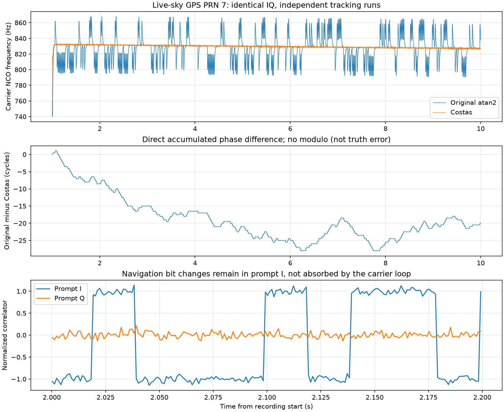

# 单天线真实 GNSS 录波：捕获、跟踪与导航比特验证

日期：2026-09-13。本报告的数据来自真实屋顶天线和 HackRF 设备录波，不是本地或外部软件仿真的卫星信号。

## 1. 结论与当前完成范围

现有接收代码经必要的真实导航电文适配后，能够处理本次 GPS L1 C/A 单天线实测录波。选取文件 1～10 秒，共 9 秒，扫描全部 GPS PRN 1～32，捕获到 PRN **2、5、6、7、9、13、23、26、29、30**。每颗使用自己的跟踪状态，输出 8995 个 1 ms 跟踪历元。各星都得到连续 **13 个校验正确且内容非恒定的导航字**，识别出 TLM 前导码、子帧号 2，以及一致的 HOW 下一子帧时间字段 590472 s。

这次实测暴露并区分了两个问题：

1. **原 PLL 不适合直接处理未知导航比特。** 原来用完整相位角鉴相，会把真实 L1 导航电文的 180° 翻转反馈进载波环路。新增可选 Costas PLL/FLL 后，电文翻转保留在 Prompt I 中，载波频率波动显著降低。历史仿真默认设置保留，真实录波入口默认启用 Costas。
2. **公开录波也有连续性问题。** 该文件开头存在异常，约 0.47～0.48 s 两颗强星的主码捕获延迟同时跳变 1111 个 DFE 输出采样点。本次保留从文件起点运行的失败结果，并在异常之后重新捕获建立新跟踪段；没有修补或拼接数据，也没有宣称跨异常的相位连续。

本轮完成的是“真实采样输入 → DFE → 捕获 → 独立跟踪 → 载波/码 NCO 输出 → 导航比特结构检查”。**没有完成实测定位、绝对伪距精度、绝对载波相位精度、双天线 SDCP 或抗欺骗性能验证。** 导航字校验不提供信号真实性认证。

## 2. 数据来源及可追溯性

原先考虑的 Tampere Zenodo 页面在本次访问时返回 HTTP 429。为完成同一验证目标，改用 ION GNSS SDR Metadata Standard 托管的 HackRF 实测示例。

| 项目 | 原始说明/实际使用值 |
|---|---|
| 提供页面 | [ION Sample GNSS Data Files](https://sdr.ion.org/api-sample-data.html) |
| 原始 IQ | [HackRF_Bands-L1.int8](https://sdr.ion.org/HackRF/HackRF_Bands-L1.int8) |
| 元数据 | [HackRF_Bands-L1.sdrx](https://sdr.ion.org/HackRF/HackRF_Bands-L1.sdrx) |
| 设备、天线 | HackRF；屋顶 RHCP Patch 天线；Static Test |
| 场地 | Oegstgeest，荷兰；XML 位置为纬度 52.1771936°、经度 4.4900595°、高 53.9 m |
| XML 时间标签 | 2017-09-09T19:55:00Z；未将该标签当作经校验的信号发射/接收时刻 |
| RF 中心频率 | 1575.420 MHz |
| 文件采样率、信号中频 | 10 MHz、+420 kHz |
| 文件表示 | 8 bit 二进制补码，交织 I、Q，每个复采样 2 字节；无块头/块尾 |
| 原文件大小 | HTTP Content-Range 表明共 1,200,000,000 字节，对应 60 秒 |
| 实际下载 | HTTP 206，字节 0～199,999,999，共 200,000,000 字节，对应前 10 秒 |
| 主要验证段 | 文件第 1 秒开始，取 9 秒；没有跨开头异常延续旧状态 |

下载片段 SHA-256：

```text
220b37c6e57255483fb7858e7fab10255d7db0459d5134531ea660e9da87ca78
```

原始元数据、HTTP 响应头、字节范围及哈希保存在 [source](data/2026-09-13-real-single-antenna/source/)；大体积 IQ 保存在本地忽略目录 `python_sim_simplified/results/real_gnss_hackrf/first10s.int8`。没有把原始 IQ 加入仓库。XML 的 owner 字段写作 GPL，未据此推断完整授权版本或商用再分发许可。

ION 另提供 [MuSNAT 对这些录波生成的观测文件](https://sdr.ion.org/musnat-rinex.html)。本次实际下载检查发现，测试前十秒 PRN 7 的伪距、载波相位字段均为零，早期信号强度还出现 -100 占位值；头部明确提示接收机位置无效。这份输出**不能当作本轮定位/相位真值**。原始行摘录见 [reference excerpt](data/2026-09-13-real-single-antenna/source/musnat_prn7_reference_excerpt.json)。没有用其数值初始化或调整本地跟踪。

## 3. 接入和验证方法

### 3.1 处理链

```text
真实天线 → 真实 HackRF RF/ADC → 公开 IQ 文件
                                  ↓
                       有符号 I/Q 读取和长度检查
                                  ↓
              现有 DFE：420 kHz 下变频、FIR、抽取 2
                                  ↓
                    5 MHz 基带 → GPS PRN 1～32 捕获
                                  ↓
                      每颗卫星各自的 DLL/FLL/PLL
                                  ↓
                 原始累计 NCO、相关值及导航比特检查
```

录波已经过真实 RF/ADC，不再调用仿真 `process_rf`，不再添加噪声、多径或干扰。使用现有 DFE 的 129 抽头 Hamming 窗 FIR，单边截止 1.8 MHz；主对照不再量化，另做 8 位输出量化实验。固定群延迟按原 DFE 方式处理。10 MHz 输入抽取 2 后为 5 MHz；本次没有把录波重采样到 33 MHz，也没有修改项目 33 MHz / 5 / 6.6 MHz 的仿真默认链。

第 1～10 秒输入的 I/Q 均值分别为 -0.35595、-2.74226 数字码，复信号 RMS 为 12.76007 数字码；观察到的输入端点码比例为 0。这里的数字码不是 dBm，不据此推导射频绝对功率。

### 3.2 捕获、跟踪及对照

- 捕获沿用现有 FFT 搜索：1 ms 相干、4 次非相干积累，多普勒范围 ±10 kHz，步长 250 Hz，主/次峰门限 2.5，主峰排除区 1 chip。全部 32 个 PRN 都保留搜索结果；没有把提供方的可见卫星名单作为候选筛选器。
- 主对照使用同一段 IQ、相同捕获、DLL 和环路增益。变化只在载波鉴相及相应质量统计是否考虑未知 BPSK 正负号；质量统计不反馈环路。
- 1 ms 跟踪积分；FLL 辅助前 5 历元；PLL 比例系数 0.30、积分频率系数 4.0；DLL 比例系数 0.08、积分频率系数 0.5。未用信号源真值初始化，没有微调每颗星的环路参数。
- 主统计去掉重新捕获后的前 0.5 秒，对剩下 **8499 个历元/星**计算；时间约为文件 1.500～9.999 s。时间标准差使用 ddof=0，不把真实多普勒缓慢变化去掉。因此频率标准差包含运动/时钟等真实变化，不是纯热噪声测量。
- 跟踪输出 `success=True` 只说明代码执行到结束。本报告额外检查鉴相量、相干性、原始累计 NCO 和导航字结构，不把该布尔值等同于可靠锁定认证。

### 3.3 为什么增加 Costas

对相关输出 `P = A·b·exp(jε)`，导航比特 `b` 是 ±1。原方案 `arg(P)` 在比特翻转时多出约 π，环路会错误追随它。真实录波入口采用：

```text
PLL 相位误差 = 0.5 × arg(P²)
FLL 相位增量 = 0.5 × arg[(P[k] × conj(P[k-1]))²]
FLL 频率误差 = 上述相位增量 / (2πT)
```

平方消去未知导航比特正负号。相关说明见 [GNSS-SDR Tracking 文档](https://gnss-sdr.org/docs/sp-blocks/tracking/)。这种鉴相仍有 **半周模糊性**，并缩小 FLL 的无模糊频率范围；当前 1 ms 下为 ±250 Hz，本轮 250 Hz 捕获网格提供的初始残差在正常捕获条件下适用。它不解决失锁、采样缺口、周跳或初始整周/半周分支。

注意：这里是载波环内部的周期鉴相，**没有对下游累计载波相位或 SDCP 按波长取余**。原始 `carrier_nco_phase_rad` 继续保留累计整周；验证脚本逐点检查其状态增量。

Costas 模式同时采用对正负号不敏感的平方相关相干性和 M2/M4 C/N0 估计。为公平比较，报告的“平方相关相干性”对原方案和 Costas 的保存相关值用同一个公式重新计算。短窗口 M2/M4 可能无效，本轮整段 C/N0 仅作信号质量辅助描述，不是经过硬件标定的 C/N0 精度结果。

## 4. 实际结果

### 4.1 起始段失败与连续性诊断

从文件 0 秒直接捕获跟踪，原方案虽报告 tracking，但第 0.5～1 秒的平方相关相干性只有约 0.026～0.297。仅切换 Costas 仍未恢复，说明不能把问题全部归因于导航电文。将起点移到 20 ms 后，跨 0.48 s 异常的跟踪仍然不好。

独立于跟踪环，每 10 ms 对 PRN 7、30 做一次 1 ms 主码捕获，覆盖完整 10 秒。保存 [逐块结果](data/2026-09-13-real-single-antenna/hackrf_code_continuity_10s.npy) 和 [异常摘要](data/2026-09-13-real-single-antenna/continuity_summary.json)：

| 文件时段 | PRN 7 主码延迟变化 | PRN 30 主码延迟变化 | 判断 |
|---|---:|---:|---|
| 0～0.01 s | -606 样点 | -2313 样点 | 开头异常，不同星的变化不相同；具体原因未确认 |
| 0.47～0.48 s | +1111 样点 | +1111 样点 | 公共时间连续性异常；5 MHz 下约 222.2 μs，可能与采样缺口/拼接有关，不能确证硬件原因 |
| 1～10 s | 未触发本检查的 >10 样点跳变标志 | 同左 | 支持选为后续独立跟踪段；不构成任意微小相位跳变都不存在的证明 |

此处主码延迟本来就是 1 ms 周期量，因此只在诊断主码延迟变化时使用周期差；载波相位评估不取余。

### 4.2 同一段实测 IQ 的原方案/Costas 对照

主统计区间约 1.5～10 秒，8499 历元/星。PLL RMS 单位 rad；频率时间标准差单位 Hz。

| PRN | 捕获峰比 | 原 PLL RMS | Costas PLL RMS | 原频率标准差 | Costas 频率标准差 | Costas 平方相关相干性 |
|---:|---:|---:|---:|---:|---:|---:|
| 2 | 6.194 | 0.6565 | 0.1179 | 16.837 | 1.590 | 0.9732 |
| 5 | 14.127 | 0.6261 | 0.0972 | 16.077 | 1.063 | 0.9818 |
| 6 | 8.972 | 0.6457 | 0.1294 | 16.546 | 0.834 | 0.9679 |
| 7 | 16.392 | 0.6453 | 0.0717 | 16.830 | 1.529 | 0.9899 |
| 9 | 35.994 | 0.6427 | 0.0583 | 16.683 | 0.854 | 0.9933 |
| 13 | 3.897 | 0.6293 | 0.1883 | 15.669 | 0.756 | 0.9341 |
| 23 | 2.612 | 0.6676 | 0.2094 | 16.336 | 1.164 | 0.9210 |
| 26 | 3.090 | 0.6689 | 0.1971 | 16.727 | 1.495 | 0.9290 |
| 29 | 6.492 | 0.6448 | 0.1213 | 16.657 | 1.671 | 0.9720 |
| 30 | 31.935 | 0.6279 | 0.0637 | 16.488 | 1.089 | 0.9922 |

两种鉴相器的输出区间不同，不能只根据各自 PLL RMS 的降低证明改善。更关键的是：同段频率异常波动降低、Prompt 电文翻转恢复、跨星一致的导航字结构通过。保存的汇总还有使用同一公式计算的相位残差 RMS，便于公平复核。

PRN 7 原方案与 Costas **直接累计 NCO 差**的范围为 -28.07394～+1.06162 周，末值约 -19.96121 周，图中没有减均值或按周折返。这是两个算法的输出差，不能称作对真实载波的绝对误差。它明确说明原方案可能把导航比特变化累积进相位输出。



原始 [Costas 汇总](data/2026-09-13-real-single-antenna/costas_start1s_9s/summary.json)、[原方案汇总](data/2026-09-13-real-single-antenna/legacy_start1s_9s/summary.json) 与对应 NPZ 中保存完整历元数组。C/N0 的 M2/M4 辅助估计范围为 41.606～52.674 dB-Hz；该范围不是接收灵敏度测试，也不代表天线增益真值。

### 4.3 导航比特提供的独立证据

从保存的 Prompt I 做离线 20 ms 比特边界搜索，不提供已知导航比特；随后检测 GPS 30 bit 导航字校验和 TLM/HOW。校验算法按 IS-GPS-200 规则实现，并对照 [RTKLIB decode_word](https://github.com/tomojitakasu/RTKLIB/blob/master/src/rtkcmn.c)。只增加诊断，不反馈到载波 NCO，不解算星历或位置。

- Costas 的 10 颗星各有 13/13 连续校验通过的导航字，字内容非恒定；均识别到 0x8B 前导码、子帧号 2、HOW 下一子帧时间 590472 s。
- 这些连续导航字跨越子帧边界。截取段从已识别前导码起不足完整 10 字，因此 `ten_words_parity_ok=False`，表示缺少后续完整子帧长度，**不是已获取的 13 字中出现校验失败**。没有宣称完整星历已解码。
- 原方案经同样的离线 20 ms 积分，输出恒定比特/全零字。**全零 GPS 字也能通过校验**，所以“校验通过数”不能单独作为验收条件。本次接受规则还要求非恒定比特和可信的 TLM/HOW 结构；原方案 10 颗星均不满足。
- HOW 时间字段的跨星一致性用于协议结构检查，没有把 XML 时间标签、HOW 和接收时刻强行对齐，也没有据此构造伪距。

结果见 [navigation_acceptance.json](data/2026-09-13-real-single-antenna/navigation_acceptance.json)。这些是接收解调证据，不是有真值的误码率，也不是反欺骗认证。

### 4.4 DFE 输出量化补充检查

在相同 IQ、相同 Costas 环路下，对 PRN 7、13、29 增加 DFE 8 位量化，binary shift=0。原始输入本身已经是硬件 8 位采样，这里验证的是软件 DFE 的额外输出量化。

| PRN | 浮点 DFE PLL RMS/rad | 8 位 DFE PLL RMS/rad | 8 位 DFE 频率标准差/Hz | 导航字与结构检查 |
|---:|---:|---:|---:|---|
| 7 | 0.071670 | 0.071741 | 1.529425 | 13/13，TLM/HOW 通过 |
| 13 | 0.188302 | 0.188323 | 0.756077 | 13/13，TLM/HOW 通过 |
| 29 | 0.121272 | 0.121303 | 1.671078 | 13/13，TLM/HOW 通过 |

本次电平条件下影响很小；不推广到低位宽、不同增益、饱和场景或项目默认 binary shift=2。见 [量化汇总](data/2026-09-13-real-single-antenna/costas_quant8_start1s_9s/summary.json)。

## 5. 实现、回归与适用范围

- [audit_real_gnss.py](../../python_sim_simplified/audit_real_gnss.py)：IQ 读取、字节范围检查、实测入口、全 PRN 捕获、跟踪保存、导航字诊断。记录实际输入窗口哈希和接收代码哈希。
- [tracking.py](../../python_sim_simplified/tracking.py)、[config.py](../../python_sim_simplified/config.py)：新增 `carrier_discriminator='costas'` 可选模式，导航数据不敏感的 PLL/FLL 与质量统计；默认 `atan2` 保留历史仿真行为。
- [test_real_gnss.py](../../python_sim_simplified/tests/test_real_gnss.py)：有符号 IQ/截断检查；有无 50 bps 翻转的同载波 NCO 一致性；GPS 校验参考向量和单 bit 错误；全零字不能当导航结构证据。相应新行为均先观察到测试失败再修正。
- 全套回归 **162 项通过**，1 条既有无噪声 C/N0 除零警告，耗时 93.94 s。随后补充全零导航字验收检查；最终相关回归 **22 项通过**，耗时 14.34 s。未把两批计数相加当成独立测试总数。
- [verify_and_plot.py](data/2026-09-13-real-single-antenna/verify_and_plot.py) 从原始 NPZ 独立重算 **335 个标量统计**，并验证各跟踪历史的累计 NCO 增量。所有检查通过；图已渲染检查。

记录中仍保留 early audit 的历史字段名：`dll_rms_chips_normalized` 实际是无量纲归一化 DLL 鉴别器 RMS，不能解释为 chip 误差；`legacy_lock_median` 在当时 Costas 文件中指所配置模式的锁定统计。最终 9 秒结果已改为 `dll_discriminator_rms`、`configured_lock_median`，本报告不将旧名解释为物理精度。

## 6. 对后续研究的实际意义

当前可以说：真实 L1 输入的读取、下变频/滤波、捕获和考虑导航比特的连续跟踪已经有一份公开实测样本支撑。原本仿真不带导航电文时通过的载波环路，直接用于真实数据会出问题；本轮发现了这一具体差距。

当前仍不能说：硬件 RF 幅相模型已经准确、DLL 绝对偏差已知、载波达到毫米精度、定位准确或 SDCP 有效。实测数据本身含未知多径、天线及硬件误差，缺少独立真值。本轮也没有实现在线掉样检测/自动重捕状态管理，异常段是在离线诊断后另开跟踪段。

接下来有了明确的顺序：先补真实电文的完整同步/星历与接收时间处理，再做真实观测和定位；待取得同步多天线 IQ 后，复用已验证的单通道流程，研究通道偏差、半周/整周分支和真实 SDCP。不能用复制单路 IQ 的方式替代真实多天线验证。

## 7. 复现

仓库根目录执行；`python` 指具有项目 requirements 的 Python 3.11 环境。第一次下载约 200 MB：

```powershell
python docs/reports/data/2026-09-13-real-single-antenna/download_recording.py --output python_sim_simplified/results/real_gnss_hackrf/first10s.int8
python python_sim_simplified/audit_real_gnss.py --iq python_sim_simplified/results/real_gnss_hackrf/first10s.int8 --start 1 --seconds 9 --mode costas --output python_sim_simplified/results/real_gnss_reproduction
python docs/reports/data/2026-09-13-real-single-antenna/verify_and_plot.py
```

输出目录必须不存在，以避免覆盖既有证据。切换 `--mode legacy` 可重现原方案；增加 `--output-bits 8 --prns 7 13 29` 可重现 DFE 量化对照，分别指定不同输出目录。
