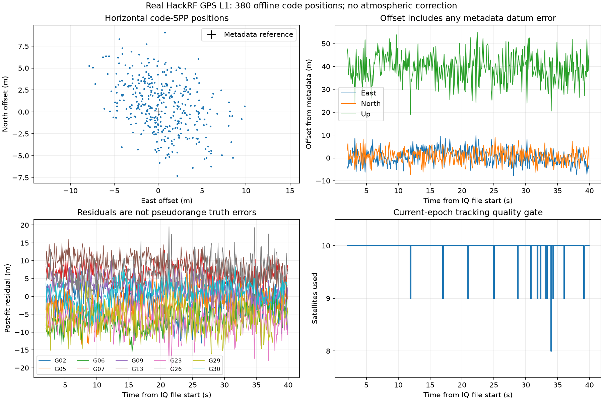

# 真实 GPS 录波：通用接收模块与码定位闭环

日期：2026-09-13。承接[真实单天线接收验证](2026-09-13-real-single-antenna.md)，对应[本轮实施计划](../validation/2026-09-13-recorded-receiver-plan.md)。

本轮已经把 IQ 读取、通道接收、电文解码、卫星时间映射和真实观测构造放入可复用模块，并以公开 HackRF 单天线录波完成 GPS L1 码定位。实验入口负责选择条件和保存结果，评估程序负责与参考信息比较。

处理文件第 1～40 秒，10 颗卫星均解出完整广播星历；第 2～39.9 秒按 0.1 秒间隔输出 **380/380 个位置解**。相对录波元数据坐标，水平 RMS **4.384 m**，垂向均值 **+39.268 m**，三维 RMS **40.000 m**。这是静态单频码定位的首轮闭环结果，不能解释为已达到高精度定位或已验证真实 SDCP。

## 1. 架构变化：哪些是通用功能，哪些是实验

| 文件 | 负责的工作 | 与本轮实测的关系 |
|---|---|---|
| [recorded_receiver.py](../../python_sim_simplified/recorded_receiver.py) | IQ 读取、分块 DFE 调度、逐 PRN 捕获跟踪、离线定位调度及命令行入口 | 接收输入只含录波、采样参数和配置，无参考位置 |
| [gps_lnav.py](../../python_sim_simplified/gps_lnav.py) | 20 ms 比特同步、字校验、TLM/HOW、时间锚点、子帧 1/2/3 星历解析 | 从各卫星真实 prompt 中解码 |
| [gps_broadcast.py](../../python_sim_simplified/gps_broadcast.py) | 广播星历轨道、钟差和地球自转坐标修正 | 输入为已解出的星历 |
| [gps_observables.py](../../python_sim_simplified/gps_observables.py) | 同一接收时刻的卫星发射时间、伪距与单历元 GPS 解算 | 不调用仿真的粗伪距辅助函数 |
| 既有 `dfe.py`、`acquisition.py`、`tracking.py`、`positioning.py` | 下变频滤波、捕获、环路与最小二乘求解 | 复用现有处理；真实 L1 选 Costas |
| [audit_real_gnss.py](../../python_sim_simplified/audit_real_gnss.py) | 原真实接收实验的配置、统计和保存 | 改为调用通用通道入口；保留旧导入名兼容 |
| [本轮核验程序](data/2026-09-13-recorded-receiver/verify_and_plot.py) | 重算存档、比较元数据坐标、生成统计和图 | 参考坐标仅在这里进入 |

调用关系为：`IQ → DFE → 各 PRN 独立捕获/跟踪 → LNAV/星历 → 共同接收时刻的伪距 → GPS 位置与钟差 → 结果评估`。

这是同一根天线记录中的多颗卫星，各有独立环路，分享同一采样时间轴。当前 Python 离线实现按 PRN 依次计算，并非墙钟时间并行运行；它们处理的是同一段录波，不是分别采集多次数据。真实双天线仍需两路同步 IQ。

DFE 新增有状态分块处理，跨块保留 NCO 时间、FIR 状态和抽取相位，群时延只处理一次。39 秒数据的 DFE 缓存约 3.12 GB，写入磁盘映射文件，避免同时构造整段原始复数数组和中间数组。接收模块仍是离线入口，不等于已经完成设备实时流式接入。

## 2. 输入、条件和可追溯性

| 项目 | 实际条件 |
|---|---|
| 来源 | ION SDR 公开样例中的 `HackRF_Bands-L1.int8`，设备实采，非本地合成 |
| 场景 | 荷兰 Oegstgeest 屋顶 RHCP patch，静止场景 |
| 下载范围 | 原始文件字节 0～799999999，共 800 MB、40 秒 |
| 输入格式 | signed int8 I/Q 交织、10 MHz、L1 中频 +420 kHz |
| 本轮处理段 | 从文件 1 秒开始，长度 39 秒；沿用上一轮对开头异常段的离线排除 |
| DFE | 抽取 2 倍到 5 MHz，129 taps，截止 1.8 MHz，浮点输出 |
| 捕获 | PRN 1～32，Doppler −10～+10 kHz、间隔 250 Hz；其余实际参数见 manifest |
| 跟踪 | 1 ms 独立积分，Costas PLL/FLL；每颗成功卫星 38995 个历元 |
| 定位时刻 | 文件时间 2.0～39.9 秒，间隔 0.1 秒；共 380 次 |
| 定位模型 | GPS L1 码、等权最小二乘；广播钟差、相对论、TGD、地球自转修正 |
| 当前未修正 | 电离层、对流层、天线/接收机逐星或方向相关码偏差 |

40 秒文件 SHA-256：`42276d2a31d99e3ab10dc8968d8d2643785f595b4f59501df723b99e15932aa8`。本次实际下载复用已验证的前 10 秒，并追加六段各 100 MB 范围，逐段记录哈希，再验证合并文件。见[下载记录](data/2026-09-13-recorded-receiver/source/download40s.json)。接收程序另对实际读取的 39 秒窗口计算哈希，见[运行 manifest](data/2026-09-13-recorded-receiver/run/manifest.json)。

录波 XML 给出纬度 `52.1771936°`、经度 `4.4900595°`、高 `53.9 m`。本次评估将其按 WGS84 椭球坐标换算；原 XML 未直接给出高度基准声明、测量方法或坐标不确定度。因此报告使用“相对元数据偏差”，不宣称测量级绝对误差。也没有根据本次解算结果反过来改参考高度。

XML 的起始日期时间没有参与接收机定时；接收机使用实际电文 HOW。GPS 周保留 10 bit 模 1024 值，本批为 941；没有按计算机当前日期悄悄推断历史记录的绝对周。当前可以给出周内时间和位置，尚未输出完整 UTC 时间解。

## 3. 电文、时间和伪距是如何得到的

### 3.1 从相关结果到可信时间标记

每颗星先舍弃 500 个启动历元，在 20 种可能的比特边界中选择相干和较大的边界，再寻找导航字对齐与极性。导航字校验使用前一字 D29*/D30* 与当前 30 bit；恒定全零位流即使能通过校验，也不能单独作为电文证据。

TLM 前导码和 HOW 必须有效，子帧号为 1～5、周内时间范围正确。完整子帧需要十个字全部通过校验。时间准入还要求至少两个锚点的子帧号、6 秒时间步进和跟踪历元数一致。星历要求子帧 1、2、3 完整，IODE/IODC 低八位一致，轨道参数合理。失连续、缺少可信时间或缺少星历时，不补造观测。

本批每颗星都有 63/63 个连续有效字、6 个一致的 TLM/HOW 时间锚点和 5 个完整子帧。完整子帧的到达顺序为 2、3、4、5、1；片段最后还有下一次子帧 2 的开头。子帧 1 在文件约 29.1 秒开始，到约 35.1 秒才能收完整。因此本次对文件 2 秒处的位置解是**利用稍后解出的星历离线回算**，不能当作 2 秒首次定位能力。

| PRN | 2 | 5 | 6 | 7 | 9 | 13 | 23 | 26 | 29 | 30 |
|---|---|---|---|---|---|---|---|---|---|---|
| IODE | 86 | 97 | 59 | 70 | 72 | 64 | 33 | 29 | 47 | 10 |
| 字校验 | 63/63 | 63/63 | 63/63 | 63/63 | 63/63 | 63/63 | 63/63 | 63/63 | 63/63 | 63/63 |

校验通过证明本批位流与导航结构自洽，不构成信号真实性认证。

### 3.2 从码 NCO 到发射时刻

设已解出的 TLM 起始对应跟踪块编号为 `a`，该子帧实际起始周内时间为 `T_a = HOW − 6 s`。对同一采样时刻 `t`，找到每颗星自己的积分块 `i`：

`t_tx,sv(t) = T_a + (i−a)×1 ms + [q_i + f_code,i×(t−t_i)] / 1.023 MHz`。

其中 `q_i` 是本地码 NCO 的连续小数码相位残差，在 TLM 锚点处选择与码周期边界相邻的分支；`t_i` 是该星该积分块的采样起始时间。代码相位本身按 1023 chips 周期表示，因此这里展开的是**码周期**，不是对累计载波相位按波长取余。

整数毫秒来自已校验的导航时间和连续历元计数，小数部分来自跟踪码 NCO。没有输入卫星真实伪距，没有用天线参考位置选择伪距分支。前提是当前 1 ms 跟踪弧连续、比特边界正确；长时间掉样、自动重捕和采样时钟大漂移后的重新定时尚不在本轮实现范围。

### 3.3 接收机时间原点和位置解

在第一个共同评估时刻，取各星发射时刻最大值加 75 ms，作为接收机公共时间原点。之后按采样时刻递增。75 ms 只是便于建立正值伪距的共同时间偏置，并非每颗星都被假定距离相同。

原始伪距为 `P_s = c × (t_rx,nominal − t_tx,sv,s)`。广播卫星钟差和 L1 TGD 修正后，再把发射时刻的卫星 ECEF 坐标旋转至接收时刻坐标系，调用现有求解器联合估计 XYZ 和接收机钟差。求解器从零状态起算，无天线参考位置初始化。

本批将公共接收时间原点另加 20 ms，位置变化约 `1.09×10⁻⁹ m`，钟差吸收了该平移；单位测试也检查了位置与钟差变化关系。这个检查针对时间原点自由度，不代表观测本身没有误差。

逐历元用 `phase_lock_metric ≥ 0.8`、`|PLL error| ≤ 0.7 rad` 筛除明显较差的通道，星历还需健康、非不可用 TGD 且距 TOE 不超过 7200 秒。这些是初始运行门槛，不是经过虚警/漏检标定的完整性监测。没有按已知位置筛星或调权。

## 4. 实际定位结果及解释

全部统计由保存的 NPZ 和位置 JSON 重算，见[summary.json](data/2026-09-13-recorded-receiver/summary.json)。STD 为总体标准差 `ddof=0`；RMS 包含均值偏移。

| 指标 | 结果 |
|---|---:|
| 位置解数量 | 380/380 |
| 用 10 / 9 / 8 颗星的位置次数 | 365 / 14 / 1 |
| 东向均值 / STD / RMS | +0.434 / 3.152 / 3.181 m |
| 北向均值 / STD / RMS | +0.766 / 2.918 / 3.017 m |
| 天向均值 / STD / RMS | +39.268 / 6.228 / 39.758 m |
| 水平 RMS | 4.384 m |
| 三维 RMS / 中位数 / P95 / 最大值 | 40.000 / 39.689 / 49.689 / 55.176 m |
| 三维去均值 RMS 散布 | 7.566 m |
| 所有使用观测的定位后残差 RMS | 6.351 m |
| 几何设计矩阵条件数范围 | 5.642～6.976 |



水平位置在元数据附近变化，垂向存在显著整体偏移。由此可以确认“码定位链路已闭环”，但不能说“定位精度已优化”。去均值散布 7.566 m 只描述这 38 秒窗口附近的重复性，不可替代包含偏移的三维 RMS。

残差 RMS 6.351 m 是位置和钟差拟合后剩下的部分。某些误差会进入估计位置和钟差，因此残差小于三维偏差并不矛盾；也不能把各星残差直接当作真实伪距误差。

**垂向偏移尚未完成归因。** 本轮未补偿大气，真实信号还包含未知多径、天线和硬件影响，DLL 对真实带限相关峰的偏差也未标定；参考坐标精度和高度基准没有独立核实。以上是待排查因素，不是已测得的误差分解。独立轨道对照降低了星历字段或轨道公式存在明显实现错误的可能性，不能据此排除整个观测链路的问题。

380 次均得到解也只适用于这段预先选好的连续静态记录；不是通用定位可用率统计。开头异常段仍是通过离线研究排除，接收机尚未具备完整的在线掉样检测、自动恢复和相位弧认证。

## 5. 验证证据

1. **抽取前后等价性。** 对上一轮相同 PRN 7 一秒 IQ，通用入口输出的 17 个跟踪数组与旧存档逐点相同，包括 NaN 位置。见[等价性记录](data/2026-09-13-recorded-receiver/refactor_equivalence.json)。未替换历史原始证据。
2. **分块处理。** 两通道复数输入、非整齐分块边界下，分块 DFE 与整段 DFE 对照通过，覆盖浮点及 8 位量化；验证 NCO、滤波状态与抽取相位跨块保持。
3. **协议与时间负例。** 测试校验参考向量、字段符号/比例、IODE 不一致、缺子帧、码周期边界、跟踪时间缺口。增加来自本批 PRN 2 的真实导航位流夹具；破坏唯一子帧 1 的一个 payload bit 后，只允许时间解码，不能准入星历；人为增加采样缺口后拒绝整条导航时间弧。
4. **独立 C 实现。** 下载并编译未修改的 RTKLIB `71db0ffa0d9735697c6adfd06fdf766d0e5ce807` 源码，用同一批校验后的 payload 字调用其 `decode_frame` 和 `eph2pos`。10 颗星 × 3 个时刻共 30 组，780 个星历字段比较通过；轨道最大三维差 `3.097×10⁻⁷ m`，钟差最大差 `3.307×10⁻¹⁸ s`。浮点容差考虑 RTKLIB `SC2RAD` 与 NumPy π 的末位差异。见[结果](data/2026-09-13-recorded-receiver/rtklib_comparison.json)及[重建入口](data/2026-09-13-recorded-receiver/verify_rtklib.py)。这是独立实现对照，共享同一电文输入；不是独立星历真值、RTKLIB 全接收机 PVT 对比或物理精度结论。
5. **存档重算。** 重新运行全部导航解码和 380 次定位，3420 项数组/标量比较通过，并检查公共时间原点不决定位置。图已渲染检查。

最终全套回归 **172 项通过，耗时 97.56 s**，见 [regression.log](data/2026-09-13-recorded-receiver/regression.log)。原无噪声场景存在一条既有 C/N0 除零警告，本轮未更改历史默认算法。最终证据文件哈希见同目录 `checksums.json`。

## 6. 复现与下一步

在仓库根目录执行，Python 环境安装项目依赖。完整重跑需约 800 MB 原始 IQ 和约 3.12 GB DFE 缓存空间；输出目录必须尚不存在：

```powershell
python docs/reports/data/2026-09-13-recorded-receiver/download_recording.py --output python_sim_simplified/results/real_gnss_hackrf/first40s.int8
python python_sim_simplified/recorded_receiver.py --iq python_sim_simplified/results/real_gnss_hackrf/first40s.int8 --start 1 --seconds 39 --output python_sim_simplified/results/recorded_receiver_reproduction
```

不重新下载 IQ，也可核验已保存的跟踪历史、电文、位置及独立 C 参考向量：

```powershell
python docs/reports/data/2026-09-13-recorded-receiver/verify_and_plot.py
python docs/reports/data/2026-09-13-recorded-receiver/verify_rtklib.py
python docs/reports/data/2026-09-13-recorded-receiver/verify_integrity.py
```

Windows GCC 可增加 `verify_rtklib.py --rebuild` 从存档上游源码重新生成参考向量。`run/` 保存全部 10 颗星的跟踪历史、导航字、时间锚点、星历、逐历元伪距、使用星列表、位置、钟差和残差；`code/` 保存接收代码快照，`source/` 保存来源与外部实现。大体积 IQ 和 DFE 缓存留在被忽略的 `results/`，不纳入源码仓库。

**接下来应先解释和降低当前静态码定位的垂向偏移。** 顺序是核实参考坐标基准，再补标准大气修正并做同一观测的对照，最后检查逐星码偏差和质量门槛。当前未据此调参，也未用减去均值来“改善精度”。之后再扩展到有独立轨迹的动态录波和真正同步多天线输入。

本轮累计载波观测仍保留原 NCO 的全部周数，只按距离符号换算；Costas 半周和整周分支未解决，未用于本轮位置解。单路实测定位成功不能替代双天线 SDCP 的通道标定或相位弧研究。

## 7. 公开依据

- [ION SDR 样例入口](https://sdr.ion.org/api-sample-data.html)及[HackRF 原始元数据](https://sdr.ion.org/HackRF/HackRF_Bands-L1.sdrx)：实际录波来源和采样配置。
- [IS-GPS-200N](https://www.gps.gov/sites/default/files/2025-07/IS-GPS-200N.pdf)：LNAV 子帧、校验、钟差、群时延及广播轨道用户算法的规范依据。
- RTKLIB 固定提交的 [rcvraw.c](https://github.com/tomojitakasu/RTKLIB/blob/71db0ffa0d9735697c6adfd06fdf766d0e5ce807/src/rcvraw.c) 与 [ephemeris.c](https://github.com/tomojitakasu/RTKLIB/blob/71db0ffa0d9735697c6adfd06fdf766d0e5ce807/src/ephemeris.c)：本轮独立 C 对照；源码、哈希及原许可说明均保留在证据目录。
