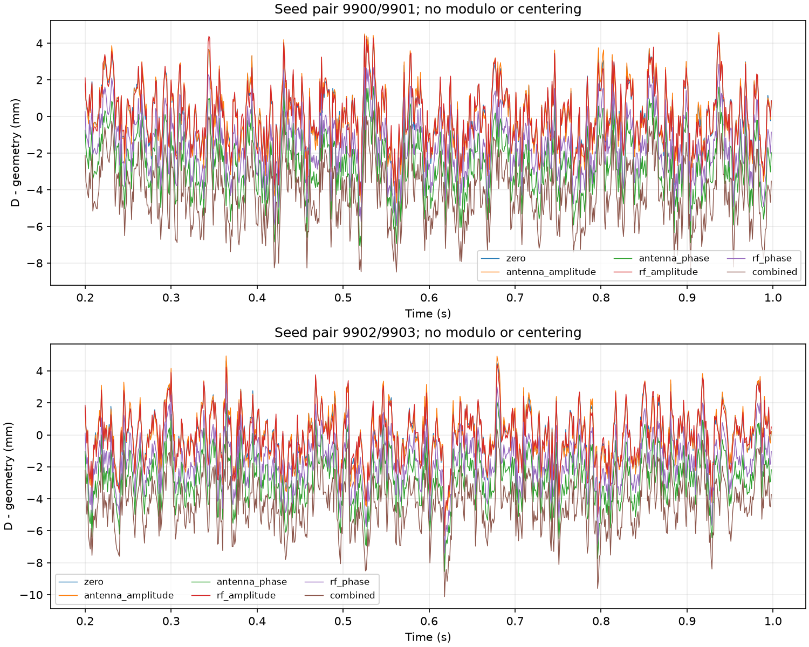

# 无多径 SDCP：天线与 RF 幅相偏差

## 结论

已将天线和 RF 的固定幅值、相位偏差分别接入信号链，并完成六场景×两组噪声对、每组 1 秒的独立 RF/DFE/跟踪仿真。本轮用于评估的 SDCP 从累计 NCO 直接计算，不取余、不重新 unwrap、不减各场景的参考均值、不按真值选择整数分支。

本批零偏差对照的几何补偿残差标准差为 1.581～1.615 mm；四项偏差同时开启后为 1.631～1.709 mm，均值为 −4.327～−4.242 mm，最大绝对残差为 8.551～10.122 mm。相对同噪声零偏差对照，均值变化 −4.249～−4.236 mm，与注入总相位 +8° 对应的 −4.229 mm 接近。

因此，当前模型下固定相位偏差主要表现为固定 SDCP 偏置，不能只看标准差评价误差。天线衰减增加了本批时间波动，RF 增益不能补回此前丢失的信噪比。以上为设定参数下的仿真结果，不是硬件幅相误差指标或检测可靠性认证。

## 模型与注入位置

信号经过以下环节：各天线几何响应及方向图 → 天线残余复增益 → 耦合及历史 channel_* 响应 → 各自 RF 噪声与标称增益 → RF 残余复增益 → 限幅/ADC → 各自 DFE → 独立捕获与 DLL/FLL/PLL。

每级残余复增益为 `10**(amplitude_error_db/20) * exp(j*phase_error_deg*pi/180)`。

- 天线：`AntennaState.amplitude_error_db` 和 `phase_error_deg` 按名字配置，未指定的天线取零。true_state 与 assumed_state 独立。残余乘子叠加于现有方向图，不替代已有参数化/实测方向图支持。
- RF：`RFConfig.amplitude_error_db` 和 `phase_error_deg` 为标量或按输入通道行排序的元组。偏差作用于等效输入信号和噪声、标称增益之后、限幅与量化之前。它代表固定噪声系数下的等效输出偏差；若改变具体 LNA 增益/噪声系数，仍应修改 RFStage 重新计算级联噪声。
- 本轮历史 `phone.channel_*` 幅相偏差与延迟均为零，避免重复计算；新增字段的通用默认值也为零，非零值由本研究入口明确启用。

天线衰减作用于入射信号，而现有 RF 等效噪声模型的噪声随后加入。RF 增益同时放大信号和噪声；即使天线 −1 dB 与 RF +1 dB 恢复了信号幅值，也不等于恢复原有信噪比。此模型没有细分外部天线噪声温度、无源损耗热噪声和接收机各级噪声源。

## 实验设置

GPS L1 C/A、PRN1、RF 33 MHz、IF 4.092 MHz、DFE 抽取 5、跟踪 6.6 MHz。TL/TR 两根点天线相距 75.9 mm，固定方位角 30°、仰角 60°，信号功率 −128.5 dBm、多普勒 1500 Hz，保持现有滤波/量化/环路参数。无干扰、无多径、零人为时延、共享理想时钟。两噪声对为 9900/9901、9902/9903，各场景复用同组 RNG 种子以便配对比较。

TL 四项偏差均为零，TR 条件如下，**数值均为人为敏感性试验设定，未引用厂家或实测数据**：

| 场景 | 天线幅值 dB | 天线相位 ° | RF 幅值 dB | RF 相位 ° |
|---|---:|---:|---:|---:|
| zero | 0 | 0 | 0 | 0 |
| antenna_amplitude | −1 | 0 | 0 | 0 |
| antenna_phase | 0 | +5 | 0 | 0 |
| rf_amplitude | 0 | 0 | +1 | 0 |
| rf_phase | 0 | 0 | 0 | +3 |
| combined | −1 | +5 | +1 | +3 |

每场景重新生成并处理两个 RF 通道，共 24 次单通道 RF/DFE/跟踪处理。并非在 SDCP 结果上直接加偏差。所有场景从开始就存在设定偏差；本轮不测试中途跳变、温漂或动态方向图。启动段逐历元历史保留，主统计固定使用 200～998 ms，每 1 ms 一个时刻，共 799 点。

## SDCP 定义及几何项

用对应积分块的起始累计 NCO 相位和频率，在同一物理时刻计算各通道相位，不跨反馈跳变作线性插值。距离符号采用：

`D(t) = −λ[φ_TR(t)−φ_TL(t)]/(2π)`；`r(t)=D(t)−g`。

几何项由单独的天线位置与方向直接计算，不从包含硬件偏差的有效导向矢量提取，因此不会把新增偏差误当作几何项补偿掉。本信号源的几何 NCO 相位为 `−2π*b·u/λ`，故本表距离符号下 `g=+32.865664 mm`。早期双跟踪基线按正 NCO 相位换算，几何值为 −32.865664 mm；两种符号不能混用，标准差和绝对值不受整体变号影响。

原始累计相位的整周/半周常数均保留，本批恰好获得与几何相近的初始分支，不意味着一般捕获都能唯一确定分支。跨场景配对差仅为事后敏感性评价，不是实际接收机可用的干净对照输入。主残差不减通道偏差真值；理论注入量只用于解释结果。

## 全部主结果

下表为 `r=D−g`，单位 mm。标准差采用 ddof=0，所有有限点参加统计，不通过剔除大残差使曲线变好。最后一列比较同一噪声对下的零偏差控制记录。

| 噪声对首种子 | 场景 | 均值 | 标准差 | RMS | 最大绝对值 | 相对 zero 的均值变化 |
|---|---|---:|---:|---:|---:|---:|
| 9900 | zero | −0.006 | 1.615 | 1.615 | 4.451 | 0.000 |
| 9900 | antenna_amplitude | −0.016 | 1.712 | 1.712 | 4.728 | −0.011 |
| 9900 | antenna_phase | −2.653 | 1.632 | 3.114 | 7.110 | −2.647 |
| 9900 | rf_amplitude | +0.016 | 1.612 | 1.612 | 4.461 | +0.021 |
| 9900 | rf_phase | −1.595 | 1.625 | 2.277 | 5.957 | −1.590 |
| 9900 | combined | −4.242 | 1.709 | 4.573 | 8.551 | −4.236 |
| 9902 | zero | −0.078 | 1.581 | 1.583 | 6.139 | 0.000 |
| 9902 | antenna_amplitude | −0.085 | 1.669 | 1.671 | 6.332 | −0.006 |
| 9902 | antenna_phase | −2.730 | 1.574 | 3.151 | 8.541 | −2.651 |
| 9902 | rf_amplitude | −0.113 | 1.566 | 1.570 | 5.995 | −0.035 |
| 9902 | rf_phase | −1.680 | 1.557 | 2.290 | 7.397 | −1.602 |
| 9902 | combined | −4.327 | 1.631 | 4.624 | 10.122 | −4.249 |

全部 12 组均有 799 个有限共同历元，两路质量条件同时通过 799/799：`phase_lock_metric >= 0.8` 且 `abs(pll_error_rad) < π/2`。24 次 RF 的硬阈值饱和比例均为零；默认软限幅仍然存在。质量通过表示本批指标没有拒绝这些点，不证明信号真实性，也不构成完备的整周/半周连续性证据。



## 结果说明与边界

1. +5° 天线相位应引入 −2.642968 mm，仿真配对均值变化为 −2.647002/−2.651363 mm；+3° RF 相位应引入 −1.585781 mm，得到 −1.589819/−1.601500 mm。合并 +8° 应引入 −4.228748 mm，得到 −4.236041/−4.248738 mm。差值包含噪声、量化和环路响应，不把它解释成校准精度。
2. 固定幅值偏差本身没有注入相位。天线 −1 dB 后两组标准差均有所上升；RF +1 dB 未产生毫米级的均值移动。这里未出现过载，不能据此外推任意增益差都无害。
3. 固定相位偏差不会通过延长平均窗口自然消失。若再减各场景自己的均值，会把本轮特意加入的硬件偏置隐藏；本报告未这样处理。
4. 单颗卫星、固定方向、单频的 SDCP 只观察到这两级相位偏差的合计，无法仅靠一个相位差拆出天线与 RF 分别偏了多少。分级校准需要额外测量或已知激励，本轮未实现校准。
5. 本批不取余的零偏差标准差约 1.6 mm，与早期取余基线的约 2.2 mm 不构成算法改进对比：噪声记录、配置来源和共同时间网格不同。本轮也没有替换历史 SDCP 检测入口；历史 `phase_difference_rad`、`all_epochs` 等兼容统计仍含旧处理，不能用于本报告的未取余结论。
6. 未验证真实方向相关 PCV、安装差异、温漂、RF 群时延/频响、独立本振漂移、多星多频或实际欺骗。当前只证明固定幅相误差能穿过完整链路，并呈现预期数量级的相位差变化。

## 数据、复现与自查

方案见[验证设计](../validation/2026-09-13-sdcp-hardware-bias-plan.md)。实现入口为 `python_sim_simplified/audit_sdcp_hardware_bias.py`，参数用法见[代码目录说明](../../python_sim_simplified/README.md)。

```powershell
python python_sim_simplified/audit_sdcp_hardware_bias.py --output <不存在的新目录>
python docs/reports/data/2026-09-13-sdcp-hardware-bias/verify.py
python -m pytest python_sim_simplified/tests -q
```

归档含 [配置与源码哈希](data/2026-09-13-sdcp-hardware-bias/manifest.json)、12 个配置文件、12 个全时段跟踪记录、[汇总](data/2026-09-13-sdcp-hardware-bias/summary.json)、未取余曲线数组与图。RF 样本不重复保存，可由配置与种子重新生成。数值图已检查。

独立核验从保存的块起点、NCO 相位/频率逐点重建全部 12 条记录，核对各条 15 个统计量、质量计数和曲线数组，并核对 29 个归档文件哈希，结果见[核验记录](data/2026-09-13-sdcp-hardware-bias/validation_checks.json)。归档哈希不包含后生成的核验记录自身。

新增三项测试先失败后通过，覆盖天线实际/估计分离、RF 对信号及噪声的复增益位置、3 周突变在原始输出中保留。相关 18 项测试通过；最终全套 **159 passed，1 warning，100.32 s**。warning 为既有无噪声测试 C/N0 除零，未新增该行为。
