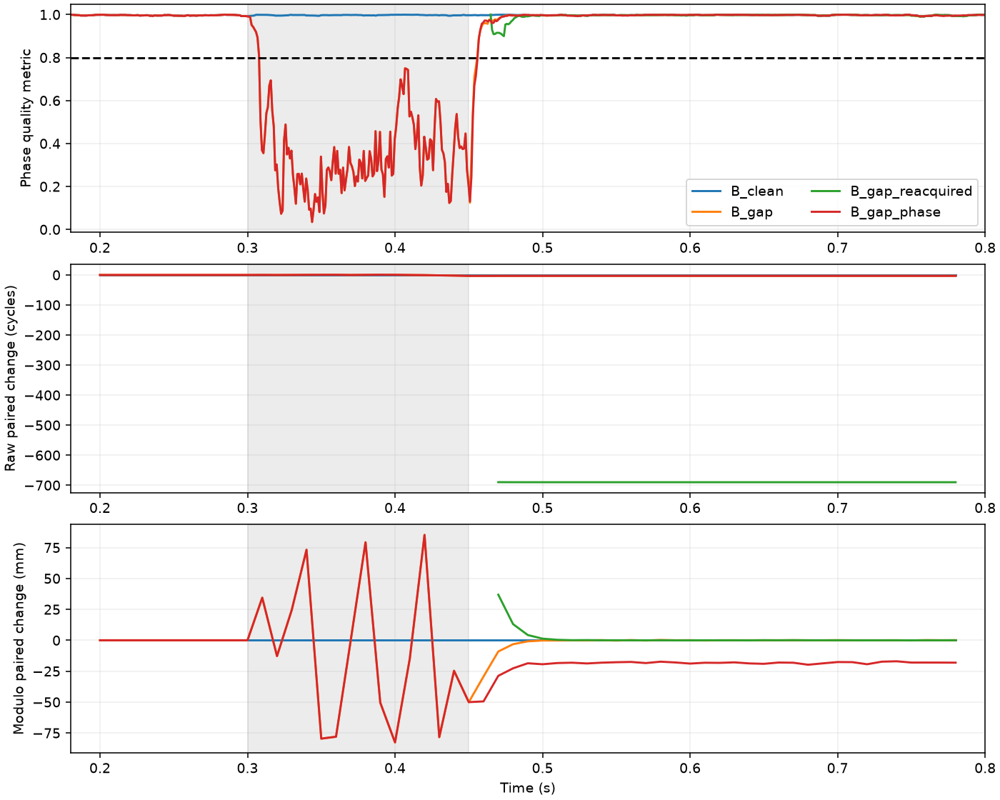

# SDCP真实跟踪链路：单路中断、环路恢复与重新捕获

2026-09-13。结论：本批RF/DFE/跟踪记录直接证明，全局`tracking`和恢复后的逐历元质量通过都不能保证旧相位弧连续。取余SDCP可以隐藏整周变化。需要把观测质量、相位弧状态和信号可信度分开管理。

## 1. 本轮验证什么

上一轮[SDCP基础审计](2026-09-13-sdcp-observation-contract.md)是在观测域验证语义。本轮在RF噪声之前中断一路源信号，再运行原有RF、DFE、捕获和跟踪，检查数值、质量和相位变化。没有注入欺骗，也没有以人造载波观测代替环路。

## 2. 实验过程

- GPS L1 PRN1、800ms、75.9mm基线；33MHz RF、DFE抽取5、6.6MHz跟踪。
- 两路各自运行RF/DFE和环路，A噪声种子9800，所有B变体使用9801作配对对照。
- 四条RF记录：A连续、B连续、B在300～450ms信号为零、同一中断但恢复时B信号增加0.6rad相位。
- 中断发生在源端，热噪声仍由后续RF加入；不是将带噪采样直接清零。无多径、无外部干扰。
- 两个中断B记录分别再取460ms后的同一DFE后缀，重新执行捕获并建立新环路。重捕的启动时刻由实验指定，不是已实现自动失锁检测与重捕调度。
- 新环路记录的历元样本索引加回后缀起点，统一到全局时间再重建载波距离；不强行拟合新旧整数起点。

共4条新RF链路记录、6条跟踪历史。单PRN，不进行PVT，不能据此解释位置误差。系统公共时钟、通道参数仍是现有理想配置，不代表实际硬件认证。

## 3. 跟踪状态与质量指标

当前`tracking.track`在处理完整输入且没有数值失败时返回全局success=true、status=tracking；没有在低质量持续时自动拆弧、停止或重捕。逐历元另有质量量。

按当前定位入口所用条件：phase_lock_metric≥0.8且|PLL误差|<π/2，得到：

| 记录 | 中断内部320～430ms通过历元/总历元 | 恢复尾段650～790ms通过历元/总历元 |
|---|---:|---:|
| A连续 | 110/110 | 140/140 |
| B连续 | 110/110 | 140/140 |
| B中断，旧环路继续 | 0/110 | 140/140 |
| B中断后重新捕获 | 不覆盖该时段 | 140/140 |
| B中断＋恢复相位变化，旧环路继续 | 0/110 | 140/140 |
| B中断＋恢复相位变化，重新捕获 | 不覆盖该时段 | 140/140 |

六条历史的全局状态均为tracking。中断内部B的prompt幅度中位数约119.6，对照约1327.2；逐历元质量在本批中断内部能拒绝噪声段。这不等于已经验证失锁检测延迟，也不说明全部边缘历元会被及时拒绝。

## 4. 恢复后SDCP变化

构造距离符号D=L_B−L_A。比较各变体D与相同种子的连续B对照D；使用650～780ms的14个10ms共同历元。没有减恢复后均值或人为对齐整数。

| B处理方式 | 原始单差相对连续对照的均值变化 | 模λ后均值变化/mm |
|---|---:|---:|
| 连续对照 | 0 | 0 |
| 中断，旧环路继续 | −0.570874m，约−3周 | +0.0075 |
| 中断后重新捕获 | −131.302632m，约−690周 | +0.0026 |
| 中断＋0.6rad相位变化，旧环路继续 | −0.589090m | −18.2089 |
| 同上，重新捕获 | −131.320854m | −18.2201 |

−690周主要反映新环路从后缀重新初始化后的累计相位起点差，不能称为接收机位置错了131m，也不能把它和旧环路的周跳等同。它证明新旧弧不可直接拼接。

0.6rad源相位增加在当前负距离相位约定下，预期距离变化约−18.17mm；两种跟踪方式均保留约−18.2mm。这个信号变化可以模拟恢复后相位关系变化，但不是欺骗身份认证实验。

无额外相位变化时，模λ结果接近零，只说明本批尾段小数周恢复到接近连续对照；**不能反向证明整数弧连续**。两条配对记录共享噪声，尾段差分标准差很小也不能称为独立接收链路达到0.04～0.06mm绝对精度。

图中灰色为源信号中断时段。原始相位图的不同整数起点与取余图形成对照；质量图展示恢复后均可通过，不代表已验证信号来源。

## 5. 对SDCP使用条件的影响

必须至少区分三个判断：

1. 当前历元能否形成有质量依据的观测；
2. 当前观测是否属于原来那条可连续比较的相位弧；
3. 当前跟踪成分是否满足信任条件。

质量通过只支持第一项的一部分。出现中断、重捕或状态不明时，原参考不能仅因质量恢复而自动继续。新弧可能恢复正确小数周，也可能带着新偏差，两者都不能依赖去均值强制对齐来宣称正常。

对于只使用模λ的小数周一致性检查，某些整数变化本身不改变统计量；应明确该算法主动舍弃了整数信息，不能再承担连续载波监测或跨弧载波定位。完整相位弧状态仍需保留给其他模块。

## 6. 已完成与未完成

已完成真实RF/DFE链路的单路源中断、旧环路继续、新捕获环路及恢复相位变化对照。没有修改默认跟踪或SDCP策略，也没有新加经验门限。

尚未完成：多种子、不同强度/中断时长、双路共同失锁、数据位/半周变化、捕获到另一真假分量、自动失锁与恢复状态机、相位分支重新确认以及PVT影响。它们应按场景文档继续验证，不能从本批单PRN结果推广。

下一项应先建立可追溯的相位弧标识与失效原因，将“恢复观测”和“允许延续旧参考”分开；不把人工指定的重捕时刻或仿真真值当作运行时可用依据。

## 7. 证据与复现

- [场景、种子与源码哈希](data/2026-09-13-sdcp-tracking-gap/manifest.json)
- [逐时段质量与相位结果](data/2026-09-13-sdcp-tracking-gap/summary.json)
- 同目录6份NPZ跟踪历史及共同历元距离，保留原始NCO、相关值和质量量。
- [独立核查记录](data/2026-09-13-sdcp-tracking-gap/validation_checks.json)：9项原实验文件哈希、5组配对统计、18个质量计数核查通过；附图作为后续补充保留独立哈希。

从根目录执行：`python python_sim_simplified/audit_sdcp_tracking_gap.py --output <新的目录>`。输出目录须不存在，避免覆盖历史数据。
