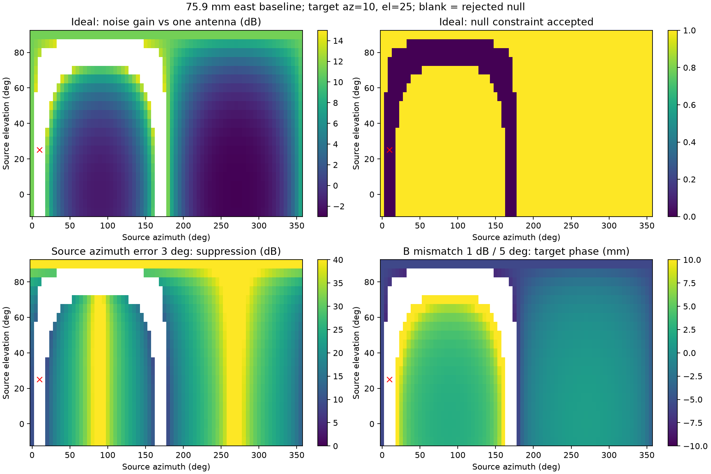

# 已知方向保护与欺骗源空间抑制：能力及失效边界

本轮执行已批准计划的空间能力扫描，并检查最简单的数据估计候选。未执行抑制后RF跟踪/PVT，原因是候选来源估计在等功率和相干场景失败，不能拿它当已验证来源继续宣称实际抗欺骗收益。

## 方法

复用 `diversity.combine_lcmv`，不修改默认流程。L1、75.9mm东西基线、理想等增益天线；方位角从北向东增加。空间响应为 `[1, exp(i 2π b cos(el) sin(az)/λ)]`。沿用前轮8颗卫星方向，每颗扫描欺骗源方位0～355°、仰角−10～90°、5°步长，共12096个目标/来源组合；四类条件共48384行。

每颗目标各自保护，不使用一个权重保护全部天空。理想来源方向用于建立能力上限；单位协方差分离几何作用，噪声为独立等方差通道输出噪声。通道失配只施于实际信号响应，噪声指标仍以该接收输出噪声定义；不是整条硬件增益变化的完整噪声模型。

空间相关性大于0.99时现有实现拒绝零陷，回退MVDR；报告把这些点列为拒绝，不能把回退算抑制成功。网格包含同一投影的重复方向，不是均匀立体角抽样，比例不代表实际发生概率。

## 结果

| 指标 | 结果 |
|---|---:|
| 接受零陷组合 | 10690/12096，88.38% |
| 接受点的噪声增益95分位/最大值，相对单天线 | 11.15/14.00 dB |
| 来源方位误差+3°时，抑制量5分位/中位数 | 14.52/28.37 dB |
| 目标方位误差+3°时，目标幅度误差绝对值95分位 | 1.73 dB |
| B路信号增益+1dB、相位+5°时，抑制量5分位/中位数 | 8.17/18.67 dB |
| 同一通道失配下，目标相位误差绝对值95分位 | 10.16 mm |

理想接受点满足单位目标响应及零陷，数值图中的240dB只是1e−12幅度显示下限，绝非硬件能实现240dB抑制。

以抑制≥20dB、目标幅度偏差≤1dB、相位偏差≤3mm、噪声增益≤3dB作为**示例工程筛选条件**，理想条件仅56.69%的全部网格通过，通道失配时35.12%。这些是明确给定的研究筛选线，不是产品验收指标，也未据结果调参。

特别反例：目标(10°,25°)和来源(170°,25°)方向相差很大，但在东西基线上的投影完全相同，空间响应完全相同。双天线无法在保护前者时消掉后者。

红叉为目标方向；空白为零陷被拒绝。噪声代价说明：数学上约束能解，不代表适合放到接收跟踪链路里。

## 数据估计候选为什么没有直接接到RF

另做复数快拍模型，目标(10°,25°)，来源(100°,10°)，种子9710；每类300次，每次2000快拍，两路复噪声功率0.0025。将样本协方差主特征向量当来源响应，再用LCMV保护真实目标。它是需要被检验的朴素候选，不是已认证的欺骗测向。

| 信号关系 | 欺骗/真实功率比 | 来源抑制中位数 |
|---|---:|---:|
| 独立复相位快拍 | 0dB | 约0dB |
| 独立复相位快拍 | +10dB | 24.84dB |
| 完全相干，固定相位差0.7rad | 0dB | 约0dB |
| 完全相干，固定相位差0.7rad | +10dB | 约10dB |

完全相干时，主特征向量趋于 `a_target + sqrt(P)*exp(iφ)*a_source`，它是混合响应。对它打零陷，即使数学上目标独立响应仍为1，也会让真实与残余欺骗分量相互抵消，不能视为真实波形成功恢复。独立快拍模型也不是实际GNSS同PRN信号；这些结果只用于反例和候选筛选，不作为RF检测率。

因此，现阶段不采用“协方差最大特征向量就是欺骗方向”接入跟踪。下一步需要利用逐PRN相关器结构、时延/频率差或其他独立信息来区分混合响应；在来源估计可用之前，理想方向RF对照只能标为上限，不能替代实际方案。

## 证据与复现

- [扫描参数、列定义及统计](data/2026-09-13-spoofing-spatial/summary.json)，同目录含完整NPZ、能力图、哈希。
- [来源估计反例](data/2026-09-13-spoofing-spatial-estimation/summary.json)，同目录保存各类300次原始统计及哈希。
- 扫描复现：`python python_sim_simplified/audit_spoofing_spatial.py --output <新的输出目录>`。
- 本轮复用的6项空间合并测试全部通过；没有修改合并算法，也没有新增RF或定位性能声明。

当前判断：保留方向保护路线，但必须限制噪声代价并控制响应失配；双天线存在明确投影盲区。尚未完成已批准后续步骤中的可靠来源估计和抑制后跟踪/PVT对照，不将本报告标为整个空间抗欺骗研究完成。
