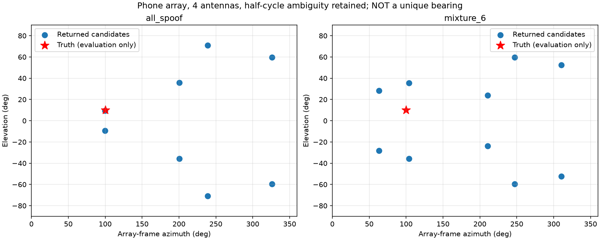

# 手机尺寸阵列测向与星间双差研究

日期：2026-09-14。原尺寸 75.9 × 160.9 mm；不使用 IMU。本轮为新增方向候选估计、观测模型验证和既有数字 RF 记录回放，没有重新采集硬件数据。

## 结论

已实现方向候选输出，但尚未实现可信唯一方向。星间双差可以消除 PRN 共有的通道项；同源信号的方向项也随之消失。当前圆离散度本来就具有这一偏差不变性，改用显式双差没有明显检测收益。可信参考星可以提供缺失的方向锚点，但其真实性及阵列坐标系中的方向必须由外部保证。

## 数学关系与实现

令载波距离天线单差为 d_s = −b·u_s + B + λN_s + e_s。星间双差为 D_sr = d_s−d_r = −b·(u_s−u_r) + λ(N_s−N_r) + e_s−e_r。

- B 是同一基线、同一历元各 PRN 共有的偏差，会被消掉；逐 PRN 的固定偏差、方向相关相位中心误差或多径不会自动消掉。双差的噪声和共享参考相关性仍存在。
- 若两个信号确实同源，u_s=u_r，方向项为零。双差可用于判断同源，不能从零反推出发射机方向。未知通道偏差与未知方向可互相补偿，归档中给出了两个不同方向但观测完全相同的确定性反例。
- 若参考星 r 独立可信且 u_r 已知，D_sr−b·u_r 可恢复目标的 −b·u_s 项，再拟合候选方向。这里不提供参考星认证能力。
- 原统计为 1−|mean(z_s)|，z_s=exp(4jπd_s/λ)。新统计是各 PRN 对 1−cos(4πD_sr/λ) 的均值，等于 S/(S−1)·(1−|mean(z_s)|²)。两者都对同一个公共相位旋转不变；新统计范围和聚合方式不同，因此阈值分别校准。

测向使用已校准天线单差，不使用最终离散度得分。上半空间 5° 网格找局部极小，再连续优化，并显式补上平面上下镜像。半周未解时 harmonic=2，保留对应的额外相位别名；harmonic=1 仅在极性已知的模型条件下运行。数值搜索不是候选完备性的数学证明。

拟合阈值为残差 RMS 8 mm，候选保留容差为相对最佳值 2 mm，均为原型工程参数，不是校准过的置信概率。无通道校准输入返回 uncalibrated；两天线返回 rank_deficient；缺测返回 invalid_observation。single_upper_candidate 仍可能有上下镜像，绝不表示唯一三维解。角度属于阵列坐标系；解释为地理方位需要已知安装朝向。

## 星间双差的检测对照

每配置独立 5000 个正常事件校准至名义 1% 虚警率；22 场景各 5000 个留出事件。种子和输入与原尺寸旧实验配对，原判据逐事件得分与旧归档完全一致。下表为原判据 → 双差判据（%）。LOS/clustered_los 行为虚警。

| 场景 | 判据 | 三天线 | 四天线 |
|---|---|---:|---:|
| los | global | 0.88 → 0.92 | 0.92 → 0.98 |
| los | cluster3 | 0.92 → 0.92 | 0.90 → 0.90 |
| partial_3 | global | 7.84 → 8.08 | 8.38 → 8.74 |
| partial_3 | cluster3 | 79.70 → 79.80 | 94.60 → 94.68 |
| partial_4 | global | 24.18 → 25.02 | 28.56 → 28.02 |
| partial_4 | cluster3 | 97.06 → 97.08 | 99.74 → 99.76 |
| mixture_6 | global | 96.64 → 97.60 | 97.00 → 97.92 |
| mixture_6 | cluster3 | 55.34 → 55.14 | 35.34 → 35.42 |
| clustered_los | global | 8.20 → 8.16 | 9.38 → 9.14 |
| clustered_los | cluster3 | 68.86 → 68.80 | 84.58 → 84.70 |

共同通道偏差注入（包括逐历元变化）对两种判据的影响都只有浮点舍入量级；没有证据表明显式星间双差额外解决了当前判据的共同偏差问题。完整计数、配对差值及区间保存在 dd_comparison.json。未对多种判据做未经校准的融合性能声明。

## 测向观测模型

100 个随机方向（仰角 10° 以上）、每个方向 10 历元、5 个同源 PRN、每通道约 2.12 mm 相位噪声。下面的误差是“返回候选集合中最接近真方向者”的角误差，由事后真值计算，绝不表示算法已选出该候选。

| 条件 | 天线数 | 仅一个上半空间候选 | 候选集合误差中位/P95（°） |
|---|---:|---:|---:|
| resolved_polarity | 3 | 28/100 | 0.34 / 1.72 |
| resolved_polarity | 4 | 28/100 | 0.25 / 0.85 |
| half_cycle | 3 | 0/100 | 0.35 / 1.71 |
| half_cycle | 4 | 0/100 | 0.26 / 0.85 |
| biased_wrong_zero | 3 | 0/100 | 15.63 / 40.99 |
| biased_wrong_zero | 4 | 0/100 | — |
| biased_calibrated | 3 | 0/100 | 0.35 / 1.71 |
| biased_calibrated | 4 | 0/100 | 0.26 / 0.85 |

半周未解时 100/100 个方向均存在多个上半空间候选。已校准四天线的候选集合覆盖较好，不等于唯一定位。错误地把 12/−18/25 mm 通道偏差当作零：三天线可给出残差合格但错误的候选；本次四天线则 100/100 拒绝拟合。第四通道增加一致性检查，但不能据此保证总能发现错误校准。

## 既有 RF 记录的测向回放

仍使用原尺寸六场景、两噪声种子、每条记录四个相关窗口。使用另一个 LOS 场景的 seed 610000 校准公共通道偏差（只有攻击 seed 620000 的噪声独立于校准种子；同种子结果不作独立统计推断）；参考天空与安装方向为模拟可信条件。未利用欺骗源真方向校准或选择候选。最佳三 PRN 由当前判据数据选出，不读取欺骗 PRN 标签。

为研究覆盖，原 global 或 cluster3 报警就触发测向，这是回放分析条件，不代表已校准的融合检测器。下表使用 LOS 校准模式；误差仍为候选集合的事后最小误差。

| 场景 | 天线数 | 有候选/总窗口 | 候选集合误差中位/P95（°） |
|---|---:|---:|---:|
| all_spoof | 3 | 8/8 | 1.29 / 1.98 |
| all_spoof | 4 | 8/8 | 0.72 / 1.32 |
| partial_3 | 3 | 8/8 | 2.63 / 4.95 |
| partial_3 | 4 | 8/8 | 3.17 / 3.74 |
| partial_4 | 3 | 8/8 | 3.08 / 5.77 |
| partial_4 | 4 | 8/8 | 2.17 / 3.14 |
| mixture_6 | 3 | 8/8 | 30.41 / 30.72 |
| mixture_6 | 4 | 8/8 | 26.35 / 26.74 |

以上全部返回多解；纯同源四天线每窗约 4–5 个上半空间候选，还带有下半空间镜像。正常 LOS 不触发；等功率真假混合全部未知。强 6 dB 混合虽然能拟合，候选集合也偏离真方向约 26–30°，说明跟踪相位不一定代表真实欺骗来波方向。

## 以 PRN 8 作方向参考的双差测向

固定选择 PRN 8 为参考，并假定其方向为合成星历方向。它在 partial_3/partial_4 中确实真实，在 all_spoof/mixture 中不满足该假设；真伪标签仅用于事后评价。参考星进入待测三 PRN 组合时拒绝计算，不悄悄换一颗已知真星。

| 场景 | 天线数 | 有候选/总窗口 | 候选集合误差中位/P95（°） |
|---|---:|---:|---:|
| all_spoof | 3 | 3/8 | 10.61 / 10.74 |
| all_spoof | 4 | 4/8 | 10.82 / 10.90 |
| partial_3 | 3 | 8/8 | 3.47 / 4.46 |
| partial_3 | 4 | 8/8 | 4.62 / 5.59 |
| partial_4 | 3 | 8/8 | 7.25 / 8.30 |
| partial_4 | 4 | 8/8 | 2.75 / 4.34 |
| mixture_6 | 3 | 8/8 | 89.01 / 89.21 |
| mixture_6 | 4 | 0/8 | — |

已验证额外注入公共通道偏差不会改变双差参考法的候选集合。但真实参考星也有跟踪误差，且共享参考会增加相关误差，所以本次没有一致的精度提升。参考被污染时可出现残差合格的错误方向：mixture_6 三天线候选集合最小误差约 89°；四天线则拒绝拟合。不能把“能计算双差”当作参考星可信。

## 结论及下一步边界

当前可交付的是可复现的方向候选原型和星间双差对照。没有得到可靠唯一方向，也没有解决真假混合测向。优先需要独立通道/相位弧校准和半周分支约束；若采用参考星法，还需独立可信的参考方向。不要通过使用仿真真方向挑选候选或事后放宽拟合阈值制造精度收益。

## 验证、代码与来源

数据核验 8172 项通过：旧归档哈希、执行源码、阈值、模型检测计数、旧判据逐事件一致性、显式双差公式以及模型/RF/参考星法每个返回方向候选的残差重算。数据和复现命令见[归档说明](data/2026-09-14-doa-dd/README.md)。完整回归 197 项通过，1 条既有无噪声 C/N0 除零警告；实际输出见 tests.log。

- [spatial_direction.py](../../python_sim_simplified/spatial_direction.py)：双差统计、校准、候选拟合。
- [spatial_reference_direction.py](../../python_sim_simplified/spatial_reference_direction.py)：可信参考星双差测向。
- [公开双差检测研究，Journal of Navigation 2018](https://www.cambridge.org/core/journals/journal-of-navigation/article/abs/gnss-spoofing-detection-technique-using-fraction-parts-of-doubledifference-carrier-phases/43726DFB962005448F3C2A412D723151)：单发射源下双差用于检测，不要求估计真实方向。
- [国防科技大学学报：天线阵列载波相位双差检测](https://journal.nudt.edu.cn/ch/reader/view_abstract.aspx?doi=10.11887%2Fj.cn.201404010)：公开同源检测原理。
- [ION 2014 双天线相位检测](https://www.ion.org/publications/abstract.cfm?articleID=12530)：单源相位关系及真假混合的跟踪/分类困难。

本地统计量、网格搜索和容差是自主实现，未声称复现 GPSPATRON 专有算法或上述论文的完整实现。
