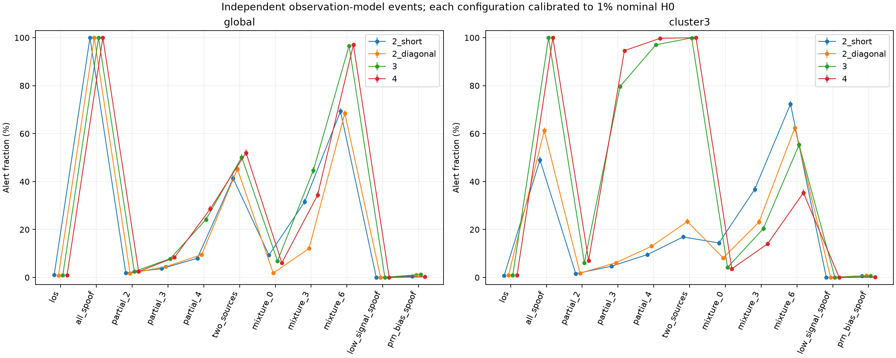
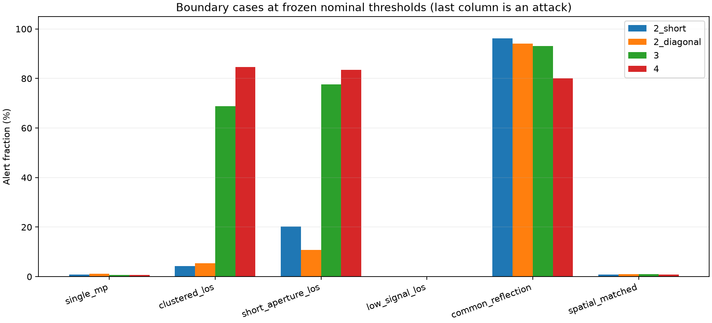
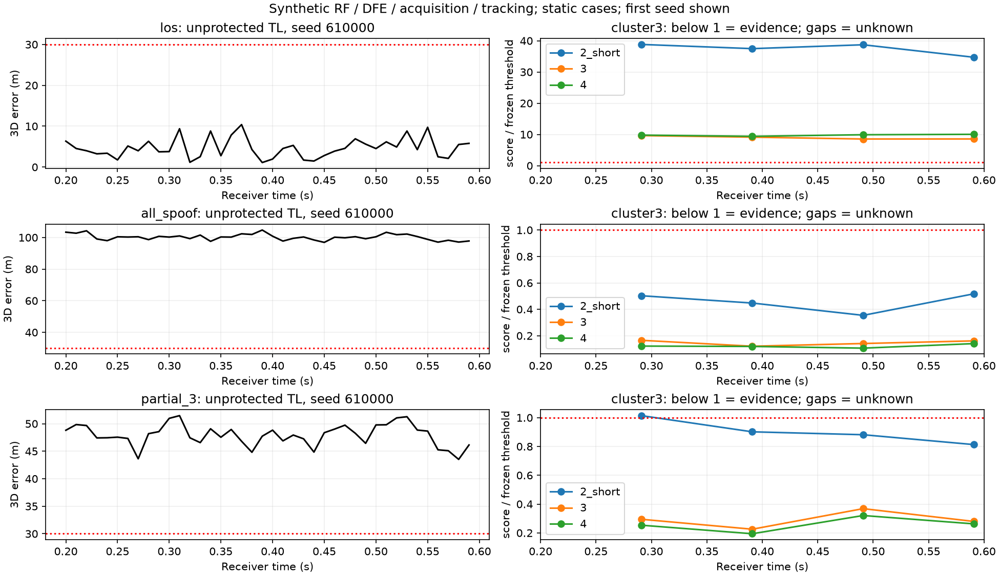
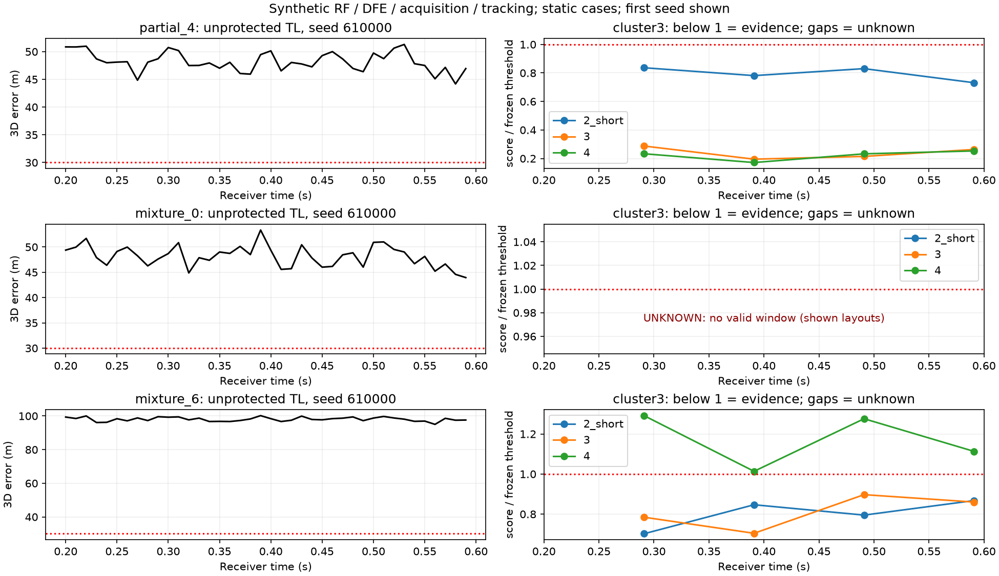

# GPSPATRON 公开原理启发的 2–4 天线抗欺骗：本地实现、验证与收益边界

2026-09-13 检索、开始实现；2026-09-14 完成验证。数据目录保留开始日期。

## 1. 结论与证据等级

本地已经实现多天线空间相位检测、冻结门限、接收记录适配和因果输出门控。**在同一标称1%正常窗口虚警目标下，三/四天线的三星同源簇判据对部分同源欺骗显示明显收益；增加天线并非在所有场景下都有效。**

观测模型中3/8部分欺骗检出率：双短基线 4.70%，三天线 79.70%，四天线 94.60%。对应正常留出虚警：0.84%、0.92%、0.90%。本轮完整RF链路结果见第6节，不能用观测模型的检出率替代RF结果。

RF三假星场景共8窗，三星簇在2/3/4天线下分别告警 6/8、8/8、8/8；因果门控后保留的危险位置分别为 20、0、0 个（各原有80个>30 m位置）。但混合+6 dB场景该判据三天线8/8、四天线0/8，是明确反例。四天线硬件不能代替适当的判据选择。

本工作是 GPSPATRON **公开空间分析原理的本地研究实现**。公开资料说明三天线测量载波相位关系、分析空间一致性，未公开产品统计量和门限；本文的圆统计、三星扫描、模型及门限均为本地选择。不是 GP-Cloud 复刻、产品性能背书或真实硬件验证。[GPSPATRON公开方法](https://gpspatron.com/coherent-gnss-spoofing-detection-multi-antenna/)

研究严格分成：A.代数/接口测试；B.独立事件观测模型；C.数字合成RF→DFE→捕获→独立跟踪→观测→检测→门控回放。没有多天线实测IQ，没有真实时钟守时，没有抑制后定位恢复。

## 2. 方法与实现

### 2.1 输入与信号假设

输入载波距离矩阵 `carrier_m[t, antenna, PRN]`、严格对齐的时间戳、同形状布尔有效掩码。默认8颗GPS L1卫星，波长 λ=0.190293672798 m，10 ms输出间隔，10历元为一个100 ms标称窗口（第一至末测量相隔90 ms）。所有通道具有共同采样/频率参考，热噪声独立。不同频段不能直接放入同一统计量。

简化观测为 Lₘˢ(t)=ρˢ(t)−rₘ·uˢ+bₘ(t)+λNₘˢ/2+εₘˢ。真实卫星方向uˢ通常分散；若多个PRN被同一发射源取代，其uˢ相同。逐星公共相位ρˢ在天线间作差时消除；某天线对的公共偏差bₙ−bₘ在圆统计模长中消除。**不减每颗卫星的启动均值**，避免把启动欺骗拟合掉。

### 2.2 全星判据（旧实现的严格扩展）

对每个天线对(m,n)，定义 zₘₙˢ(t)=exp[j·4π(Lₙˢ−Lₘˢ)/λ]。

在PRN集合S上定义 Dₘₙ(S,t)=1−|Σₛ∈S zₘₙˢ(t)/|S||。对窗口内历元和所有天线对平均得到 G(S)。全星分数为 G(全部8星)。分数越低，越符合多个信号共用一个空间相位模式。

两天线全星分数与原 `spoofing.spatial_dispersion` 数学一致，已以随机数据直接回归比较。全星替代容易检出，但部分假卫星的公共模式会被其余真卫星稀释。

### 2.3 新增三星同源簇扫描

枚举8颗卫星的全部 C(8,3)=56 个三元组，计算 C=min₍|S|=3₎ G(S)。同一个三元组必须在整个窗口持续一致，不能逐历元任意换簇。该分数用于发现至少三颗同源PRN，不保证识别具体假星；不输出可据此安全剔除的卫星列表。

两/三/四天线分别有1/3/6个天线对，但通道差分自由度至多为1/2/3，不能把所有天线对视为独立。还需区别几何维度：本项目四角共面，四天线的基线向量秩仍为2；第四天线提供额外带噪观测与冗余，不新增第三个几何测向维度。这里平均全部天线对以避免任意参考天线选择，**不把天线对当作独立试验**。门限针对包含56次搜索的完整统计量标定，控制多重比较影响。

4π而非2π让整数周及半周模糊不改变判决，也使相位空间以λ/2折叠；方向不同但投影等价时可出现混淆。因此这是“同源证据”，不是卫星身份认证。几颗真实卫星方向集中、共同反射也可给出相似证据。

两个判据分别评估、分别给出门限，**没有未经重新标定就做OR融合**。双天线的三星扫描可能因正常天空中的偶然三元组重合而被迫使用很低门限，故甚至不如全星判据；第5节保留这一负面结果。

### 2.4 三态与因果门控

- `1`：分数严格小于冻结门限，存在同源证据；
- `0`：本窗口未见同源证据，**不等于信号已认证**；
- `-1`：时间不连续、缺测、NaN、质量不合格或窗口不完整，无法判断。

任一配置中的任一天线/PRN无效就让整窗unknown，不静默减星或更换天线。窗口判决时刻=最后观测时刻+1 ms保守观测生产延迟；这个延迟不包括实际软件执行和通信耗时。输出门控在判决可用之后才生效，绝不回溯删除已经输出的早期位置。首窗完成前保持unknown；后续沿用最近完成窗口的状态。示例策略仅状态0暂时放行，告警/未知均拦截。一个新无证据窗口即释放，本轮没有认证重捕/恢复状态机。

代码：`python_sim_simplified/spatial_spoofing.py`；旧接口和默认仿真入口保留。

## 3. 配置、标定与实验设计

使用现有 `presets.mate70_phase_centers()` 中75.9×160.9 mm四角矩形；名字沿用仓库，并不代表真实手机硬件数据。2短基线=TL/TR，2对角线=TL/BR，3=TL/TR/BL，4=全部。对角线约177.9 mm，用于区分更大孔径与更多空间约束的收益。3和4具有相同最大孔径。

每个独立事件先生成同一套四天线数据，再取配置子集，确保噪声、天空、攻击条件配对。正常天空仰角正弦在sin15°至1之间均匀，方位均匀，阵列姿态为均匀随机旋转；这是假设的评估总体，不是实际卫星星座轨道统计。

每种配置/判据使用5000条独立H0事件，取下侧1%经验分位数（`method='lower'`，告警使用严格小于）。留出每场景5000条事件，22场景共110000条四天线事件，8种配置/判据组合使用相同事件。标定种子200000起；评估300000起，每场景跨度10000、每250条一批且批种子递增。空间完全匹配反例特意与正常评估复用同一观测，验证不可辨识性。

| 配置 | 天线 | 全星门限 | 三星簇门限 |
| --- | --- | --- | --- |
| 2_short | TL, TR | 0.197406949 | 0.004283685 |
| 2_diagonal | TL, BR | 0.248840743 | 0.004709827 |
| 3 | TL, TR, BL | 0.396293480 | 0.016342095 |
| 4 | TL, TR, BL, BR | 0.414669896 | 0.019647292 |

标称小角度相位噪声每根天线标准差3/√2 mm，天线对约3 mm；窗口10历元AR(1)系数0.7，不能按10个独立样本估算增益。每条独立事件重新生成几何和噪声，因此Wilson区间以5000个事件为分母。目标1%是标定目标，不是已证明总体虚警≤1%；实际留出虚警与区间如下。

| 场景 | 2短基线：比例 [95% CI] | 3天线：比例 [95% CI] | 4天线：比例 [95% CI] |
| --- | --- | --- | --- |
| 正常天空（虚警） | 0.84% [0.62, 1.13] | 0.92% [0.69, 1.22] | 0.90% [0.67, 1.20] |
| 8/8 全星同源替代 | 49.04% [47.66, 50.43] | 100.00% [99.92, 100.00] | 100.00% [99.92, 100.00] |
| 3/8 部分同源 | 4.70% [4.15, 5.32] | 79.70% [78.56, 80.79] | 94.60% [93.94, 95.19] |
| 4/8 部分同源 | 9.54% [8.76, 10.39] | 97.06% [96.55, 97.49] | 99.74% [99.56, 99.85] |

这也不是长期任务级1%虚警保证。连续窗口存在相关性，长期任务中的至少一次告警概率不能直接等同单窗口虚警率。

## 4. 信号与压力场景

观测模型先构造真实/假信号复相量、加入噪声，再提取相位，而非将真假相位线性插值。混合场景假、真码及多普勒完全重合，并在TL处相位对齐；这只是理想相关器输入模型，没有模拟环路夺取。全替代和部分替代表示已跟踪到相应来源。

覆盖全星替代、2/3/4/6颗部分替代、两源各4星、假/真功率−6/0/+3/+6/+12 dB混合、单星多径、3颗真实卫星方向集中、阵列缩小10倍、低信号、逐星方向相关偏差、第四通道劣化、共同反射及空间匹配攻击。所有压力测试保持原门限，显示分布变化的风险，不用其结果重新选门限。

低信号试验把每根天线相位等效噪声设为20 mm；逐星偏差是在每根天线、每颗PRN加入20 mm标准差的固定偏差，不能当成会被公共通道偏差消除的误差；坏第四通道设为40 mm。非恶意共同反射设为同方向、强于直达10 dB，是来源分类的反例，不意味着正常开阔环境普遍如此。

## 5. 观测模型结果与收益归因

### 5.1 三星簇检测

| 场景 | 2天线短基线 | 2天线对角线 | 3天线 | 4天线 |
| --- | --- | --- | --- | --- |
| 正常天空（虚警） | 0.84% | 0.92% | 0.92% | 0.90% |
| 8/8 全星同源替代 | 49.04% | 61.24% | 100.00% | 100.00% |
| 2/8 部分同源 | 1.58% | 1.80% | 6.10% | 7.06% |
| 3/8 部分同源 | 4.70% | 6.14% | 79.70% | 94.60% |
| 4/8 部分同源 | 9.54% | 13.04% | 97.06% | 99.74% |
| 6/8 部分同源 | 27.54% | 36.60% | 100.00% | 100.00% |
| 两源各4星 | 16.90% | 23.34% | 99.90% | 100.00% |
| 全星真假等功率混合 | 14.38% | 8.16% | 4.20% | 3.62% |
| 全星混合，假/真+3 dB | 36.74% | 23.12% | 20.36% | 14.02% |
| 全星混合，假/真+6 dB | 72.34% | 62.38% | 55.34% | 35.34% |
| 全星混合，假/真+12 dB | 99.54% | 98.98% | 99.28% | 94.84% |



对3/8部分同源，三天线比相同最大孔径的双对角线更好，说明收益不仅来自增加基线长度。四天线与三天线最大孔径相同；额外观测对该场景进一步减少漏检。两颗部分欺骗仍多漏检，因为候选至少要求三颗PRN共同一致。

### 5.2 区分更换统计量与增加天线

| 场景 | 全星2 | 全星3 | 全星4 | 三星簇2 | 三星簇3 | 三星簇4 |
| --- | --- | --- | --- | --- | --- | --- |
| 正常天空（虚警） | 1.10% | 0.88% | 0.92% | 0.84% | 0.92% | 0.90% |
| 8/8 全星同源替代 | 100.00% | 100.00% | 100.00% | 49.04% | 100.00% | 100.00% |
| 3/8 部分同源 | 3.68% | 7.84% | 8.38% | 4.70% | 79.70% | 94.60% |
| 4/8 部分同源 | 8.02% | 24.18% | 28.56% | 9.54% | 97.06% | 99.74% |
| 全星混合，假/真+6 dB | 69.30% | 96.64% | 97.00% | 72.34% | 55.34% | 35.34% |

仅增加天线、继续全星平均，部分欺骗收益有限；同源簇扫描和更多空间观测共同带来主要改善。另一方面，全星同源替代用原全星判据已经100%检出，不能将三星簇在这个场景的表现包装为新增收益。全星真假混合+6 dB时，全星判据比三星簇更好，不能宣布一个判据全面替代另一个。

| 场景 | 配置对比 | 检出变化/百分点 | 配对近似95%区间 | 新增检出/新增漏检 |
| --- | --- | --- | --- | --- |
| partial_3 | 2_short->3 | +75.00 | [+73.78, +76.22] | 3766/16 |
| partial_3 | 2_diagonal->3 | +73.56 | [+72.29, +74.83] | 3713/35 |
| partial_3 | 3->4 | +14.90 | [+13.85, +15.95] | 785/40 |
| partial_4 | 2_short->3 | +87.52 | [+86.60, +88.44] | 4379/3 |
| partial_4 | 2_diagonal->3 | +84.02 | [+82.97, +85.07] | 4222/21 |
| partial_4 | 3->4 | +2.68 | [+2.23, +3.13] | 136/2 |
| mixture_6 | 2_short->3 | -17.00 | [-18.66, -15.34] | 543/1393 |
| mixture_6 | 2_diagonal->3 | -7.04 | [-8.93, -5.15] | 1002/1354 |
| mixture_6 | 3->4 | -20.00 | [-21.37, -18.63] | 214/1214 |

配对区间由每事件差值d∈{−1,0,1}的均值及样本标准误计算，属于大样本正态近似；零差异时样本区间可退化，不意味着真实总体差异严格为零。点值使用配对事件，不能将8组重复处理当成8倍独立样本。

### 5.3 失效边界

| 压力场景 | 2短基线告警 | 3天线告警 | 4天线告警 |
| --- | --- | --- | --- |
| 正常：1颗卫星反射，幅度0.6 | 0.90% | 0.68% | 0.60% |
| 正常：3颗真卫星方向集中 | 4.24% | 68.86% | 84.58% |
| 正常：阵列尺寸缩到10% | 20.26% | 77.62% | 83.56% |
| 正常：相位低信号 | 0.00% | 0.00% | 0.00% |
| 欺骗：相位低信号 | 0.00% | 0.00% | 0.00% |
| 欺骗：逐天线逐星20 mm偏差 | 0.68% | 0.70% | 0.12% |
| 欺骗：第四通道40 mm噪声 | 49.04% | 100.00% | 0.00% |
| 非恶意：+10 dB共同方向反射 | 96.16% | 93.16% | 80.06% |
| 欺骗：逐星空间特征完全匹配 | 0.84% | 0.92% | 0.90% |



多天线没有解决以下问题：真假复相量混合可能仍表现为方向分散；低信号会破坏同源相干性导致漏检；非共同逐星偏差不会相消；第四通道质量差会拖累平均判据；正常方向聚集、共同反射会产生告警。阵列缩小后沿用旧门限导致高虚警，说明更换布局须重标定。空间匹配反例与真实信号输入逐元素相同，任何仅依赖本输入的算法都无法区分。

## 6. 完整数字接收链验证与输出保护

两组新噪声种子610000、620000，6场景，每场景四根天线分别生成并处理600 ms数字RF，合计48条通道记录、384条PRN跟踪历史。33 MHz复RF、4.092 MHz中频、RF热噪声/限幅/量化、DFE抽取5至6.6 MHz；每根天线8星先相加后经过一套RF/DFE，各PRN独立捕获和跟踪。为了复用已验证单通道入口，每个物理天线用一条单通道配置处理，物理位置差编码为各星传播距离差，四通道映射保存在manifest。

接收机只接收原始卫星辅助信息，不接收假位置。假信号码与载波由同一伪距生成：虚假位置为参考位置向东100 m，单个发射源方位100°、仰角10°，跨天线传播差对所有假PRN相同。混合场景为真信号与该假位置波形叠加，**和第4节的完美码重合模型不同**；不声称动态、相干接管已经成功。

输出观测为0.20–0.59 s，每条记录40历元、4个完整窗；每场景两种子共8窗。门限从观测模型直接冻结迁移，没有用RF结果重新拟合。检测只消费累计载波NCO重建距离和既有PLL质量掩码；位置真值只用于离线评估。

### 6.1 三星簇告警与因果门控

| 场景 | 天线 | 告警窗/总窗 | 未知窗/总窗 | 原始RMS/m（两种子范围） | 保留危险/原有危险历元 | 告警/未知拦截危险历元 | 保留/可用定位历元 |
| --- | --- | --- | --- | --- | --- | --- | --- |
| los | 2_short | 0/8 | 0/8 | 5.28–6.18 | 0/0 | 0/0 | 60/80 |
| los | 3 | 0/8 | 0/8 | 5.28–6.18 | 0/0 | 0/0 | 60/80 |
| los | 4 | 0/8 | 0/8 | 5.28–6.18 | 0/0 | 0/0 | 60/80 |
| all_spoof | 2_short | 8/8 | 0/8 | 100.21–100.40 | 0/80 | 60/20 | 0/80 |
| all_spoof | 3 | 8/8 | 0/8 | 100.21–100.40 | 0/80 | 60/20 | 0/80 |
| all_spoof | 4 | 8/8 | 0/8 | 100.21–100.40 | 0/80 | 60/20 | 0/80 |
| partial_3 | 2_short | 6/8 | 0/8 | 47.96–48.12 | 20/80 | 40/20 | 20/80 |
| partial_3 | 3 | 8/8 | 0/8 | 47.96–48.12 | 0/80 | 60/20 | 0/80 |
| partial_3 | 4 | 8/8 | 0/8 | 47.96–48.12 | 0/80 | 60/20 | 0/80 |
| partial_4 | 2_short | 7/8 | 0/8 | 48.04–48.23 | 10/80 | 50/20 | 10/80 |
| partial_4 | 3 | 8/8 | 0/8 | 48.04–48.23 | 0/80 | 60/20 | 0/80 |
| partial_4 | 4 | 8/8 | 0/8 | 48.04–48.23 | 0/80 | 60/20 | 0/80 |
| mixture_0 | 2_short | 0/8 | 8/8 | 48.20–89.63 | 0/80 | 0/80 | 0/80 |
| mixture_0 | 3 | 0/8 | 8/8 | 48.20–89.63 | 0/80 | 0/80 | 0/80 |
| mixture_0 | 4 | 0/8 | 8/8 | 48.20–89.63 | 0/80 | 0/80 | 0/80 |
| mixture_6 | 2_short | 7/8 | 0/8 | 98.06–98.15 | 10/80 | 50/20 | 10/80 |
| mixture_6 | 3 | 8/8 | 0/8 | 98.06–98.15 | 0/80 | 60/20 | 0/80 |
| mixture_6 | 4 | 0/8 | 0/8 | 98.06–98.15 | 60/80 | 0/20 | 60/80 |

“危险”在试验前固定为TL的3D误差>30 m，仅用于本轮工程示例，不是通用安全标准。危险历元减少必须分清告警拦截、unknown拦截及接收机本来就没输出。表中分母均为实际可用位置，原有危险数为0时“0/0”不表示100%防护。

正常LOS的四天线三星簇策略保留 60/80 个原可用位置，其中未知状态拦截安全位置 20 次、告警拦截安全位置 0 次。首窗尚未完成的启动保持造成输出损失，因此不能只报“危险输出被消除”而不报告正常服务代价。阻止输出不是获得更准确的位置，保留位置的条件RMS也不是原总体定位精度改善。

### 6.2 RF统计量消融

| 场景 | 全星2 | 全星3 | 全星4 | 三星簇2 | 三星簇3 | 三星簇4 |
| --- | --- | --- | --- | --- | --- | --- |
| los | 0/8 | 0/8 | 0/8 | 0/8 | 0/8 | 0/8 |
| all_spoof | 8/8 | 8/8 | 8/8 | 8/8 | 8/8 | 8/8 |
| partial_3 | 0/8 | 0/8 | 0/8 | 6/8 | 8/8 | 8/8 |
| partial_4 | 0/8 | 0/8 | 8/8 | 7/8 | 8/8 | 8/8 |
| mixture_0 | 0/8 | 0/8 | 0/8 | 0/8 | 0/8 | 0/8 |
| mixture_6 | 0/8 | 8/8 | 8/8 | 7/8 | 8/8 | 0/8 |

三假星情况下，原全星判据在2/3/4天线下都没有告警；说明收益主要来自引入部分同源簇，再由多基线增强可靠性。四假星情况下三星簇三/四天线均8/8，双短基线7/8。此处8/8只描述这两条记录的窗口结果。

混合+6 dB下，三星簇三天线8/8、四天线0/8，且四天线没有unknown窗：这是**有效观测上的漏检**。残余真实信号使额外天线对仍具有方向相关差异，分数相对冻结门限越界；增加天线不能保证统计量向同源方向移动。相同数据的全星判据三/四天线均8/8。等功率混合下所有配置都是8/8 unknown，虽然策略阻止了输出，但检测本身没有给出有效同源证据。





图示每场景第一噪声种子，表格包括两个种子。每场景只有2条独立四天线噪声记录，时间窗相关且天空固定，**不能据8个窗口宣布普遍的检测率或虚警保证**。本轮RF层验证接收链可接入和特定场景下的门控效果；不是外场统计验证。

## 7. 实现验证、复现与证据追溯

核心行为测试先失败后实现：配置数量、旧全星数值一致性、部分三PRN共源、天线/PRN排列不变、公共偏差/半周模糊、时间错序和缺口、NaN与不完整窗、PRN顺序不一致、因果门控。生成模型另验证空间匹配输入与LOS完全相同、全替代无噪声空间一致、RF真/假跨天线传播差及危险输出分母。

完整RF冒烟过程中发现配置归档含Path对象不能JSON序列化；先以失败测试复现，再仅对归档JSON增加路径编码处理，未改变信号或判据。正式模型运行早于这项归档修复，原执行版本保存在 `model/code/`；差异不涉及模型统计。正式RF代码和测试快照见数据目录 `code/` 与 `tests/`，对应manifest及哈希。

完整回归：188项通过，1条既有无噪声C/N₀除零警告（`test_phase_origin`），无新增失败。结果核验从跟踪历史重算，而不是只核对汇总JSON。出图检查后仅为全unknown的空面板补上真实时间范围和明确标注，未更改仿真、观测或判决；再绘图代码与指纹保存在 `plot_code/`、`plot_refresh.json`。

在仓库根目录运行（输出目录必须不存在）：

```powershell
python -m pytest -q python_sim_simplified/tests
python python_sim_simplified/audit_spatial_diversity.py --output python_sim_simplified/results/gpspatron_model_repeat
python python_sim_simplified/audit_spatial_diversity_rf.py --output python_sim_simplified/results/gpspatron_rf_repeat --model python_sim_simplified/results/gpspatron_model_repeat/thresholds.json
python docs/reports/data/2026-09-13-gpspatron-spatial/verify.py
python docs/reports/data/2026-09-13-gpspatron-spatial/build_report.py
```

最后两条检查/重建的是本次归档，不是自动检查任意新输出。实际运行将RF拆为互不覆盖的两批：`--cases los all_spoof partial_3` 写入rf_a，`--cases partial_4 mixture_0 mixture_6` 写入rf_b；参数、种子、门限相同。

- `model/`：校准分数、每场景5000条事件的8种分数、冻结门限、Wilson区间、配对统计、图和随机配置。
- `rf_a/`、`rf_b/`：每通道完整跟踪JSON、RF/DFE配置、提取的载波/有效性NPZ、因果窗、输出门控及图；未保存体积巨大的原始合成IQ，但保留确定性生成代码/配置/种子。
- `verify.py`：从原始分数重算计数/门限/区间，从跟踪记录重建观测/窗口/门控，并核验manifest代码与文件哈希。
- `validation.json`、`regression.log`：最终验证证据；`build_report.py`从JSON重新生成本报告数值表，避免手抄。

## 8. 工程判断与未覆盖范围

本轮支持将三天线空间相位检测作为部分同源欺骗监测的可行研究方向；四天线能在部分干净通道场景进一步降低漏检，但不存在无条件单调收益。部署前需用目标设备实际布局、方向图、同步误差、互耦与质量分布重新标定，并在不泄露评估数据的前提下验证。

尚未覆盖：真实2–4通道同时录波；动态相干接管/缓慢牵引的首次告警延迟；分布式攻击者；自主星历/电文认证；时间同步和频率偏差的在线校准；动态星集/遮挡切换；多年运行虚警；安全恢复状态机；抑制后PVT恢复。未实现GPSPATRON的全部分类器、RF阻断硬件或授时守时。当前no_evidence也不能作为允许高风险导航的唯一依据。

与原双天线方案相比，本轮明确增加的是可配置多基线统计、部分同源簇检测、同虚警目标的配对评估和完整接收链门控证据；具体收益以模型和RF两层各自的结果为准。
