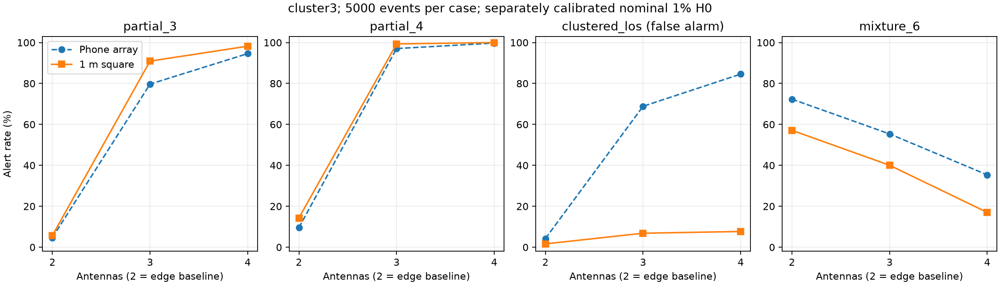

# 1 米阵列与手机尺寸阵列：抗欺骗识别对照

日期：2026-09-14。仅改变阵列尺寸并重新标定阈值；不加入 IMU，不改变检测公式。

## 方法与可比条件

- 原阵列：75.9 × 160.9 mm；新阵列：1 × 1 m 正方形。这里“1 米”指相邻天线距离，对角线为 √2 m，不是所有天线对均相距 1 m。长宽比也随之改变，不能把结果解释为保持形状的纯等比例缩放。
- 两天线：TL–TR（旧名 `2_short`，新阵列中边长为 1 m）及 TL–BR（`2_diagonal`）；三天线：TL/TR/BL；四天线：全部四角。
- 每种尺寸、布局、判据分别使用 5000 个无欺骗事件校准名义 1% 虚警率，之后冻结阈值。22 个场景各 5000 个独立评估事件；两种尺寸复用随机种子，在每个场景内保持天空、姿态和噪声抽样配对。
- 判据保持 global 和 cluster3，不进行未校准的 OR 融合。每个事件包含 10 个相关历元；模型不是动态捕获仿真。short_aperture 压力场景在各自基准阵列上再乘 0.1，因此对应绝对尺寸不同。
- RF：相同固定八星天空、单欺骗源方位角 100°/仰角 10°、虚假位置向东偏 100 m；6 场景 × 2 噪声种子 × 4 天线 × 600 ms，共 48 路接收记录。33 MHz RF、6.6 MHz DFE 及原捕获跟踪链保持不变。每场景只有两个独立噪声记录，8 个判决窗口彼此相关。
- RF 的跨天线传播差通过逐星 range_at_zero_m 编码进入信号；单路配置中的默认 phone 坐标不表示此次阵列孔径。实际孔径以 model/thresholds.json 和 RF manifest 的 physical_positions_m 为准。

## 观测模型结果

表中为旧尺寸 → 1 米阵列的报警率（%）；LOS/clustered_los 是虚警，其余所列为欺骗检出。

| 场景 | 判据 | 2 天线边长 | 3 天线 | 4 天线 |
|---|---|---:|---:|---:|
| los | global | 1.10 → 0.86 | 0.88 → 0.60 | 0.92 → 0.78 |
| los | cluster3 | 0.84 → 0.98 | 0.92 → 0.70 | 0.90 → 0.80 |
| all_spoof | global | 100.00 → 100.00 | 100.00 → 100.00 | 100.00 → 100.00 |
| all_spoof | cluster3 | 49.04 → 60.12 | 100.00 → 100.00 | 100.00 → 100.00 |
| partial_3 | global | 3.68 → 3.72 | 7.84 → 8.48 | 8.38 → 11.84 |
| partial_3 | cluster3 | 4.70 → 5.76 | 79.70 → 90.92 | 94.60 → 98.22 |
| partial_4 | global | 8.02 → 10.58 | 24.18 → 31.18 | 28.56 → 42.76 |
| partial_4 | cluster3 | 9.54 → 14.28 | 97.06 → 99.32 | 99.74 → 100.00 |
| two_sources | global | 41.36 → 46.16 | 50.16 → 51.72 | 52.02 → 64.12 |
| two_sources | cluster3 | 16.90 → 22.10 | 99.90 → 99.94 | 100.00 → 100.00 |
| mixture_0 | global | 9.34 → 0.80 | 6.90 → 0.62 | 6.10 → 0.72 |
| mixture_0 | cluster3 | 14.38 → 5.88 | 4.20 → 0.94 | 3.62 → 0.82 |
| mixture_6 | global | 69.30 → 72.94 | 96.64 → 98.36 | 97.00 → 99.52 |
| mixture_6 | cluster3 | 72.34 → 57.12 | 55.34 → 40.04 | 35.34 → 17.00 |
| clustered_los | global | 4.46 → 3.28 | 8.20 → 5.74 | 9.38 → 7.72 |
| clustered_los | cluster3 | 4.24 → 1.62 | 68.86 → 6.84 | 84.58 → 7.68 |

完整 176 项比较及配对差值区间见 [model_comparison.json](data/2026-09-14-spacing-1m/model_comparison.json)；双天线对角线配置亦包含其中。

三 PRN 部分替代的 cluster3 检出率差值（1 米减旧尺寸，单位为百分点）：

- 2_short：+1.06，配对正态近似 95% 区间 [+0.23, +1.89]。
- 3：+11.22，配对正态近似 95% 区间 [+10.02, +12.42]。
- 4：+3.62，配对正态近似 95% 区间 [+2.95, +4.29]。

区间以冻结的校准阈值为条件，没有计入校准集随机性，也没有对跨场景多重比较作校正。

## 数字 RF 接收链结果

每格为“报警窗口/总窗口；未知窗口数”，顺序为旧尺寸 → 1 米。未知不算检出；有效且未报警才是无证据。

| 场景 | 判据 | 2 天线边长 | 3 天线 | 4 天线 |
|---|---|---|---|---|
| los | global | 0/8; 0 → 0/8; 0 | 0/8; 0 → 0/8; 0 | 0/8; 0 → 0/8; 0 |
| los | cluster3 | 0/8; 0 → 0/8; 0 | 0/8; 0 → 0/8; 0 | 0/8; 0 → 0/8; 0 |
| all_spoof | global | 8/8; 0 → 8/8; 0 | 8/8; 0 → 8/8; 0 | 8/8; 0 → 8/8; 0 |
| all_spoof | cluster3 | 8/8; 0 → 8/8; 0 | 8/8; 0 → 8/8; 0 | 8/8; 0 → 8/8; 0 |
| partial_3 | global | 0/8; 0 → 0/8; 0 | 0/8; 0 → 0/8; 0 | 0/8; 0 → 0/8; 0 |
| partial_3 | cluster3 | 6/8; 0 → 6/8; 0 | 8/8; 0 → 8/8; 0 | 8/8; 0 → 8/8; 0 |
| partial_4 | global | 0/8; 0 → 0/8; 0 | 0/8; 0 → 8/8; 0 | 8/8; 0 → 8/8; 0 |
| partial_4 | cluster3 | 7/8; 0 → 7/8; 0 | 8/8; 0 → 8/8; 0 | 8/8; 0 → 8/8; 0 |
| mixture_0 | global | 0/8; 8 → 0/8; 4 | 0/8; 8 → 0/8; 4 | 0/8; 8 → 0/8; 8 |
| mixture_0 | cluster3 | 0/8; 8 → 0/8; 4 | 0/8; 8 → 0/8; 4 | 0/8; 8 → 0/8; 8 |
| mixture_6 | global | 0/8; 0 → 8/8; 0 | 8/8; 0 → 8/8; 0 | 8/8; 0 → 8/8; 0 |
| mixture_6 | cluster3 | 7/8; 0 → 8/8; 0 | 8/8; 0 → 0/8; 0 | 0/8; 0 → 0/8; 0 |

输出门控另见各 RF summary.json 的 policy 字段：启动未知、检测报警、有效未报警分别保留，门控不代表恢复正确定位。

cluster3 下“危险但仍输出”的历元数（3D 误差 >30 m；旧尺寸 → 1 米）：

| 场景 | 2 天线边长 | 3 天线 | 4 天线 |
|---|---:|---:|---:|
| all_spoof | 0 → 0 | 0 → 0 | 0 → 0 |
| partial_3 | 20 → 20 | 0 → 0 | 0 → 0 |
| partial_4 | 10 → 10 | 0 → 0 | 0 → 0 |
| mixture_0 | 0 → 30 | 0 → 30 | 0 → 0 |
| mixture_6 | 10 → 0 | 0 → 60 | 60 → 60 |

该指标可因无法判决而全部阻断变为零，必须与前表的未知数量一起看；不能把“零危险输出”自动解释为“全部检出”。30 m 是研究示例阈值。

## 分析与边界

1. 对三 PRN 同源部分替代，cluster3 的三天线检出率从 79.70% 到 90.92%，四天线从 94.60% 到 98.22%。这是冻结阈值、配对随机观测下的收益；global 全星统计仍不擅长少数 PRN 替代。
2. 真实卫星聚集场景的 cluster3 虚警下降明显，但 1 米三/四天线仍达 6.84%/7.68%，高于名义目标；不能说误报问题已经解决。推断原因是更大孔径提高了近邻方向的相位差异。
3. 真假混合不能概括为随距离增大而改善。模型 mixture_6 中，四天线 global 从 97.00% 到 99.52%，cluster3 却从 35.34% 到 17.00%。两种判据需要分别报告，不能事后挑选效果好的判据并声称系统已经具备该性能。
   RF 也有明确退步：mixture_6 的三天线 cluster3 从 8/8 降到 0/8，全部是有效观测下漏检；同场景 global 仍为 8/8。四天线 cluster3 则新旧均为 0/8。等功率 mixture_0 新阵列双/三天线虽然有 4 个窗口恢复有效，却全部未检出，导致各有 30 个危险历元通过门控。
4. 本判据使用倍相后的圆统计，1 米约为 5.26 个 GPS L1 波长。更大孔径增加方向敏感度，也保留周期折叠和方向混淆。只增加间距不能保证单调改善，更不是方向真实性认证。
5. RF 固定天空只有一个几何样本，模型则随机化天空与姿态；其数值不应相互替代。三 PRN 替代的三/四天线 cluster3 在新旧尺寸均为 8/8，未显示检出次数增加；四 PRN 替代的三天线 global 从 0/8 到 8/8。RF 有效观测上的低检出与无效观测形成的未知必须区分。
6. 仍是假设理想天线、无互耦和共同采样/频率参考的数字仿真；没有加入 1 米硬件所需的电缆差异、同步误差、温漂或真实场地多径。不能外推为实物或 GPSPATRON 商用设备性能。

## 验证与复现

保存数据重算验证通过：498 项检查，包括旧归档哈希、冻结阈值、全部模型报警计数、48 路 RF 记录重建后的判决与观测一致性。新增几何检验和相关既有测试共 17 项通过；见 [tests.log](data/2026-09-14-spacing-1m/tests.log)。

源代码快照、命令和所有中间记录见 [数据说明](data/2026-09-14-spacing-1m/README.md)。本轮未改写前次报告或冻结数据。
