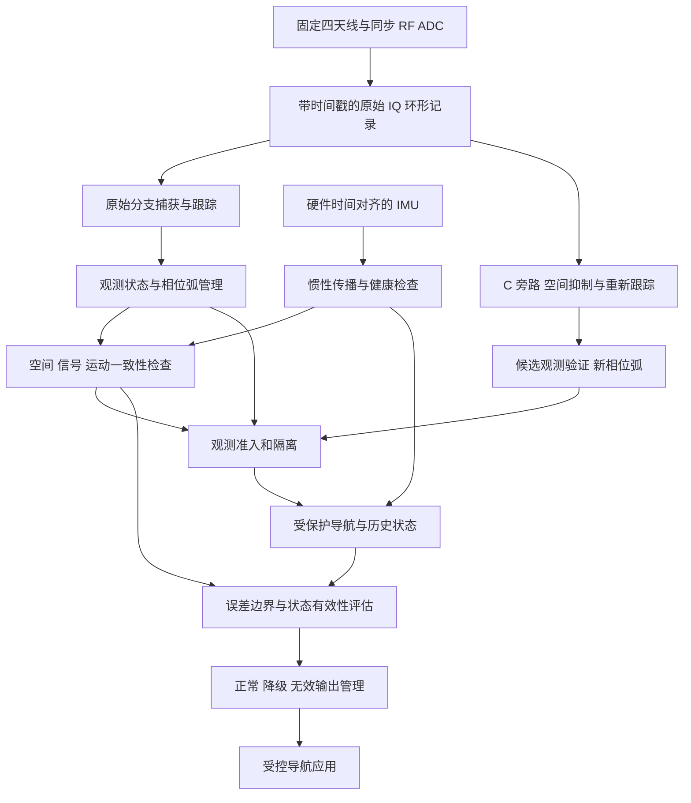

# 手机尺寸多天线抗欺骗：B 首发与 C 升级设计草案

日期：2026-09-14。状态：**需求访谈已形成基线；本设计待用户评审。未实施、未取得商用放行。**

## 1. 产品目标与责任

目标是在手机尺寸内建立可验证的抗欺骗导航系统，先用于开阔室外、车辆固定支架。首发 B 提供检测、观测隔离、短时续航和输出保护；升级 C 增加空间抑制与重新跟踪。客户接受因证据不足而无效，不能接受明显错误位置仍被标为可信。不能依靠长期关闭导航来满足保护目标。

“可以商用”在本文中是研发目标，不是已有能力。已确认的指标属于待验证要求；没有实测依据的噪声、误差边界、阈值和持续时间不赋予伪精确数值。本文为导航应用产品设计，不宣称适用于自动驾驶控制或达到任何功能安全认证等级。

### 1.1 用户确认的需求基线

| 编号 | 已确认决策 | 对设计的约束 |
|---|---|---|
| R01 | 手机尺寸约 75.9 × 160.9 mm，天线位置固定 | 保留当前平面布局为初始机械基线；不能默默改成 1 m 阵列 |
| R02 | 首版四路同步，可自研硬件；IMU 可用 | 2/3 路仅作对照和故障研究，不继承四路承诺 |
| R03 | 先开阔室外固定支架车载 | 手持、口袋及未验证安装条件不纳入首版承诺 |
| R04 | GPS L1＋IMU 可作为首版范围 | 所有进入最终位置的 GNSS 观测必须经过保护；第三方未保护定位不能旁路进入 |
| R05 | 离线基本保护，联网只增强 | 网络不能成为默认可信源；不以在线服务可用作为基础依赖 |
| R06 | 正常状态水平误差 P95 ≤20 m | 替代先前 5 m 提议；1 m 为后续目标；高度另报、不承诺相同指标 |
| R07 | 30 m 偏差仍标可信算失败 | P95 不允许掩盖尾部错误；不能将 20–50 m 都标成正常可信 |
| R08 | 50 m 为硬保护上限 | 无法支持误差边界时应提前无效，不能等知道真误差超过 50 m 才处理 |
| R09 | 正常／降级／无效三态 | 降级显著区别于正常可信；无效时禁止旧位置或预测值冒充当前位置 |
| R10 | 10/30/60 s 为攻击后续航检查点 | 不是全部必须通过的已承诺续航时长；同时报告精度和有效覆盖 |
| R11 | 可先发 B，目标倾向 C | B 也须实机验收；C 未通过时不能宣传其能力 |
| R12 | 单发射源为必须验收范围 | 包括多 PRN、部分/全星、混合、慢拖、功率变化及撤除；单源反射仍需覆盖 |
| R13 | 两种启动均测试 | 开机已受攻击且无可信起点时可一直无效，计保护成功与导航不可用两个结果 |
| R14 | 每个完整测试小时误触发 ≤1 次，累计降级/无效 ≤5 s | 不能只算长时间平均；真实遮挡等不可用另外计入总覆盖率 |
| R15 | 可信位置错误首轮出现一次即失败 | 零观测失败不等于零真实风险；场景修复后重新验证 |
| R16 | 可保存历史与回退；恢复可延迟 | 不能仅凭锁星、低残差或一个无告警窗恢复 |
| R17 | 首期可控应用与接口 | 状态、年龄和有效位必须由消费者实际遵守 |
| R18 | 成本功耗暂不约束；预算周期不确定；分阶段放行 | 不指定尚未验证的器件 BOM 或交付日期；集成可行性仍须验证 |

### 1.2 必须澄清的指标关系

P95 是集合统计量，不能用于判定单历元可信。本文提出一项**供评审的保守状态规则**：正常输出要求有依据的水平误差边界 U_H ≤20 m；降级允许 20 m < U_H ≤50 m，或虽 U_H 较小但 GNSS 不可用、处于惯性续航；边界不存在、失效或 >50 m 则无效。正常样本的 P95 ≤20 m 仍单独验收。

此规则比单纯 P95 要求更严格；它是设计建议，不把用户的 P95 目标偷换成已经批准的逐历元硬界。用户已明确的 30 m 可信错误反例，按 NORMAL 且实际水平误差 ≥30 m 判硬失败。DEGRADED 不得显示“可信定位”；它仍须满足其所报告的边界及 50 m 限制。任意可用状态实际误差超出已宣称边界都要记录为边界违例，不能只在超过 30/50 m 时才统计。

## 2. 架构选择与可复用证据

| 路线 | 内容 | 决策 |
|---|---|---|
| A | 多天线检测＋告警／门控 | 可复用原型，不满足短时续航目标 |
| B | 同步四天线＋IMU＋观测隔离＋受保护导航＋三态输出 | 首发目标，先验证硬件和正常导航，再开展对抗闭环 |
| C | B＋独立空间抑制分支＋重新捕获跟踪＋观测再准入 | 升级目标，不因 B 通过而自动放行 |

现有证据见[空间检测](../../reports/2026-09-14-gpspatron-spatial-diversity.md)、[1 m 对照](../../reports/2026-09-14-spacing-1m.md)、[测向与双差](../../reports/2026-09-14-doa-double-difference.md)、[65 项工程问题模型](../../reports/2026-09-14-engineering-error-model.md)。这些是模型/数字 RF 和单天线真实录波积累，没有真实四天线车载与 IMU 联合验证。

可复用：空间统计量、星间 DD 对照、完整 RF/跟踪回放、相位弧生命周期原型、候选测向、冻结阈值与独立留出的方法。不能直接复用为产品承诺：原 1% 名义单窗虚警、可信参考星假设、理想通道标定、候选集合最近真方向误差、未经融合校准的 global/cluster3 OR、一个无异常窗口就恢复的示例门控。

外部研究支持载波与 IMU 联合检测的研究方向，但公开论文采用特定的载波差分估计器和标定条件，不证明本 GPS L1 离线实现已具备其结果：[Clements 等研究](https://arxiv.org/abs/2203.00140)。GPSPATRON 官方也明确安装和环境条件影响误报，其固定设施说明不能直接转用为车载手机指标：[官方安装相关误报说明](https://support.gpspatron.com/support/solutions/articles/101000466612-high-false-positive-rate-of-spoofing-jamming-detection)。

## 3. 数据流与隔离边界

图中“受保护”“准入”是需要实现和验证的职责名称，不是已获得的真实性证明。原始分支、C 分支、导航和检查器共用传感器，存在共同失效，不能把它们视为统计独立认证方。

### 3.1 模块契约

| 模块 | 输入与输出 | 必须保证的边界 |
|---|---|---|
| 采集同步 | IQ、IMU、采样计数、温度、增益/重启状态 | 同一单调硬件时间轴；丢重样、乱序、时间不连续可识别 |
| 通道标定 | 频率/温度/增益/安装条件→复通道响应及有效域 | RF 注入标定与天线方向图标定分开；重启/越界使旧标定失效 |
| 观测生成 | IQ→码、载波、Doppler、C/N0、相关器形状、arc_id | 观测含生成时间和可用时间；错误锁定不能仅由质量门判成真 |
| 多证据检查 | 空间与运动残差、质量及硬件状态→证据/隔离建议 | 无异常不等于真实；融合流程整体标定，不能简单独立相乘 |
| 导航 | 已准入观测＋IMU→位置速度姿态、钟差、偏置和不确定性 | 未准入观测不更新正式状态及 IMU 偏置；候选计算与提交分离 |
| 历史与回退 | 时间版本化观测、状态、准入证据 | 只能向当前及未来发修正；已发出的错误不能被事后回放抹掉 |
| 边界和输出 | 状态集合、误差预算、延迟→U_H/有效性/原因 | 无合法边界就无效；不能把滤波协方差直接命名为保护水平 |
| C 候选处理 | 原始 IQ→抑制 IQ→新观测 | 不改变原始分支；不直接写正式位置；新滤波权重需追踪相位影响 |

## 4. 硬件与标定设计

### 4.1 原型结构

四路保留独立天线端口与采集链，统一参考时钟、实际采样同步与可测的 LO 相位关系；“同晶振”不足以代替这些验证。IMU 使用与 IQ 可对齐的硬件时标；软件接收时间不能冒充采样时间。测量天线参考点至 IMU 的杆臂与安装姿态，记录支架安装版本。

天线布置沿用当前四角布局作为初值。应以安装后实际相位中心和复方向图建模，不能把壳体尺寸等同于可实现的天线间距。先允许主机承担原型计算，不能因此声称处理、电源、散热与手机本体集成已经完成。量产前必须有完整手机包络内的 RF、天线、IMU 和自干扰复验。

需要同步记录增益状态、饱和比例、温度、重启、采样计数与固件配置。射频公共源分路校准识别相对通道频响；转台/已知方向 OTA 校准识别安装后的方向响应与互耦，两者不能互相替代。辅助校准源也必须标定夹具影响，不能把其误差当作天线误差。

### 4.2 误差参数

沿用 65 项模型中的分类：固定参数、温漂/随机游走及相关噪声、方向相关项、离散故障。IMU 增加陀螺/加计偏置、比例因子、轴不正交、温度、振动整流、时差及杆臂。各参数保存单位、测量条件、相关组、版本及证据来源。

未定器件规格前，不写“相位误差必须小于某个度数、IMU 必须达到某个零偏”的凭空预算。先用敏感性扫描得到满足输出目标的可行区，再选择能够实测覆盖该区的器件。任何标定越界必须对输出状态产生作用，不能仅写日志。

## 5. B：检测、隔离与受保护导航

### 5.1 多层检查的职责

1. **硬件/观测健康**：同步、饱和、通道失效、弧变化、标定越界。失败优先影响观测准入，不能统一解释成欺骗。
2. **空间证据**：保留 global、cluster3 与显式 DD，逐天线、逐星保留诊断。共参考协方差由差分矩阵传播；4 天线的 6 条基线不是 6 份独立证据。单个可疑簇不自动证明其余 PRN 真实。
3. **信号形态**：功率、AGC、Doppler/码载波关系、相关器多峰或畸变、失锁/重捕。平滑或高质量的假信号不能由此排除。
4. **运动一致性**：用更新前的惯性预测检查 GNSS 观测，分别保留码、Doppler及有效相位弧内载波残差；静止、匀速和弱机动应单列，不能把 IMU 的作用默认成随时可观。
5. **长期变化**：针对缓慢拖偏、标定污染和渐进残差，评估不同时间尺度的累计证据。融合阈值由完整流程标定，时间相关样本不能视为独立事件。

二倍相位的 DD/集中度对公共通道相位有不变性，但不提供绝对同源方向，也不认证某颗参考星。现有统计量是空间证据，不单独驱动“可信”标签。

### 5.2 导航估计与污染防止

候选导航状态为位置、速度、姿态、加计/陀螺偏置、接收机钟差/钟漂；需要时增加时间偏差和有效弧的载波偏置。首版以码和 Doppler 联合惯性导航为主，载波先用于监测和经验证的弧内增量，不要求用当前未知初相立即实现整周固定定位。

导航每周期采用“预测→计算候选更新→检查→提交”的事务顺序。检测残差使用更新前状态，避免待检 GNSS 先改写 IMU 偏置，再参与自洽证明。一个候选滤波器可用于研究，但不是独立真值。车辆非完整约束只在固定安装及经验证运动条件下作为有方差的辅助，停车检测、侧滑/颠簸失效另行建模；不能暗中依赖车轮速度或地图真值。

部分卫星被隔离后，仅当剩余观测的准入、几何和误差边界满足要求时继续融合。没有证据证明剩余观测可用时，进入纯惯性短时传播或无效；不以“还有四颗星”作为充分条件。

### 5.3 IMU 续航不是固定倒计时

为理解敏感性，忽略其他项的短时水平误差近似为

$$\delta p(t)\approx\delta p_0+\delta v_0t+\tfrac12\delta b_at^2+\tfrac12g\delta\theta_0t^2+\tfrac16g\delta b_gt^3.$$

式中加计偏置单位 m/s²、陀螺偏置 rad/s、姿态误差 rad；它是局部量级关系，不是完整车辆误差模型或保护界。未知航向、车辆运动、杆臂/时差等须在状态传播中保留。正确初始位置也不能消除未知初速和姿态误差。

对 10/30/60 s 分别统计误差、状态和覆盖率；边界可能在 10 s 前失效，不能为了通过检查点继续有效输出。最短必须达到的攻击下可用时长还未承诺，属于后续产品放行决策，不能把这三个检查点偷换成三个保证。

### 5.4 历史与回退

保存包含状态、IMU、观测、相位弧、标定及准入证据的环形历史。报警时评估多个历史候选，不能固定“回退几秒”即认为干净。攻击可能从更早开始；没有可验证的干净候选就不得延续历史的“可信”标签。缓存长度依实测检测延迟和慢拖扫描决定，其截断必须显式影响可恢复性。

回退重放只改善当前及未来输出。按真实发布时刻记录所有已发位置、状态和错误暴露，离线回放不得重写这份审计记录。原始与 C 分支共享 IMU，回退时也要恢复当时的偏置估计及其有效性。

### 5.5 无可信起点与恢复

离线冷启动可能无法确定真实位置、速度、航向、时间或参考卫星；单源检测未告警不是起点认证。设备应留在初始化/无效，直到满足已验证的起点准入条件；这些条件必须由受控注入和独立真值验证，不能直接将一段 LOS 风格数据标成可信。

启动静止无法仅靠普通加速度计确定绝对航向；运动激励是否足够要检查，不能强制假设方向已知。GNSS 星历、时间与钟状态也可能受骗，不能只冻结位置而继续无条件更新其他状态。

恢复需要观测健康、稳定新弧、有效标定、运动一致性、误差边界和起点条件同时满足。不同恢复证据相关，需要端到端验证。恢复等待时间待测，不能仅用一个无告警窗口释放。

## 6. 误差边界、状态机与应用接口

### 6.1 有条件边界的构造与失效

设当前仍不能排除的假设集为 H_k，包括不同观测子集、污染起点和标定/传感器偏差范围。概念上的水平包络为

$$U_H(k)=\sup_{h\in H_k}\{\lVert\hat p_{H,h}-\hat p_{H,out}\rVert+q_h(k)+b_h(k)\},$$

其中 q_h 是在声明分布及风险水平下的随机范围，b_h 是残余确定性误差界。此式定义研发目标，不证明已知全部假设或已获得可靠上界。假设集遗漏、误差无界、标定越界、初始状态不可辨识时返回 unavailable，而不是把 U_H 截断成 49.9 m。

针对可排除哪些攻击假设的证据、尾部分布和遗漏风险，必须独立验证。采用“保护水平与告警限值分开”的思想，但不移用航空数值或宣称航空完整性；概念参考 [ESA SBAS Fundamentals](https://gssc.esa.int/navipedia/index.php/SBAS_Fundamentals)。本产品的概率风险目标、允许暴露时间尚未冻结，因此现在只能称“候选工程边界”，不能宣称已获得认证保护水平。

### 6.2 内部状态与外部状态

| 内部状态 | 对外状态 | 进入/退出原则 |
|---|---|---|
| 初始化、未建立起点 | INVALID | 起点、传感器及标定未准入；允许一直停留，但计入不可用 |
| 正常 GNSS 融合 | NORMAL | 观测通过完整准入，符合第 1.2 节建议边界和状态条件 |
| 可疑观测隔离、惯性续航 | DEGRADED 或 INVALID | 边界有效且 ≤50 m 才可降级；否则立即无效 |
| 回退重放/重新初始化 | INVALID，或经检查的 DEGRADED | 回放结果通过当前边界检查才允许发布 |
| 恢复观察 | INVALID 或 DEGRADED | 不因一次无异常转正常；所有恢复条件满足后再准入 |
| 硬件/同步/标定失效 | INVALID | 不带着失效配置继续默认四路正常；降级能力须另行验证 |

异常证据足以拒绝输入时，先隔离并按当前边界输出，不等待完成“究竟是欺骗还是故障”的分类。状态切换所用检测窗、确认时间、迟滞、计算和传输时延都进入验收，不能用非因果回放减少延迟。

### 6.3 输出契约（拟议字段）

每条位置同时发布 `solution_time`、`publication_time`、`position`、`status`、`usable`、`bound_valid`、`horizontal_bound_m`、`last_admitted_gnss_time`、`reason_codes`、`calibration_id`、`solution_revision`。无有效边界时置空，不写零。状态与位置原子发布，不允许界面缓存有效位。

NORMAL 才使用正常可信样式；DEGRADED 显示“降级估计、精度范围和更新时间”，不得同样显示“可信”；INVALID 停止作为当前有效定位。最后可信位置只可作为带年龄的历史标记。消费者检测过期和断流，不能把冻结坐标当静止位置。

候选、真值和正式位置使用不同数据通路。测试真值绝不进入生产准入；接口暂停、进程崩溃、陈旧时间戳也须能使应用停止显示正常有效状态。

## 7. C：空间抑制候选分支

### 7.1 先识别空间响应，不要求唯一地理方向

在单源窄带理想模型下，四路 IQ 为 x=a_J s_J+Σ_s a_s s_s+n。若有足够证据估计可疑空间子空间 U_J，可构造候选投影

$$P_\perp=I-U_J(U_J^HU_J)^{-1}U_J^H,\qquad y=P_\perp x.$$

实际实现需考虑噪声白化、条件数、校准误差和频率依赖；上式只给原理。估计同一个复空间响应并不要求先选定唯一方位角，所以现有 DOA 多解不必直接阻塞全部抑制研究。但当前二倍相位观测丢失的信息不自动恢复，不能直接将其候选当作完整 IQ 导向矢量。

空间子空间可能从相关后跨天线复观测和受约束候选拟合中估计。仅取原始协方差最大特征向量可能选到其他干扰、混合项或噪声；当 GNSS 信号低于噪声或真假相干混合时，不能假定最大特征向量就是欺骗源。为避免筛选偏差，子空间估计和候选验收须使用独立时间数据或明确建模其相关性。

### 7.2 可验证的限制

四路阵列只有四个复通道维度；若可疑子空间秩为 r，理想投影最多剩 4-r 维。单个发射源经多径后有效子空间不保证秩 1。真实卫星响应接近被消除空间时同样会损失；前端已经饱和的信息也不能靠数字零陷恢复。

逐星约束波束形成可作为另一候选，但依赖经过验证的真实卫星导向响应和足够空间自由度；不能用可疑 PVT、姿态或星历构造“可信方向”再用它证明结果。候选搜索不无限增加零陷来追求功率最小。

零陷和阵列校准的物理依赖可参考厂商的实际阵列测量讨论：[Analog Devices OTA 测量](https://www.analog.com/en/resources/technical-articles/over-the-air-pattern-measurements-for-hybrid-beamforming-phased-array.html)。该示例阵列与本项目不同，仅支持标定/互耦影响的工程理由，不移用其性能。

### 7.3 从抑制到重新准入

1. 原始 IQ 不变，候选权重只作用于旁路；记录权重和其估计数据来源。
2. 候选重新捕获/跟踪，建立新观测弧；滤波相位和权重切换导致的码/载波偏差进入模型。
3. 对比真实信号损失、跟踪状态、码/Doppler、惯性一致性和位置误差边界，不以干扰下降 dB 或锁星数作为充分条件。
4. 候选不能提供可信起点或有效边界时留在旁路，主路径按 B 规则输出。
5. C 准入为观测级受控提交，禁止直接将“更平滑”的候选 PVT 复制到正式输出。

“独立分支”是软件状态隔离，不是独立传感器证据。C 可能在同一攻击下与原始分支一起错，必须用独立真值验证。

## 8. 验证设计与指标

### 8.1 必测矩阵

| 类别 | 必测内容 | 特别防止的误判 |
|---|---|---|
| H0 正常 | 开阔环境的静止、起步、匀速、转弯、制动；天空/姿态变化 | 只用理想均匀天空标定，遗漏实际相关性 |
| 启动 | 正常启动；开机全假；开机真假混合；起点不明确 | 直接把第一次稳定解视为可信 |
| 单源攻击 | 突然替代、相干接管、慢速拖偏、部分/全 PRN、功率升降、真假强弱交替 | 只测明显位置跳变或只测强纯假 |
| 攻击环境 | 相对方向、距离/近场、移动、单源反射、真实信号减弱 | 把单源自动等价成理想秩一平面波 |
| 恢复 | 攻击撤除、间歇重启、恢复后再次攻击、相位弧变化 | 一窗无异常即恢复；污染偏置被继承 |
| 硬件故障 | 温漂、AGC、时差、丢重样、通道失效、饱和、标定版本错误 | 故障伪装成“无异常”，继续标可信 |
| 消费端 | 延迟、断流、乱序、应用重启、陈旧位置 | 后端停判但界面继续显示有效 |
| C 配对 | 相同输入 B 与 B+C，真实星近零陷、混合错估、多径秩变化 | 只报抑制度，不报位置错误和真实星损失 |

功率、拖偏速率、持续时间、车速、温度与安装范围必须在测试前冻结；留出未参与调参的边界场景。先在受控注入中获得可重复因果证据，再进行合适条件下的多通道 OTA 与车载验证。四路简单分配同一信号只可验证同步/通道，不可验证真实多方向天空；空间模拟需保留逐星逐通道传播关系。

独立真值需具备不被同一欺骗源带偏的证据，不能把附近另一台普通 GNSS 接收机视为天然真值。可在受控模拟中使用生成真值，在车辆试验中设计隔离参考、已知轨迹或独立计量；真值自身误差、时延和杆臂进入结果。真值不确定到不能裁定时，标为不可裁定，不能当通过。

### 8.2 指标定义

- 水平误差：e_H(t)=‖p_H,out(t)-p_H,truth(t)‖，按解算对应时刻对齐；同时评价消费者使用时的陈旧位置误差。
- 正常精度：NORMAL 样本 P95 ≤20 m；同时报告 NORMAL、DEGRADED、INVALID 占比，防止选择性保留导致虚假精度。
- 硬失败：NORMAL 实际偏差 ≥30 m；任意 usable 状态实际偏差 >50 m；无效/陈旧被消费端当有效使用。边界违例 e_H>U_H 另列，即使没有达到硬失败阈值也不得忽略。
- 误触发：在真值和独立记录支持的正常有效工作条件中，保护逻辑错误引发的降级/无效事件。连续非正常段算一次；回到正常后再次退出另算一次，不能通过长迟滞合并事件来改善计数。
- 每小时规则：测试前固定非重叠整小时切分；跨界事件在所有被影响小时计数，持续时间按相交时长分配。每个完整小时 ≤1 次且累计 ≤5 s；不足一小时单独报告，不冒充整小时验收。另报滑动小时最差值辅助发现切分敏感性。
- 总不可用：所有原因的 INVALID 时间，以及初始化、真实遮挡、设备故障造成的非正常时间分别报告；不能把长时间无效改名后从总时长删除。
- 续航：每个攻击场次 10/30/60 s 状态、误差与截至该时刻持续可用时长；unknown/失锁计入分母，不只统计幸存样本。
- 延迟：攻击开始、最早可疑证据、隔离、状态发布及应用生效分别记录。错误输出不能用报警后的离线回退抵消。
- 恢复：撤除攻击至重新可用/正常时间、错误恢复次数、恢复后再次受骗；仍无法恢复的场次按删失/未恢复明确报告。

“可信位置错误首轮一次即失败”是研发门槛，不是风险概率声明。若 n 次独立、同分布场次零失败，单侧 95% 二项上界为 1-0.05^(1/n)，不能把同记录相邻窗口算 n；该上界也不覆盖未测试攻击。硬件重复、路线、天空和噪声条件须分层，必要时按场次统计。

### 8.3 旧指标不能直接迁移

当前空间检测使用的 1% 名义 H0 单窗阈值不满足或不证明“每小时一次、五秒”目标。举例，在独立、非重叠 100 ms 窗的假设下，1% 对应每小时预期 360 个阳性窗口；真实窗口相关且事件有迟滞，不能据此直接算事件次数，但足以说明需要重新校准完整状态机。不能把阈值压得极低而不复测慢拖漏检和告警延迟。

## 9. 分阶段放行与交付物

| 阶段 | 交付物 | 放行证据 | 不通过时 |
|---|---|---|---|
| G0 设计基线 | 本文评审、风险/验收定义、可行性扫描计划 | 用户确认设计；未冻结发布参数列出负责人和测量方法 | 不下商用承诺；继续补定义 |
| G1 同步与标定 | 四通道＋IMU 台架、原始记录、误差模型实测参数 | 时间/相位/频温漂/重启/弧生命周期在试验包络内可检测与建模 | 先修硬件和时标，不靠检测阈值掩盖 |
| G2 正常车载 | GPS L1＋IMU、受控应用、安装规范、独立真值 | 正常精度、每小时误触发及总可用性记录；动态与起点边界明确 | 调整模型/安装或经用户同意收窄范围 |
| G3 B 对抗闭环 | 七类单源攻击及故障回放、因果状态记录 | 错误可信零观测失败、边界违例审查、延迟/续航/恢复与覆盖；独立留出通过 | 修复后重验，不只删除失败场景 |
| G4 B 产品放行 | 实机安装包络、产测/版本/回滚流程、发布说明 | 冻结第 10 节参数并满足；手机集成复验；对外声明与证据一致 | 保持研发/受控试用状态，不能称已商用就绪 |
| G5 C 升级 | 旁路抑制与重新跟踪、B 配对报告 | 在冻结场景中可用性/续航收益，且无新增错误接受或不可接受误伤 | 保留 B，C 不接管正式输出 |

不填假定周期或预算。先用 G1 的原型与计量资源清单形成实际报价/工期，再由用户决定资源投入。软件演示可以支持 G0/G1 准备，不替代 G2–G4 实机证据。

## 10. 发布前仍需冻结的决策与实测量

这些未决项不阻止评审架构，但**阻止商用放行**；不能把此前多轮“接受”解释为它们也已得到确认。

| 项目 | 当前状态 | 获得依据的方法与冻结时点 |
|---|---|---|
| 误导性有效输出的目标概率和允许暴露时间 | 未由用户定义 | G0/G1 提供风险—试验规模—延迟取舍，G3 正式验收前冻结 |
| 正常服务总可用率与启动等待上限 | 只定义了误触发容忍度，未定义总可用率 | G2 给出实测分布，G4 前批准；长期无效不能默认算成功产品 |
| B 最低攻击下有效续航要求 | 仅有 10/30/60 s 检查点 | G3 测量后决定发布承诺；不能宣传必达 60 s |
| 20 m 正常边界的逐历元规则 | 本文保守建议 | 本文评审确认；不与 P95 混淆 |
| 起点与恢复的充分准入条件 | 结构确定、证据未建立 | G1/G2 标定，G3 冷启动、污染历史和慢拖验证 |
| 最高车速、温度、安装和攻击参数包络 | 未测 | 可行性扫描后冻结试验范围，留出边界场景；G4 前写入产品限制 |
| 通道与 IMU 型号、误差预算、缓存长度、处理频率 | 未选型/未实测 | G1 数据和算法敏感性确定，不能从理想仿真反推为实物规格 |
| 第三方服务接入 | 首发不依赖 | 后续单独证明真实性、失效行为及相关性；不自动纳入本版 |
| C 子空间估计与候选选择 | 原理候选，尚未实现 | G5 比较投影/约束方法，冻结权重更新及新弧策略 |

## 11. 与当前代码的对应及首个可实施子项目

| 现有文件 | 可复用部分 | 新设计必须补充 |
|---|---|---|
| `spatial_spoofing.py` | 空间分数、窗口状态、因果输出例子 | 事件级校准；旧单窗释放门控不能用作商用恢复 |
| `spatial_direction.py` | DD、校准假设与候选拟合 | 无唯一 DOA 保证；不能直接生成 C 的 IQ 零陷权重 |
| `spatial_reference_direction.py` | 可信参考方向的研究对照 | 当前依赖外部真实性假设，不用作自动认证 |
| `sdcp_arc.py` | 标定/跟踪版本与弧生命周期 | 接入实际事件来源、恢复准入与消费端状态 |
| `rf.py` / `dfe.py` / `positioning.py` | 数字链、观测重建与回放 | 实测时差、相关噪声、频响、IMU 时标与硬件故障 |
| 既有 audit 与冻结归档 | 原基线、负面结果、配对方法 | 保留不覆盖；新增实验建立独立证据目录 |

建议第一个实施子项目是“G1 数据契约与四路 RF/IMU 同步、标定、故障可观测性”，形成可独立验收的接口和台架数据；不一次实现整套 C。G2 导航/输出状态机、G3 对抗验证、G5 主动抑制分别形成子规格与计划。

本文未修改任何算法默认行为，未新增检测实验，未改变已冻结归档。评审通过后再编写第一个子项目的实施计划。
