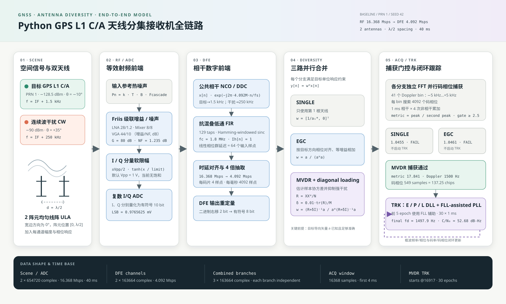

# GPS L1 C/A 手机角点空域抗干扰仿真：设计与实现

> 当前默认模型仍是 HUAWEI Mate 70 外形上的四个**理想角点相位中心**，用于保持既有数值基线；代码同时支持明确标注的合成参数化天线和用户提供的测量表格。三者都不是产品级验证。



图源包括 [`docs/antenna_diversity_chain.svg`](docs/antenna_diversity_chain.svg)、[`docs/antenna_diversity_chain.mmd`](docs/antenna_diversity_chain.mmd) 和 [`docs/antenna_diversity_chain.png`](docs/antenna_diversity_chain.png)；对外范围图见 [`docs/simulation_architecture.svg`](docs/simulation_architecture.svg)，视觉规范见 [`ARCHITECTURE.md`](ARCHITECTURE.md#制图与维护约定)。

## 1. 研究问题和边界

仿真比较 `single`、`egc`、`mvdr`、`blind_null` 四个分支。比较不仅限于阵列响应：每个合并输出经过相同的 Doppler–码相位捕获，捕获成功后再进入闭环跟踪。因此问题是“空间处理后的信号能否被 GNSS 基带捕获并跟踪”。

L1 载频 1575.42 MHz 用于波长、空间相位和码 Doppler 比例；实际生成并采样的是 4.092 MHz 等效复数 IF。默认强 CW 案例中可重复看到 MVDR 空域抑制和后续捕获/跟踪成功，但这只适用于当前理想几何、静态方向和已知目标导向矢量，不是实际手机性能结论。

## 2. 配置族

- `default_config()` / `mate70_default_config()`：Mate 70 外形 160.9 × 75.9 × 7.8 mm，默认 `("TL", "TR", "BL", "BR")` 四个理想共面角点。
- `parametric_phone_config(active_antennas)`：确定性的 `synthetic_phone_corner_v1`，含四个不同 yaw、有限余弦滚降双极化方向图、一个合成遮挡区和弱非对称互耦；该预设明确是非实测敏感性模型。
- `PhoneArrayConfig.active_antennas`：任意不重复的 2–4 角点子集；[`antenna_diversity/array/geometry.py`](antenna_diversity/array/geometry.py) 枚举全部 11 种组合。
- `channel_delay_ns` / `estimated_channel_delay_ns`：四角真实通道真时延和接收机假设时延，默认全部为零。
- `legacy_ula_config()`：原始双阵元、L1 半波长 ULA，供旧结论回归。
- `interferers`：0–3 个 `CWInterferer`；每个有独立方向、功率、频偏、初相、`start_ms` 和 `stop_ms`。

手机阵列和 legacy ULA 都进入相同的 `(channels, samples)` RF/DFE/合并链。`jammer` 字段只服务 legacy 配置；手机配置读取 `interferers`。

## 3. 手机坐标和分层天线流形

手机中心是原点；`+x` 向右、`+y` 向顶端、`+z` 垂直屏幕向外。方位角 `az` 从 `+x` 朝 `+y` 逆时针增加，仰角 `el` 从手机平面向 `+z` 增加：

\[
\mathbf u(az,el)=
[\cos(el)\cos(az),\ \cos(el)\sin(az),\ \sin(el)]^T.
\]

位置 \(\mathbf p_m\) 的空间响应是

\[
a_m(az,el,f)=g_m(az,el,f)
\exp\left(-j\frac{2\pi f}{c}\mathbf p_m^T\mathbf u\right).
\]

`WavePolarization` 在手机球面切向基中保存单位功率 Jones 向量 `[E_az,E_el]`。RHCP/LHCP 手性按“从阵列朝辐射源观察”的方向定义；外部方向和电场先变换到每个阵元的本地 yaw/pitch/roll 坐标，再与本地复数有效高度 `h=[h_az,h_el]` 做共轭内积。

第 `m` 个互耦前端口电压为

```text
x_m = b_m(u) · h_m(u_m,f)^H e_m · exp(-j 2π f p_m·u/c)
a_effective = D_channel · C_coupling · x
```

`b_m` 是一个或多个方向性衰减区在 dB 域叠加后的电压因子；`C_coupling` 从固定四角有向路径构造并按激活顺序抽取；`D_channel` 是逐接收通道幅相响应。运算顺序是 `D(Cx)`，不能交换。默认 ideal/isotropic 路径显式保持与极化无关的 `1+0j`，因此旧数值不因 Jones 接口引入 `1/sqrt(2)` 缩放。

每个手机天线配置都有独立的 true state 和 assumed state。目标、干扰、解析协方差与生成样本使用 true state；EGC/MVDR 的目标导向约束使用 assumed state。这样能单独研究方向、相位中心、姿态、方向图、遮挡、互耦、通道幅相和目标极化的模型失配。

信号与干扰的 `power_dbm` 都表示到达“单位增益且极化完全匹配的参考天线端口”的功率。方向图绝对增益、交叉极化损失和遮挡不会在流形生成后重新归一化，而是进入真实链路预算。

方向图来源固定为三类：

- `ideal`：兼容旧各向同性响应；
- `parametric`：峰值增益、余弦指数、有限后瓣、名义极化、XPD 和交叉分量相位；
- `measured`：规则方位/仰角网格的复数双极化有效高度。

测量 CSV 的固定列为：

```text
element_name,frequency_hz,azimuth_deg,elevation_deg,
h_az_real,h_az_imag,h_el_real,h_el_imag
```

同一阵元/频率必须形成完整无重复规则网格；方位按周期插值，仰角只在声明范围内双线性插值，复数实部/虚部分别插值。首版不做频率插值。配置解析时计算并校验 SHA-256，摘要进入科学配置哈希、summary 和报告。角点坐标仍只是按手机外形边界生成的接口初值；仓库没有 Mate 70 实测相位中心或方向图。

## 4. 场景与干扰

GPS L1 C/A 复数 IF 目标为

\[
s[n]=\sqrt{P_sR}\,c[n]
\exp\{j[2\pi(f_{IF}+f_D)n/f_s+\phi_0]\}.
\]

第 \(k\) 个开启的 CW 干扰为

\[
j_k[n]=w_k[n]\sqrt{P_kR}
\exp\{j[2\pi(f_{IF}+\Delta f_k)n/f_s+\phi_k]\},
\]

其中 `w_k[n]` 由各自的起止时间门产生。场景输出分别保留每个干扰的 truth 分量；零干扰时保持合法的空集合。GPS 有独立 true/assumed 极化，每个干扰有自己的实际极化；阵元通道还可配置真实/估计幅相误差，用于导向矢量失配研究。

第 (m) 个通道的真实延迟为 (	au_m) 时，复中频源分量按

\[
x_m(t)=a_m\,s_{IF}(t-\tau_m)
\exp\{-j2\pi(f_c-f_{IF})\tau_m\}
\]

生成。序列移位已经产生 (f_{IF}+f_D) 或 (f_{IF}+\Delta f_k) 对应的相位，额外因子补回下变频移除的载波部分，因此单频分量的总相位等价于 (exp[-j2\pi f_{src}\tau_m])。目标取 (f_{src}=f_c+f_D)，每个干扰分别取 (f_{src}=f_c+\Delta f_k)。非整数样点使用 33 抽头 Hamming 窗 sinc 插值；记录外样本视为零，输出保持原长度。

`channel_delay_ns` 作用于实际目标和干扰序列；`estimated_channel_delay_ns` 只进入目标假设导向矢量。现有天线几何空间相位和静态通道幅相响应仍独立保留，不重复计入时延。`blind_null` 不读取估计时延，只观察延迟后的实际样本。

## 5. RF、ADC 和 DFE

[`antenna_diversity/rf/frontend.py`](antenna_diversity/rf/frontend.py) 计算 Friis 级联增益与噪声系数，在输入参考温度/带宽下加入热噪声，再执行 I/Q 限幅和复数 ADC 量化。RF 采样率为 16.368 Msps。

[`antenna_diversity/dfe/processing.py`](antenna_diversity/dfe/processing.py) 对所有通道使用公共 NCO 做 −4.092 MHz DDC，随后经过 129-tap Hamming-windowed sinc FIR、64 样点群延迟对齐、4 倍抽取和 8-bit 重量化。输出率为 4.092 Msps，即 4 samples/chip。公共处理保持通道间相对相位。当前 DDC NCO、FIR 系数和 FIR 累加仍为浮点运算；只有 DFE 输出边界按配置对 I/Q 舍入、移位并饱和到整数码值，数组容器仍为 `complex128`。

这里的“群延迟对齐”只补偿公共 FIR 的固定群延迟，不估计或消除阵元之间配置的 `channel_delay_ns`。因此真实/估计时延不一致会继续进入合并、捕获和跟踪。

## 6. SINGLE、EGC、MVDR 和 Blind Nulling

四个合并器接受 2、3 或 4 通道并产生一维样本：

- SINGLE 选第一激活通道；
- EGC 按假设目标导向矢量做相位对齐和等增益合并；
- MVDR 从 DFE 样本协方差计算 loaded 权值；
- `blind_null` 从 DFE 样本协方差检测单个占主导的相关干扰模态，并对配置的参考通道投影。

MVDR 使用

\[
\mathbf w=\frac{(\widehat{\mathbf R}+\delta\mathbf I)^{-1}\mathbf a_0}
{\mathbf a_0^H(\widehat{\mathbf R}+\delta\mathbf I)^{-1}\mathbf a_0},
\qquad
\delta=\alpha\,\mathrm{tr}(\widehat{\mathbf R})/M,
\]

并保持 \(\mathbf w^H\mathbf a_0=1\) 的目标约束。当前端到端权值对整段 DFE 数据一次计算，不是在线滑窗 MVDR。

Blind Nulling 的函数边界是 `combine_blind_null(x, cfg)`，其中 `x` 仅为 shape `(channels, samples)` 的 DFE 样本，`cfg` 只包含 `detection_threshold_db`、`reference_channel` 和 `min_reference_projection_power`；接口没有目标导向矢量。令 \(N\) 为样本数、\(\mathbf X\) 为该数据块，先计算

这里必须区分算法输入和评估 truth：`combine_blind_null()` 的检测与权值形成只读取 `x` 和 `cfg`。pipeline 在权值形成完成、合并输出产生之后，才使用场景生成的真实目标/干扰导向量计算 `target_direction_gain`、`interferer_direction_gains` 和 `worst_interferer_gain`；这三个字段是 post-combining 的 truth-only 诊断量，绝不参与 `combine_blind_null()` 的检测或权值形成。

\[
\widehat{\mathbf R}=\frac{\mathbf X\mathbf X^H}{N},\qquad
\mathbf C=\mathbf D^{-1/2}\widehat{\mathbf R}\mathbf D^{-1/2},\qquad
\mathbf D=\operatorname{diag}(\widehat{\mathbf R}).
\]

令 \(\lambda_1\le\cdots\le\lambda_M\) 为 Hermitian \(\mathbf C\) 的特征值，检测分数为

\[
S_{\mathrm{dB}}=10\log_{10}\!\left(
\frac{\lambda_M}{\frac{1}{M-1}\sum_{m=1}^{M-1}\lambda_m}
\right).
\]

最大特征向量按通道功率映射并归一化，得到 \(\hat{\mathbf v}\)。若 \(S_{\mathrm{dB}}\) 达到阈值，参考通道基向量为 \(\mathbf q=\mathbf e_r\)，则

\[
\mathbf P_\perp=\mathbf I-\hat{\mathbf v}\hat{\mathbf v}^H,\qquad
\gamma=\mathbf q^H\mathbf P_\perp\mathbf q,\qquad
\mathbf w=\frac{\mathbf P_\perp\mathbf q}{\gamma},\qquad
y[n]=\mathbf w^H\mathbf x[n].
\]

这保证 \(\mathbf w^H\hat{\mathbf v}=0\) 且 \(\mathbf w^H\mathbf q=1\)。若输入零功率、相关归一化/向量退化、检测未过门限，或 \(\gamma\) 小于 `min_reference_projection_power`，分支分别以 `zero_input_power`、`degenerate_interference_vector`、`no_interference_detected`、`unsafe_reference_projection` 旁路到原始参考通道。权值从整段 DFE 数据块形成并固定用于同一完整块；它不处理滑窗更新、动态相位或多干扰子空间。

固定的跨通道相位偏置会出现在 \(\widehat{\mathbf R}\) 中，因而能被 \(\hat{\mathbf v}\) 吸收；但权值估计与使用期间的相对相位必须稳定，漂移会降低零陷深度。该事实不是对真实 Mate 70 通道校准、动态相位容限或多个干扰源的验证。

## 7. 捕获与跟踪

捕获对每个 Doppler bin 做载波擦除，以 FFT 相关搜索全部 C/A 码相位，并用排除主峰邻域后的 peak/second-peak 比值判决。默认是 1 ms coherent × 4 noncoherent，门限 2.5。

捕获失败的分支明确记录 `acquisition_failed`。成功分支进入 1 ms epoch 的 Early/Prompt/Late DLL 与 FLL-assisted PLL，输出载波频率、码相位、鉴别器、prompt 和 C/N₀ 记录。

Carrier NCO 有 `float` 和 `fixed` 两种模式，默认 `float` 保持原数值路径。固定模式只量化载波 NCO 状态。设时钟为 (f_{clk})、字长为 (N)、模数为 (M=2^N)，浮点环路频率命令为 (f_{cmd})：

```text
FCW = round_away_from_zero(f_cmd / f_clk * 2^N)
f_actual = FCW * f_clk / 2^N
phase_correction_word = round_away_from_zero(
    pll_kp * phase_error_rad / (2*pi) * 2^N
)
phase_word[k+1] = (
    phase_word[k] + FCW[k+1] * n_ticks + phase_correction_word
) mod 2^N
```

FCW 是 N 位有符号二进制补码，支持 `[-f_clk/2, f_clk/2)`；相位字是 N 位无符号整数。每个历元必须包含整数个 NCO 时钟 `n_ticks = f_clk * coherent_interval_s`，溢出直接报错，不做饱和或回绕。

固定模式的历元顺序为：用当前量化频率和相位字相关；计算同一套 DLL/PLL/FLL 误差；浮点环路滤波器产生下一频率命令；量化下一 FCW；量化 PLL 比例相位修正并更新相位字；记录历元后状态。历元内载波副本为 `2*pi*phase_word/2^N + 2*pi*f_actual*n/fs`。Code NCO 的载波 Doppler 耦合读取实际量化频率，但 Code NCO 自身仍是浮点。

所有成功跟踪结果都给出 `carrier_frequency_command_hz`、实际 `carrier_frequency_hz`、量化误差和 NCO 模式；固定模式另给出整数 `carrier_fcw`、`carrier_phase_word` 和频率 LSB。`run_tracking_nco_comparison.py` 深拷贝同一配置，以相同随机种子分别运行 float、30-bit 和 43-bit，并输出逐分支 CSV、载波频率图和量化误差图。它隔离的是 Carrier NCO 量化，不能据此直接归因任何实测偏差。

## 8. 分析与扫描

端到端结果由 [`antenna_diversity/analysis/metrics.py`](antenna_diversity/analysis/metrics.py) 压缩为分支指标。绘图覆盖 RF/DFE 与合并频谱、手机阵列方位/仰角响应（标出目标及所有干扰）、捕获热力图和跟踪曲线。七阶段研究还把单阵元 true/assumed 方向图、逐源极化匹配、复数互耦幅相和遮挡前后响应保存为 `antenna_diagnostics.csv`，再仅从已保存行生成四幅证据图；报告阶段不重新调用模型。

[`antenna_diversity/experiments/spatial_scan.py`](antenna_diversity/experiments/spatial_scan.py) 是不生成时域样本的快速解析路径。它报告目标/逐干扰方向增益、最差干扰增益、输出信号/干扰/噪声功率、输出 SINR、权值范数、白噪声增益、协方差秩/条件数、加载量和快拍策略。入口包括：

- `compare_corner_combinations()`：全部 11 个 2–4 角点组合；
- `scan_interferer_directions()` 和 `scan_assumed_target_directions()`；
- `scan_interferer_powers()`、`scan_diagonal_loading()`、`scan_position_errors()`。

所有扫描深拷贝配置，并保持调用者提供的参数顺序。

`blind_null` 的权值必须从实际 DFE 样本协方差得到，因而只属于完整样本链，不能作为解析扫描模式；研究全链行中的 `analytic_output_sinr_db` 对该分支明确为 `None`。

## 9. 顺序 Monte Carlo

[`antenna_diversity/experiments/monte_carlo.py`](antenna_diversity/experiments/monte_carlo.py) 的 `run_monte_carlo(cfg, seeds)` 按传入顺序逐个运行完整链路。每次都深拷贝配置、设置 seed 并关闭绘图；API 不暴露并行参数，以保证随机状态和输出排序确定。

`MonteCarloRun` 只保存 seed 和每分支的标量记录。`MonteCarloResult` 汇总捕获率、跟踪率，以及 acquisition metric、最终 Doppler 误差、输出 SINR、最差干扰增益的 branch-wise 列表。若端到端指标不存在，列表位置明确为 `None`。`to_dict()` 不含 NumPy 数组，可用 `json.dumps(..., allow_nan=False)`。

## 10. 可重复实验入口

```python
import numpy as np
from antenna_diversity import parametric_phone_config
from antenna_diversity.config import default_config, legacy_ula_config
from antenna_diversity.experiments import (
    compare_corner_combinations, run_monte_carlo,
    scan_interferer_directions,
)
from antenna_diversity.pipeline import run_end_to_end

phone = default_config()
phone.array.active_antennas = ("TL", "TR", "BR")
phone.plot.enable = False
result = run_end_to_end(phone)

all_eleven = compare_corner_combinations(phone, "mvdr")
grid = scan_interferer_directions(
    phone, 0, np.arange(0, 360, 30), np.arange(0, 91, 15), "mvdr"
)
mc = run_monte_carlo(phone, seeds=(101, 102, 103))

legacy = legacy_ula_config()
legacy.plot.enable = False
legacy_result = run_end_to_end(legacy)

synthetic = parametric_phone_config(("TL", "BR"))
synthetic.plot.enable = False
synthetic_result = run_end_to_end(synthetic)
```

命令行入口是 [`run_end_to_end.py`](run_end_to_end.py)、[`run_legacy_ula.py`](run_legacy_ula.py) 和七阶段 [`run_spatial_research.py`](run_spatial_research.py)。小型参数化研究可直接运行：

```powershell
$env:MPLBACKEND='Agg'
python -W error run_spatial_research.py `
  --config antenna_diversity/studies/example_antenna_realism.json `
  --preset quick --name antenna-realism-smoke
```

## 11. 明确未建模项

以下均不在当前结论中：真实 Mate 70 相位中心标定和产品级暗室方向图；全波机壳/人体散射；互耦导致的外部噪声相关性；多径/NLOS；运动与动态 DOA；宽带、扫频、脉冲或调制等非 CW 干扰；多颗卫星与多 PRN 并发；导航数据、位/帧同步和 PVT；在线 DOA 与鲁棒导向矢量估计；实时滑窗 MVDR；通道延迟估计与 DFE 自动对齐；随时间变化的群时延、独立采样时钟偏差和漂移；完整 RF 非理想；完整 TRK 定点运算；固定字长相关累加器、鉴相器、环路滤波器和 Code NCO；异步 DDS/采样时钟保持效应与 DDS 杂散；L5 信号、码和端到端链路。

因此 `ideal` 只能说明旧基线，`parametric` 只能说明人为参数敏感性，`measured` 只说明输入由可追溯表格驱动。下一步应输入经坐标、极化和功率标定的相位中心、复数方向图与耦合测量，再在真实传播数据上重新验证空间自由度、捕获和跟踪结论。
