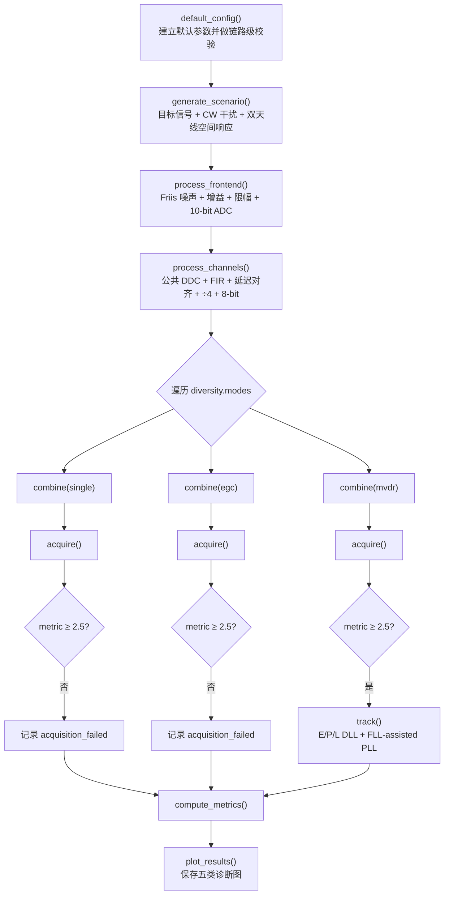

# Python GPS L1 C/A 天线分集仿真：设计框图与实现说明

> 文档范围：只描述 `python_sim` 中当前 GPS L1 C/A 双天线仿真，不包含独立的 MATLAB Galileo E5/AltBOC 代码。
>
> 当前实现：等效复数 IF 场景 → RF 增益/噪声/限幅/ADC → DDC/低通/抽取/重量化 → SINGLE/EGC/MVDR → FFT 捕获 → E/P/L DLL 与 FLL-assisted PLL 跟踪 → 指标与作图。


可编辑图源：

- [`docs/antenna_diversity_chain.svg`](docs/antenna_diversity_chain.svg)：完整矢量图，可直接导入 Figma、Illustrator 或 Inkscape；每个形状与文字均可编辑。
- [`docs/antenna_diversity_chain.mmd`](docs/antenna_diversity_chain.mmd)：Mermaid 源码，修改算法结构和连线最快。
- [`docs/antenna_diversity_chain.png`](docs/antenna_diversity_chain.png)：报告或笔记中直接使用的位图版本。
- [`docs/diagram-style.md`](docs/diagram-style.md)：图形的配色与信息层级说明。

---

## 1. 这套仿真究竟研究什么

当前代码用一个可重复的强干扰案例比较三种双天线处理方式：

1. `single`：只使用第 1 路天线；
2. `egc`：按已知目标方向把两路信号相位对齐，然后等增益相加；
3. `mvdr`：在保持目标方向单位响应的约束下，根据接收数据的空间协方差自适应压低输出功率，从而对强干扰方向形成零陷。

比较不是停留在阵列方向图或输出信干噪比上，而是让三路结果分别经过同一套捕获和跟踪处理。因此最终问题是：**某种合并方法产生的信号，能否被真实的 GNSS 基带处理链捕获并稳定跟踪？**

默认场景故意设置得较困难：目标 GPS 信号为 −128.5 dBm，而连续波干扰为 −90 dBm，两者相差 38.5 dB。目标来自 −10°，干扰来自 +35°。默认结果中，`single` 与 `EGC` 无法捕获，`MVDR` 利用空间差异抑制干扰后成功捕获和跟踪。

这个现象只是**当前场景与参数下的结果**，不能概括成“MVDR 永远优于 EGC”。当目标导向矢量失配、快拍不足、阵列校准误差较大、干扰快速变化或信噪比较低时，MVDR 也可能显著退化。

### 1.1 一个重要建模边界

代码中的 `carrier_hz = 1575.42 MHz` 用于：

- 计算 L1 波长与半波长阵元间距；
- 建立载波 Doppler 与码率 Doppler 的比例；
- 作为天线空间相位的物理参考。

但代码**没有**以 16.368 Msps 直接采样 1575.42 MHz 射频载波。真正生成的是位于 4.092 MHz 的等效复数 IF 信号。这种做法保留了当前研究需要的功率、噪声、限幅、量化、频率搬移、阵列相位和基带处理关系，同时避免用极高采样率模拟真实 L1 RF 波形。

---

## 2. 软件总体结构

主入口是 [`run_end_to_end.py`](run_end_to_end.py)，核心调度位于 [`antenna_diversity/pipeline.py`](antenna_diversity/pipeline.py)。调用关系如下：



`SimulationResults` 保存整条链路的中间结果，而每种合并方法对应一个 `BranchResult`：

```text
SimulationResults
├── config                  所有配置
├── truth                   场景真值、导向矢量和真实 Doppler
├── scene_input_v           天线端复电压
├── adc_codes               RF/ADC 输出
├── rf_info                 增益、噪声、LSB、饱和率
├── dfe_channels            两路 DFE 输出
├── dfe_info                FIR、采样率、群延迟、输出长度
├── branches
│   ├── single: BranchResult(combined, combining, acquisition, tracking)
│   ├── egc:    BranchResult(combined, combining, acquisition, tracking)
│   └── mvdr:   BranchResult(combined, combining, acquisition, tracking)
└── metrics                 三分支汇总指标
```

---

## 3. 默认参数与频率规划

### 3.1 场景和阵列

| 参数 | 默认值 | 含义 |
|---|---:|---|
| PRN | 1 | GPS L1 C/A 卫星号 |
| L1 载频 | 1575.42 MHz | 波长、空间相位和 Doppler 比例参考 |
| C/A 码率 | 1.023 Mcps | 1023 chips/ms |
| 等效 IF | 4.092 MHz | RF/ADC 处的复数中频 |
| RF 采样率 | 16.368 Msps | IF 的 4 倍 |
| 仿真时长 | 40 ms | 654720 个 RF 样点 |
| 真实 Doppler | +1500 Hz | 目标载波位于 IF + 1500 Hz |
| 码延迟 | 137.25 chips | RF 下为 2196 样点，DFE 下为 549 样点 |
| 目标功率 | −128.5 dBm | 天线端目标功率 |
| 目标到达角 | −10° | 以阵列宽边为 0° |
| 干扰功率 | −90 dBm | 天线端连续波干扰功率 |
| 干扰到达角 | +35° | 与目标存在空间角度差 |
| 干扰频偏 | +250 kHz | 干扰位于 IF + 250 kHz |
| 阵元数 | 2 | 双天线 |
| 阵元间距 | 0.0951468 m | L1 半波长，约 9.515 cm |

### 3.2 链路中的频率变化

| 位置 | 目标中心频率 | CW 干扰中心频率 | 采样率 |
|---|---:|---:|---:|
| 场景/RF/ADC | 4.092 MHz + 1.5 kHz | 4.092 MHz + 250 kHz | 16.368 Msps |
| DDC 后 | +1.5 kHz | +250 kHz | 16.368 Msps |
| FIR/抽取后 | +1.5 kHz | +250 kHz | 4.092 Msps |
| 捕获/跟踪 | 搜索并跟踪 +1.5 kHz | 作为残留窄带干扰 | 4.092 Msps |

DDC 确实存在，而且在 FIR 之前执行。所有天线通道使用同一个 NCO 序列，因此不会破坏通道之间携带到达角信息的相对相位。

### 3.3 数据尺寸和时间基准

| 阶段 | NumPy shape | 数据率/时间 |
|---|---:|---|
| `scene_input_v` | `(2, 654720)` | 16.368 Msps，40 ms |
| `adc_codes` | `(2, 654720)` | 16.368 Msps，10-bit I/Q 码字 |
| `dfe_channels` | `(2, 163664)` | 4.092 Msps，8-bit I/Q 码字 |
| 每个 `combined` | `(163664,)` | 4.092 Msps，单路复数基带 |
| 捕获输入窗口 | 前 16368 点 | 4 ms |
| 成功分支跟踪 | 30 × 4092 点 | 30 个 1 ms epoch |

DFE 输出不是严格的 `654720 / 4 = 163680` 点，因为 FIR 的前 64 个输入样点用于补偿群延迟。Python 中：

```python
aligned = filtered[:, group_delay:]  # group_delay = 64
x_out = aligned[:, ::4]
```

所以输出长度为：

\[
N_{out}=\left\lfloor\frac{654720-1-64}{4}\right\rfloor+1=163664.
\]

MATLAB 版本中常见的 `firstValid = groupDelay + 1` 是因为 MATLAB 下标从 1 开始；Python 下标从 0 开始，所以这里直接从下标 64 开始。

---

## 4. 场景生成：从码、载波到双天线复电压

实现文件：[`antenna_diversity/gnss/scenario.py`](antenna_diversity/gnss/scenario.py)、[`antenna_diversity/gnss/ca_code.py`](antenna_diversity/gnss/ca_code.py)、[`antenna_diversity/array/steering.py`](antenna_diversity/array/steering.py)。

### 4.1 C/A 码采样

代码先生成 PRN 1 的 1023-chip C/A 码。载波 Doppler 也会使接收码率产生同比例缩放：

\[
f_{code,rx}=f_{code}\left(1+\frac{f_D}{f_{L1}}\right).
\]

第 \(n\) 个 RF 样点对应的码相位为：

\[
\phi_c[n]=\left(\frac{n f_{code,rx}}{f_s}-\tau_{chip}\right)\bmod 1023.
\]

当前模型用 `floor(code_phase)` 选择码片，因此生成的是理想矩形 BPSK 码片，没有加入发射滤波、接收天线带宽或码片边缘成形。

### 4.2 目标信号电压

dBm 先换算为瓦：

\[
P_W=10^{(P_{dBm}-30)/10},
\qquad A_V=\sqrt{P_W R}.
\]

复数 IF 目标波形可写成：

\[
s[n]=A_V c[n]\exp\left(j\left[2\pi(f_{IF}+f_D)\frac{n}{f_s}+\phi_0\right]\right).
\]

### 4.3 导向矢量约定

对于位置为 \(p_m\) 的阵元，代码采用以阵列宽边为 0° 的约定：

\[
a_m(\theta)=\exp\left(-j\frac{2\pi p_m\sin\theta}{\lambda}\right).
\]

双阵元位置为 `[0, λ/2]`。因此第 1 个阵元是相位参考，第 2 个阵元携带由到达角决定的相位差。

每通道还可以加入幅相不一致：

\[
h_m=10^{\epsilon_{A,m}/20}\exp(j\epsilon_{\phi,m}).
\]

有效导向矢量是 \(\mathbf a_{eff}=\mathbf h\odot\mathbf a\)。默认幅度误差和相位误差均为 0，但保留了校准误差研究接口。

### 4.4 干扰

干扰是一个不带扩频码的连续复指数：

\[
j[n]=A_J\exp\left(j\left[2\pi(f_{IF}+250\text{ kHz})\frac{n}{f_s}+\phi_J\right]\right).
\]

最终天线端数据矩阵为：

\[
\mathbf X_{ant}[n]
=\mathbf a_{s,eff}s[n]+\mathbf a_{j,eff}j[n],
\]

其 shape 为“天线数 × 样点数”。热噪声不在场景函数内生成，而是在 RF 前端函数中根据温度、带宽和级联噪声系数加入。

---

## 5. RF 前端与 ADC

实现文件：[`antenna_diversity/rf/cascade.py`](antenna_diversity/rf/cascade.py) 和 [`antenna_diversity/rf/frontend.py`](antenna_diversity/rf/frontend.py)。

### 5.1 Friis 级联增益与噪声系数

默认三级前端：

| 级 | 增益 | 噪声系数 NF |
|---|---:|---:|
| LNA | 28 dB | 1.2 dB |
| Mixer | 8 dB | 8 dB |
| VGA | 44 dB | 10 dB |

总功率增益为 80 dB。线性噪声因子使用 Friis 公式：

\[
F_{cascade}=F_1+\frac{F_2-1}{G_1}
+\frac{F_3-1}{G_1G_2}+\cdots.
\]

当前计算得到级联 NF 约为 1.235 dB。较大的前级 LNA 增益会压低后级 Mixer 与 VGA 噪声因子对总 NF 的贡献。

### 5.2 热噪声

输入参考热噪声功率为：

\[
P_n=kTBF_{cascade},
\]

其中 `k = 1.380649e-23 J/K` 是玻尔兹曼常数，默认 \(T=290\) K、\(B=8.184\) MHz。当前输入参考噪声功率约为 \(4.3546\times10^{-14}\) W，50 Ω 下复包络 RMS 电压约为 1.4756 μV。

I、Q 两路分别产生独立零均值高斯噪声，并乘以 `noise_rms_v / sqrt(2)`，因此复噪声满足：

\[
E\{|n_I+jn_Q|^2\}=V_{rms}^2.
\]

随机数使用固定 `seed = 42` 和 MT19937，保证默认结果可重复。

### 5.3 增益、限幅和 ADC

功率增益换成电压增益：

\[
G_V=\sqrt{G_P}.
\]

加入噪声后的天线电压乘以 \(G_V\)，再进入 ADC 输入限幅。默认软限幅对 I、Q 分量分别使用：

\[
y_I=V_{lim}\tanh(x_I/V_{lim}),\qquad
y_Q=V_{lim}\tanh(x_Q/V_{lim}),
\]

其中 \(V_{lim}=V_{pp}/2=0.5\) V。关闭软限幅后则对 I、Q 分别做硬裁剪。

10-bit ADC 的 LSB 为：

\[
LSB=\frac{1\text{ V}}{2^{10}}=0.9765625\text{ mV}.
\]

I、Q 分别量化并限制在 `[−512, 511]`。`matlab_round()` 实现与 MATLAB 一致的“半值远离零”舍入，避免 NumPy 默认银行家舍入造成跨语言差异。默认基线的两路饱和比例均为 0。

---

## 6. DFE：DDC、低通、抽取和重量化

实现文件：[`antenna_diversity/dfe/decimator.py`](antenna_diversity/dfe/decimator.py) 和 [`antenna_diversity/dfe/processing.py`](antenna_diversity/dfe/processing.py)。

### 6.1 公共相干 DDC

NCO 为：

\[
q[n]=\exp\left(-j2\pi f_{IF}\frac{n}{f_s}\right).
\]

每个天线通道乘以同一个 `q[n]`。这一步将 4.092 MHz IF 搬移到零中频附近：

- 目标残留 +1500 Hz Doppler；
- 干扰残留 +250 kHz；
- 通道间的空间相位差保持不变。

因此代码顺序是明确的：**先 DDC，再低通，再抽取**。

### 6.2 129-tap Hamming-windowed sinc FIR

滤波器不依赖专用滤波器设计工具箱。长度为 129，中心索引为 64。理想低通脉冲响应为：

\[
h_{ideal}[m]=\frac{2f_c}{f_s}
\operatorname{sinc}\left(\frac{2f_c}{f_s}m\right),
\quad m=-64,\ldots,64.
\]

Hamming 窗为：

\[
w[n]=0.54-0.46\cos\left(\frac{2\pi n}{N-1}\right).
\]

两者相乘后再除以所有系数之和，使直流增益为 1。截止频率 1.8 MHz 小于抽取后 Nyquist 频率 2.046 MHz，因此它同时承担信道低通与抽取前抗混叠滤波。

### 6.3 群延迟为什么是 64

奇数长度、对称系数的线性相位 FIR 群延迟为：

\[
\tau_g=\frac{N-1}{2}=64\text{ samples}.
\]

这种 FIR 的群延迟在其线性相位有效频带内是常数；严格地说，在零点或相位不连续位置讨论群延迟会变得不稳定。代码丢弃前 64 个输出样点，让剩余数据与输入时间轴对齐，然后每隔 4 点取一个样点。

### 6.4 输出量化

抽取后的数值先除以 \(2^2=4\)，相当于二进制右移 2 位，再把 I、Q 分别限制到有符号 8-bit 范围 `[−128, 127]`。这样可以研究固定点动态范围对后续阵列、捕获和跟踪的影响。

---

## 7. 天线合并：SINGLE、EGC 与 MVDR

实现文件：[`antenna_diversity/diversity/combiner.py`](antenna_diversity/diversity/combiner.py)。

两路 DFE 数据组成矩阵 \(\mathbf X\in\mathbb C^{M\times N}\)，合并输出统一写为：

\[
y[n]=\mathbf w^H\mathbf x[n].
\]

### 7.1 样本协方差与对角加载

代码对完整 DFE 数据估计样本协方差：

\[
\mathbf R=\frac{1}{N}\mathbf X\mathbf X^H.
\]

对角加载量为：

\[
\delta=\alpha\frac{\operatorname{Re}\{\operatorname{tr}(\mathbf R)\}}{M},
\qquad \alpha=0.01.
\]

加载后的协方差是 \(\mathbf R_L=\mathbf R+\delta\mathbf I\)。`trace(R)/M` 是每个阵元平均接收功率，因此 `α` 是相对于平均功率的无量纲加载强度。它能改善矩阵条件数并降低样本误差导致的权值爆炸。

### 7.2 SINGLE

只使用第 1 路天线，同时按第 1 阵元的目标响应归一化：

\[
\mathbf w_{single}=[1/a_1^*,0,\ldots]^T.
\]

它提供不使用天线分集的基准。

### 7.3 EGC

\[
\mathbf w_{EGC}=\frac{\mathbf a}{\mathbf a^H\mathbf a}.
\]

EGC 只利用目标导向矢量做相位对齐，每个阵元的权值幅度相等。它不利用数据协方差，也不会主动在干扰方向形成最优零陷。当干扰在两根天线上的相位关系不利时，EGC 只能部分抵消；默认场景下其干扰方向增益从 SINGLE 的 1 降到约 0.3867，但仍不足以捕获弱 GPS 信号。

### 7.4 MVDR

MVDR 解下列约束优化：

\[
\min_{\mathbf w}\ \mathbf w^H\mathbf R_L\mathbf w,
\qquad
\text{s.t. }\mathbf w^H\mathbf a=1.
\]

闭式解为：

\[
\mathbf w_{MVDR}=
\frac{\mathbf R_L^{-1}\mathbf a}
{\mathbf a^H\mathbf R_L^{-1}\mathbf a}.
\]

默认场景的 MVDR 干扰方向幅度增益约为 0.00472，相当于相对于单位幅度约 −46.5 dB。代码使用 `np.linalg.solve()` 解线性方程，没有显式计算矩阵逆。

### 7.5 为什么 MVDR 依赖已知目标导向矢量

约束 \(\mathbf w^H\mathbf a=1\) 告诉 MVDR “哪个空间方向必须保留”。如果 `a` 的角度、阵列位置、通道幅相校准或阵列模型不准确，算法可能把真实目标的一部分误认为应当压低的功率，产生自零陷或目标增益损失。

当前代码给 MVDR 的是**名义目标导向矢量**，不是在线估计结果；因此默认案例属于“目标 DOA 已知”的理想化研究。后续研究应逐步加入导向矢量角度误差、通道幅相误差、对角加载扫描和鲁棒波束形成方法。

---

## 8. 捕获：二维 Doppler–码相位搜索

实现文件：[`antenna_diversity/receiver/acquisition.py`](antenna_diversity/receiver/acquisition.py)。

### 8.1 搜索网格

- Doppler：−5000 Hz 到 +5000 Hz，步进 250 Hz，共 41 个 bin；
- 码相位：一整个 1 ms C/A 周期，共 4092 个样点；
- DFE 下每码片 4 个样点；
- 每次 1 ms 相干积分；
- 连续 4 个块的相关功率非相干累加，总观察时间 4 ms。

### 8.2 FFT 并行码相位相关

对每个 Doppler bin \(f_k\)，先擦除候选载波：

\[
x_k[n]=x[n]\exp(-j2\pi f_k n/f_s).
\]

然后用 FFT 实现与本地码的循环相关：

\[
r_k[\tau]=\operatorname{IFFT}\left\{
\operatorname{FFT}(x_k)\operatorname{FFT}(c)^*
\right\}.
\]

四个 1 ms 块累加的是 \(|r_k[\tau]|^2\)，而不是复相关值，所以不同毫秒之间不要求载波相位连续。

### 8.3 峰值判决

在完整二维搜索面上找主峰。然后只在最佳 Doppler 行上，把主峰附近 ±1 chip 的循环码相位区域排除，再找第二峰：

\[
\text{metric}=\frac{P_{peak}}{P_{second}}.
\]

默认门限为 2.5。排除区域为 4 个样点，因为 DFE 下恰好每码片 4 个样点。

成功捕获会输出 Doppler、码相位、主峰、第二峰、判决比值以及完整二维 `search_power`；后者正是捕获热图的数据来源。

---

## 9. TRK：E/P/L DLL 与 FLL-assisted PLL

实现文件：[`antenna_diversity/receiver/tracking.py`](antenna_diversity/receiver/tracking.py)。捕获失败的分支不会进入跟踪。

### 9.1 跟踪起点

捕获使用最前面的 4 ms。跟踪从估计码相位对应的第一个、且位于捕获窗口之后的完整 1 ms 码周期开始。

默认 MVDR 捕获码相位为 549 点：

```text
549 → 4641 → 8733 → 12825 → 16917
```

前 4 ms 共 16368 点，所以第一次可用跟踪 epoch 从样点 16917 开始。之后最多处理 30 个 1 ms epoch。

### 9.2 载波擦除与 E/P/L 相关器

每个 epoch 内根据当前载波频率和相位生成本地载波，将输入下变频到基带。随后生成 Early、Prompt、Late 三个本地码：

- Prompt：当前码相位；
- Early：当前相位加半个 early–late 间距；
- Late：当前相位减半个 early–late 间距。

配置的 early–late 总间距为 0.5 chip，因此 Early 和 Late 分别位于 Prompt 两侧 ±0.25 chip。

三个相关器输出为：

\[
E=\sum x_{bb}[n]c_E[n],\quad
P=\sum x_{bb}[n]c_P[n],\quad
L=\sum x_{bb}[n]c_L[n].
\]

### 9.3 鉴别器

非相干归一化 DLL 鉴别器：

\[
e_{DLL}=\frac{|E|-|L|}{|E|+|L|+\epsilon}.
\]

Prompt 相位 PLL 鉴别器：

\[
e_{PLL}=\operatorname{atan2}(Q_P,I_P).
\]

相邻 Prompt 的相位差构成 FLL 误差：

\[
e_{FLL}=\frac{\angle(P_kP_{k-1}^*)}{2\pi T_{epoch}}.
\]

### 9.4 环路更新

前 5 个 epoch 使用 FLL 辅助载波频率拉入；PLL 的积分项持续修正频率，比例项修正载波相位。DLL 也同时具有积分码频率修正和比例码相位修正。

码率初值利用载波 Doppler 辅助：

\[
f_{code}=f_{code,nom}\left(1+\frac{f_{carrier}}{f_{L1}}\right).
\]

每个 epoch 保存：E/P/L、DLL/PLL/FLL 误差、载波频率、码率、码相位、Prompt 幅度、相位锁定指标和估计 C/N₀。

这里的环路增益是离散经验增益，并不是由指定噪声带宽、阻尼系数经过标准二阶/三阶环路公式严格离散化得到。若要研究真实接收机动态性能，应把它升级为按噪声带宽和动态应力设计的环路滤波器。

---

## 10. 默认运行结果怎样解读

在 2026-08-12 使用默认配置重新运行得到：

| 模式 | 捕获 | 捕获比值 | 捕获 Doppler | 干扰方向幅度增益 | 跟踪 | 最终 Doppler | 最终 C/N₀ |
|---|---:|---:|---:|---:|---:|---:|---:|
| SINGLE | 否 | 1.0455 | −1750 Hz（伪峰） | 1.0000 | 否 | — | — |
| EGC | 否 | 1.0461 | −1750 Hz（伪峰） | 0.38671 | 否 | — | — |
| MVDR | 是 | 17.841 | +1500 Hz | 0.0047215 | 是 | 1497.9 Hz | 52.684 dB-Hz |

MVDR 稳态后十个 epoch 的 PLL RMS 为 0.21611 rad，DLL RMS 为 0.2037，平均 Prompt 幅度为 821.97。

正确理解是：

- `single` 中强 CW 干扰直接进入接收机，搜索面没有明显的正确相关峰；
- `EGC` 对干扰有一定空间衰减，但剩余干扰仍然太强；
- `MVDR` 借助正确的目标导向矢量保持 −10° 目标响应，并在 +35° 附近形成深零陷；
- 干扰降低后，C/A 码二维相关峰才从背景中显现，随后载波和码环才能锁定。

注意：失败分支返回的 −1750 Hz 只是全局伪峰位置，不是对真实卫星 Doppler 的有效估计。

---

## 11. 五类结果图分别看什么

实现文件：[`antenna_diversity/analysis/plotting.py`](antenna_diversity/analysis/plotting.py)。运行入口会在 `python_sim/results/` 下生成：

### 11.1 `rf_dfe_spectra.png`

依次显示天线 1 输入、ADC 输出和 DFE 输出频谱。重点检查：

- RF/ADC 处信号是否围绕 4.092 MHz；
- ADC 是否出现严重削顶导致的宽带谐波；
- DDC 后目标是否移到约 1.5 kHz、干扰是否移到 250 kHz；
- 低通和抽取后的频谱是否处于 ±2.046 MHz Nyquist 范围。

### 11.2 `combined_spectra.png`

分别画 SINGLE、EGC、MVDR 合并后的绝对频谱，并共享横纵坐标。绿虚线标目标 Doppler，红虚线标干扰频偏。共享坐标很重要，否则每幅图单独自动缩放会掩盖 MVDR 对 250 kHz CW 的实际抑制度。

### 11.3 `array_response.png`

绘制三种权值对 −90° 到 +90° 名义导向矢量的响应。重点看：

- −10° 目标方向是否维持约 0 dB 单位响应；
- +35° 干扰方向的响应是否被 MVDR 压低；
- 双阵元阵列的自由度有限：保持一个目标约束后，理论上只能独立控制有限数量的干扰方向。

### 11.4 `acquisition_search.png`

每种模式占一行：左侧为 Doppler–码相位二维热图，右侧为最佳 Doppler 行的码相位切片。红叉是主峰，橙点是排除主峰邻域后的第二峰。比较主峰是否尖锐、是否位于 +1500 Hz 和 137.25 chips，以及主峰/第二峰比是否超过 2.5。

### 11.5 `tracking_comparison.png`

只绘制成功进入跟踪的分支。上图是载波 Doppler 估计，虚线为真实 +1500 Hz；下图是 Prompt 相关幅度。默认情况下只有 MVDR 曲线，这是捕获门控的正常结果，不是绘图遗漏。

---

## 12. 配置校验的作用

[`antenna_diversity/config.py`](antenna_diversity/config.py) 的 `SimulationConfig.validate()` 是整条链路的契约检查。它确保：

- PRN 在 1–32；
- 频率、阻抗、采样率和持续时间有效；
- 阵元位置与通道误差数组长度等于天线数；
- RF 级联参数和 ADC 位宽有效；
- 抽取率为正整数，FIR 长度为奇数；
- DFE 截止频率低于输出 Nyquist；
- DFE 输出每毫秒和每码片都是整数样点；
- 捕获网格非空、积分长度和门限有效；
- 跟踪至少存在一个有效 epoch。

这些检查把跨模块的隐含假设提前变成明确错误。例如，如果随意修改输出采样率，使每码片不再是整数样点，当前的本地码采样、捕获码相位网格和 E/P/L 相关都会改变，配置会在运行前直接拒绝这种不一致。

---

## 13. 代码文件索引

| 文件 | 职责 |
|---|---|
| [`run_end_to_end.py`](run_end_to_end.py) | 命令行入口、输出指标、生成并保存图像 |
| [`antenna_diversity/config.py`](antenna_diversity/config.py) | 全部配置对象、默认参数、跨链路校验 |
| [`antenna_diversity/pipeline.py`](antenna_diversity/pipeline.py) | 串接完整流程，建立三种合并分支 |
| [`antenna_diversity/models.py`](antenna_diversity/models.py) | `SimulationResults` 和 `BranchResult` |
| [`antenna_diversity/gnss/ca_code.py`](antenna_diversity/gnss/ca_code.py) | GPS L1 C/A PRN 码生成 |
| [`antenna_diversity/gnss/scenario.py`](antenna_diversity/gnss/scenario.py) | 目标、干扰、码延迟、Doppler 和天线响应 |
| [`antenna_diversity/array/steering.py`](antenna_diversity/array/steering.py) | 宽边角度约定下的导向矢量 |
| [`antenna_diversity/rf/cascade.py`](antenna_diversity/rf/cascade.py) | Friis 级联增益和噪声系数 |
| [`antenna_diversity/rf/frontend.py`](antenna_diversity/rf/frontend.py) | 热噪声、增益、软/硬限幅和 ADC |
| [`antenna_diversity/dfe/decimator.py`](antenna_diversity/dfe/decimator.py) | Hamming-windowed sinc FIR 设计 |
| [`antenna_diversity/dfe/processing.py`](antenna_diversity/dfe/processing.py) | 公共 DDC、FIR、时延对齐、抽取和重量化 |
| [`antenna_diversity/diversity/combiner.py`](antenna_diversity/diversity/combiner.py) | SINGLE、EGC、loaded MVDR 权值与合并 |
| [`antenna_diversity/receiver/acquisition.py`](antenna_diversity/receiver/acquisition.py) | FFT 二维捕获、第二峰排除和门限判决 |
| [`antenna_diversity/receiver/tracking.py`](antenna_diversity/receiver/tracking.py) | E/P/L 相关器、DLL、FLL、PLL 和 C/N₀ |
| [`antenna_diversity/analysis/metrics.py`](antenna_diversity/analysis/metrics.py) | 空间抑制、捕获和稳态跟踪指标 |
| [`antenna_diversity/analysis/plotting.py`](antenna_diversity/analysis/plotting.py) | 五类诊断图 |

---

## 14. 如何运行和修改

在 `python_sim` 目录下运行：

```powershell
python run_end_to_end.py
```

程序会打印三种模式的指标，并把图保存到 `python_sim/results/`。

做参数研究时，建议不要直接散改内部函数，而是复制默认配置后只修改研究变量：

```python
from antenna_diversity.config import default_config
from antenna_diversity.pipeline import run_end_to_end

cfg = default_config()
cfg.array.desired_angle_deg = -8.0
cfg.jammer.angle_deg = 30.0
cfg.diversity.diagonal_loading_factor = 3e-2
cfg.array.channel_phase_error_deg[:] = [0.0, 5.0]

results = run_end_to_end(cfg)
```

为了让实验结论可比较，建议每次只扫描一组有关变量，并保存：配置、随机种子、三分支指标、合并后频谱、方向图、捕获热图和跟踪曲线。

---

## 15. 当前模型的简化与后续扩展顺序

### 15.1 当前已覆盖

- GPS L1 C/A 码、码延迟与载波/码 Doppler；
- 双阵元空间相位、幅相通道误差接口；
- 强 CW 干扰；
- Friis 级联 NF、热噪声、增益、非线性限幅和 ADC；
- 公共相干 DDC、抗混叠 FIR、抽取和固定点重量化；
- SINGLE、EGC、带对角加载 MVDR；
- FFT 捕获、闭环载波/码跟踪；
- RF/DFE/合并频谱、方向图、捕获热图和跟踪图。

### 15.2 尚未覆盖

- 卫星导航数据比特及 20 ms 比特边界；
- 多颗卫星和多 PRN 同时存在；
- 多径、NLOS、天线互耦和真实方向图；
- 时间变化的卫星/干扰 DOA；
- 宽带、扫频、脉冲或调制干扰；
- 各 RF 级独立非线性、模拟滤波器和本振相位噪声；
- ADC 时钟抖动、I/Q 不平衡、DC 偏置；
- 在线 DOA 估计与盲导向矢量估计；
- MVDR 协方差滑窗、训练数据隔离和权值在线更新；
- 由噪声带宽/阻尼系数设计的标准 DLL/PLL 环路滤波器；
- 导航数据解调、位同步、帧同步和 PVT。

### 15.3 推荐的研究推进顺序

1. 扫描干扰功率、干扰角度和目标/干扰角间隔，建立三种方法的捕获成功边界；
2. 扫描目标 DOA 误差与通道相位误差，量化 MVDR 对导向矢量失配的敏感度；
3. 扫描对角加载系数和协方差快拍长度，寻找鲁棒性与零陷深度的平衡；
4. 将协方差和 MVDR 权值改为滑动更新，研究动态干扰；
5. 加入多径和第二个干扰源，检查双阵元自由度限制；
6. 再升级跟踪环路和导航数据模型，研究动态应力与长时间稳定性。

这个顺序先回答天线分集本身的核心问题，再逐步引入接收机与环境复杂度，比较容易定位每次性能变化的原因。
