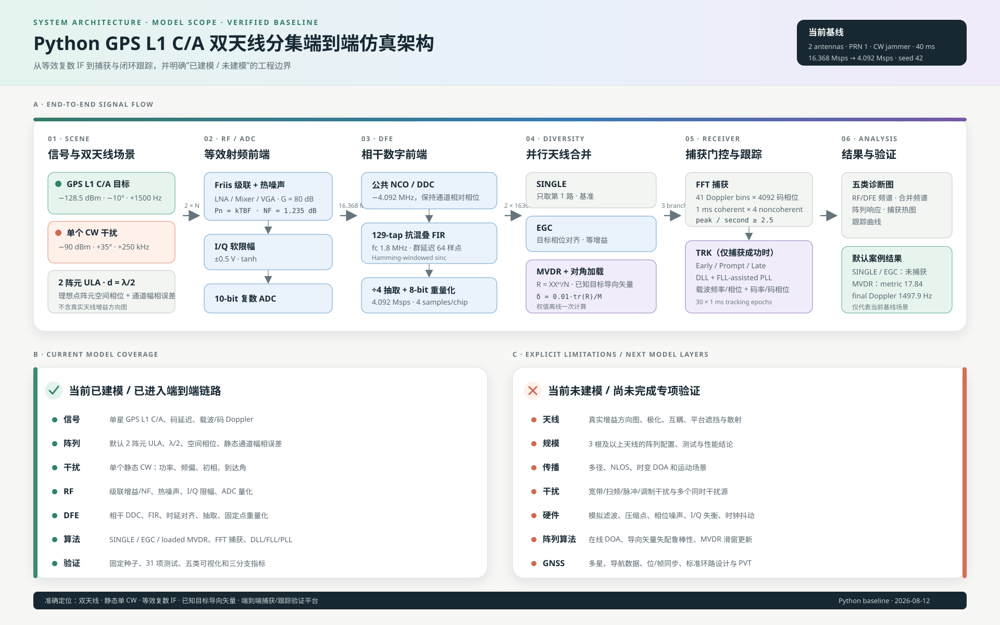

# 手机角点 GPS L1 C/A 空域抗干扰仿真

本目录是 GPS L1 C/A 的 Python 原生端到端仿真：入射方向/极化 → 分层手机天线 → 等效复数 IF → RF/ADC → DFE → SINGLE/EGC/MVDR/blind_null → 捕获/跟踪。`default_config()` 仍使用 **HUAWEI Mate 70 的 160.9 × 75.9 × 7.8 mm 外形尺寸**和理想、共面、各向同性角点，保证旧基线不变；另有明确标为非实测的参数化预设，以及需要外部 CSV 与摘要的测量输入接口。任何预设都**不代表已知的真实 Mate 70 天线位置或产品性能**。



- 对外架构与模型边界：[`ARCHITECTURE.md`](ARCHITECTURE.md)
- 公式、接口和实现映射：[`DESIGN.md`](DESIGN.md)
- 可编辑矢量图：[`docs/simulation_architecture.svg`](docs/simulation_architecture.svg)
- 报告用位图：[`docs/simulation_architecture.png`](docs/simulation_architecture.png)

## 坐标、方向和数据约定

手机中心为原点，`+x` 指向屏幕右侧，`+y` 指向手机顶部，`+z` 垂直于屏幕向外。方位角从 `+x` 朝 `+y` 逆时针增加；仰角从手机平面向 `+z` 增加，范围 0°–90°。方向单位向量为

```text
u = [cos(el) cos(az), cos(el) sin(az), sin(el)]
```

每个阵元先把手机坐标中的单位功率 Jones 向量 `e=[E_az,E_el]` 变换到本地姿态，再计算

`x_m = b_m(u) h_m(u_m,f)^H e_m exp(-j 2π f p_m·u/c)`，

最后按 `a_effective = D_channel C_coupling x` 依次施加端口互耦和逐通道幅相响应。真实场景、干扰协方差和样本生成使用 true state；MVDR 目标约束使用 assumed state。所有多通道数组 shape 为 `(channels, samples)`；合并输出为 `(samples,)`。默认理想模型显式绕过极化内积，仍严格得到旧版单位阵元响应。

## 环境与入口

要求 Python 3.11+、NumPy、SciPy、Matplotlib 和 pytest：

```powershell
cd F:\antenna_diversity\python_sim
python -m pip install -e ".[test]"
$env:MPLBACKEND='Agg'
python -W error -m pytest -q
python -W error run_end_to_end.py
python -W error run_legacy_ula.py
```

`default_config()` 是四个理想手机角点的当前默认；`parametric_phone_config()` 提供确定性的 `synthetic_phone_corner_v1` 合成方向图、姿态、遮挡、极化和弱非对称互耦；`legacy_ula_config()` 保留原始双阵元半波长 ULA 基线。三者共享 channels-by-samples 的 RF、DFE、合并、捕获和跟踪链路。

## 捕获前 Blind Nulling

默认的四个分支为 `single`、`egc`、`mvdr` 和 `blind_null`。前三者分别使用参考通道、假设目标导向矢量的等增益合并，以及同一目标约束下的 loaded MVDR；`blind_null` 在捕获前仅从 DFE 的多通道样本估计一个占主导的相关干扰模态，再对配置的参考通道进行投影。它不接收、也不推断目标方向，因此不能宣称保护未知目标；目标损失必须由后续捕获/跟踪证据检验。

```python
from antenna_diversity.config import default_config
from antenna_diversity.pipeline import run_end_to_end

cfg = default_config()
cfg.diversity.modes = ("single", "egc", "mvdr", "blind_null")
cfg.diversity.blind_null.detection_threshold_db = 6.0
cfg.diversity.blind_null.reference_channel = 0
cfg.diversity.blind_null.min_reference_projection_power = 0.01
result = run_end_to_end(cfg)
blind = result.branches["blind_null"]
print(blind.combining["detection_score_db"])
print(blind.combining["nulling_enabled"])
print(blind.combining["bypass_reason"])
```

`detection_score_db` 是归一化样本协方差主特征值相对其余特征值均值的 dB 比；`interference_detected` 表示它是否达到门限；`nulling_enabled` 表示参考投影是否安全且实际使用了零陷；`bypass_reason` 为 `None` 或 `no_interference_detected`、`unsafe_reference_projection`、`zero_input_power`、`degenerate_interference_vector` 之一。盲权值由整段 DFE 数据块估计一次，并固定应用于该完整数据块，不是在线或滑窗算法。

**算法输入与 truth-only 诊断边界：** `target_direction_gain`、`interferer_direction_gains` 和 `worst_interferer_gain` 是权值形成完成后，由 pipeline 使用场景的真实目标/干扰导向量计算的 post-combining 诊断量；它们只用于评估，不是 `combine_blind_null()` 的输入，绝不参与干扰检测或权值形成。Blind Nulling 的检测和权值形成只使用上文所述的 DFE 样本 `x` 与 blind 配置。

固定的通道间相位偏置会被样本协方差观察到，因而可包含在所估计的干扰向量中；但在权值估计窗口和权值使用窗口之间，**相对相位必须稳定**。相位漂移会降低零陷深度。本实现没有解决动态相位、多干扰子空间估计或真实 Mate 70 校准。

## Carrier NCO 定点验证

TRK 默认仍使用浮点 Carrier NCO。需要验证硬件频率控制字时，可单独启用固定模式；RF、DFE、捕获、相关器、鉴相器、环路滤波器和 Code NCO 不随之定点化：

```python
from antenna_diversity.config import default_config
from antenna_diversity.pipeline import run_end_to_end

cfg = default_config()
cfg.tracking.carrier_nco_mode = "fixed"
cfg.tracking.carrier_nco_clock_hz = 6.6e6
cfg.tracking.carrier_nco_word_bits = 30
cfg.plot.enable = False
result = run_end_to_end(cfg)
```

固定模式把浮点环路命令量化成 N 位有符号 FCW，并用同样位宽的无符号相位累加器更新历元起始相位。`carrier_frequency_command_hz` 是量化前环路命令，`carrier_frequency_hz` 是实际用于载波副本的量化频率；`carrier_fcw`、`carrier_phase_word` 和 `carrier_frequency_quantization_error_hz` 提供逐历元证据。研究 JSON 可直接覆盖同名的三个 `tracking` 字段。

L1 默认时钟 6.6 MHz 下，30-bit 频率 LSB 为 `6.6e6 / 2^30 ≈ 0.006147 Hz`；43-bit 在相同时钟下细 8192 倍。可用同一确定性场景比较浮点、30-bit 和 43-bit：

```powershell
$env:MPLBACKEND='Agg'
python -W error run_tracking_nco_comparison.py `
  --clock-hz 6600000 --word-bits 30,43 `
  --output-dir results/tracking_nco
```

命令生成 `tracking_nco_comparison.csv`、独立的载波频率图和量化误差图。该实验用于隔离 Carrier NCO 量化影响，不能单独证明实测偏差由 NCO 引起。

## 可复现空间研究套件

`run_spatial_research.py` 顺序运行解析扫描、鲁棒性研究、代表场景筛选、完整样本链验证和报告发布。它不打开 GUI；成功后会打印 manifest、报告、9 张表和 12 幅图的绝对路径。[理想快速示例](studies/example_quick.json) 保留旧用法；[参数化天线示例](antenna_diversity/studies/example_antenna_realism.json) 显式列出可编辑的载频/IF/采样率、两个角点组合、天线 true/assumed state、GPS/干扰极化、遮挡和互耦。

```powershell
cd F:\antenna_diversity\python_sim
$env:MPLBACKEND='Agg'

# 全部 11 种稳定顺序组合
python run_spatial_research.py --preset standard --combinations all

# 单个组合
python run_spatial_research.py --preset quick --combinations TL+BR --modes egc,mvdr

# 指定组合列表；逗号分隔，组合内部用 +
python run_spatial_research.py --preset quick --combinations TL+BR,TL+TR+BR --modes egc,mvdr

# 加载可编辑 JSON；只覆盖输出位置和研究名
python run_spatial_research.py --config studies/example_quick.json `
  --output-dir results/studies --name example-quick

# 小型参数化天线七阶段研究
python -W error run_spatial_research.py `
  --config antenna_diversity/studies/example_antenna_realism.json `
  --preset quick --name antenna-realism-smoke

# 配置不变时恢复中断运行
python run_spatial_research.py --config studies/example_quick.json --resume
```

配置优先级固定为 `命令行显式覆盖 > JSON > quick/standard/extended 预设 > default_config()`。未在命令行给出的选项不会遮蔽 JSON；已有研究目录默认拒绝覆盖。`--resume` 只在 schema 与科学配置哈希一致时复用哈希校验通过的阶段，从首个缺失、失败或损坏的阶段继续。

每次研究写入 `<output_dir>/<name>/`：

```text
<output_dir>/<name>/
├── manifest.json
├── resolved-config.json
├── checkpoints/
│   ├── baseline.json ... report.json
├── tables/
│   ├── baseline_rankings.csv ... antenna_diagnostics.csv
├── figures/
│   ├── baseline_rankings.png ... blockage_comparison.png
├── summary.json
└── report.md
```

表中的 `output_sinr_db` / `analytic_output_sinr_db` 是由功率、阵列流形和协方差得到的解析空间指标，不生成时域 RF 样本。`acquisition_metric`、`acquired`、`tracking` 和最终 Doppler 来自 RF → ADC → DFE → 合并 → 捕获/跟踪的样本链；`final_cn0_db_hz` 仅在跟踪给出有限估计时存在，否则为 JSON `null`，原因见同一行的 `status`/`reason`。`blind_null` 只允许在完整样本链中运行，故其 `analytic_output_sinr_db` 为 `None`，绝不能作为零值绘制或与解析 MVDR SINR 混同。解析 SINR、捕获指标与 C/N₀不是可互换的量，报告把它们并列作为不同证据。

> **证据标签：** 报告中的 `ideal` 是旧各向同性基线，`parametric` 是人为合成敏感性模型，`measured` 才表示由带 SHA-256 的外部表格驱动。三者都不等于 Mate 70 产品级验证。

## 可复制配置示例

任意不重复的 2–4 个角点都可激活；名称和顺序为 `TL`、`TR`、`BL`、`BR`：

```python
from antenna_diversity.config import default_config
from antenna_diversity.pipeline import run_end_to_end

cfg = default_config()
cfg.array.active_antennas = ("TL", "TR", "BR")
cfg.plot.enable = False
results = run_end_to_end(cfg)
```

每个角点还可以分别配置真实通道延迟和接收机使用的估计延迟，单位均为 ns：

```python
cfg = default_config()
cfg.array.active_antennas = ("TL", "TR")
cfg.array.channel_delay_ns["TR"] = 10.0
cfg.array.estimated_channel_delay_ns["TR"] = 8.0
```

`channel_delay_ns` 会延迟目标和每个干扰源的实际复中频序列，并保留对应的射频载波相位；`estimated_channel_delay_ns` 只修正 EGC/MVDR 等已知目标导向矢量。`blind_null` 不读取估计延迟，只观察真实延迟后的多通道样本。当前 DFE 不执行通道间时间对齐，因此真实值与估计值不一致时会保留相干合并和码域损失。默认四个角点全部为 `0.0 ns`，与旧模型一致。

若要直接运行参数化模型：

```python
from antenna_diversity import parametric_phone_config
from antenna_diversity.pipeline import run_end_to_end

cfg = parametric_phone_config(("TL", "BR"))
cfg.plot.enable = False
results = run_end_to_end(cfg)
```

手机配置支持 0–3 个分别具有方向、功率、频偏、初相和独立时间门的 `CWInterferer`：

```python
from antenna_diversity.config import CWInterferer, Direction, default_config

cfg = default_config()
cfg.interferers = ()  # 零干扰
cfg.interferers = (
    CWInterferer(Direction(120.0, 10.0), power_dbm=-90.0, offset_hz=250e3),
    CWInterferer(
        Direction(250.0, 25.0), power_dbm=-96.0, offset_hz=-180e3,
        initial_phase_rad=1.1, start_ms=2.0, stop_ms=18.0,
    ),
)
```

## 快速组合与方向扫描

解析扫描不生成时域 RF 样本，适合先筛选参数；它们会深拷贝配置，不改写调用者输入：

```python
import numpy as np
from antenna_diversity.config import default_config
from antenna_diversity.experiments import (
    compare_corner_combinations,
    scan_interferer_directions,
)

cfg = default_config()
all_subarrays = compare_corner_combinations(cfg, mode="mvdr")  # 11 个子集
direction_grid = scan_interferer_directions(
    cfg, interferer_index=0,
    azimuths_deg=np.arange(0.0, 360.0, 15.0),
    elevations_deg=np.arange(0.0, 91.0, 10.0), mode="mvdr",
)
```

同一模块还提供干扰功率、目标假设方向、位置误差和对角加载扫描。

## 顺序 Monte Carlo

本阶段故意顺序运行：随机状态和结果顺序与传入 seed 完全一致，不暴露并行参数。返回值只保留每 seed、每分支的标量记录、捕获/跟踪率以及 acquisition metric、最终 Doppler 误差、输出 SINR、最差干扰增益的分布；端到端链未提供的输出 SINR 明确为 `None`，不保存原始样本数组。

```python
import json
from antenna_diversity.config import default_config
from antenna_diversity.experiments import run_monte_carlo

cfg = default_config()
cfg.plot.enable = False
mc = run_monte_carlo(cfg, seeds=(101, 102, 103))
print(json.dumps(mc.to_dict(), ensure_ascii=False, indent=2, allow_nan=False))
```

## 当前模型边界

当前窄带手机天线层已建模：每角点独立姿态、复数双极化响应、参数化/表格方向图、方向性电压衰减、固定频率复数互耦，以及 true/assumed 模型失配。信号和干扰功率都以“到达单位增益且极化完全匹配的参考天线端口”为基准，因此绝对方向图增益、极化失配和遮挡会进入链路预算。

测量方向图 CSV 固定为 `element_name,frequency_hz,azimuth_deg,elevation_deg,h_az_real,h_az_imag,h_el_real,h_el_imag`；方位周期插值、仰角有界插值，解析后记录文件 SHA-256。未建模项仍包括真实相位中心标定、全波机壳/人体散射、互耦引起的外部噪声相关、多径/NLOS、运动和动态 DOA、非 CW 干扰、多星/多 PRN、导航数据与 PVT、在线 DOA/鲁棒导向估计及实时滑窗 MVDR。

运行脚本生成的频谱、空间响应、捕获热力图、跟踪曲线和研究报告位于忽略版本控制的 `results/` 目录。
