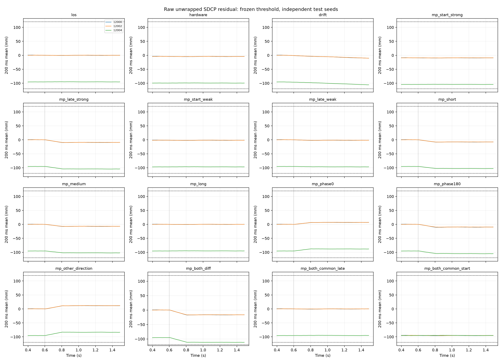
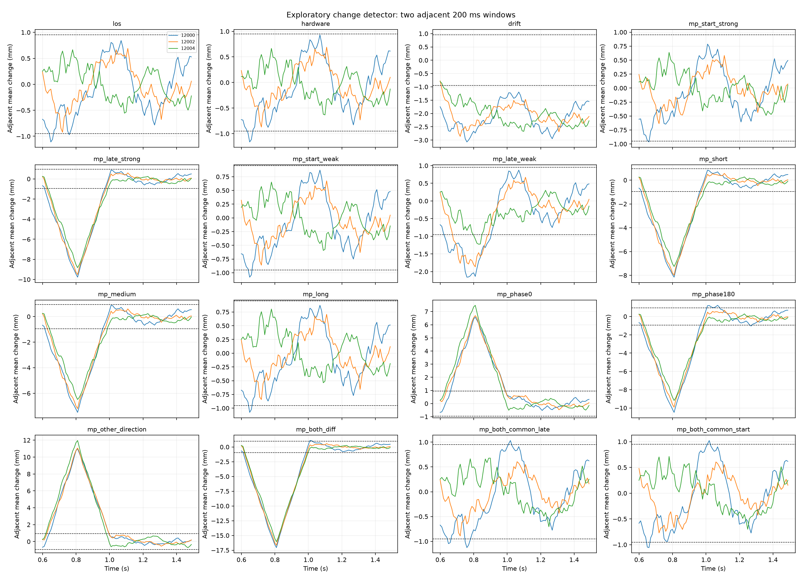
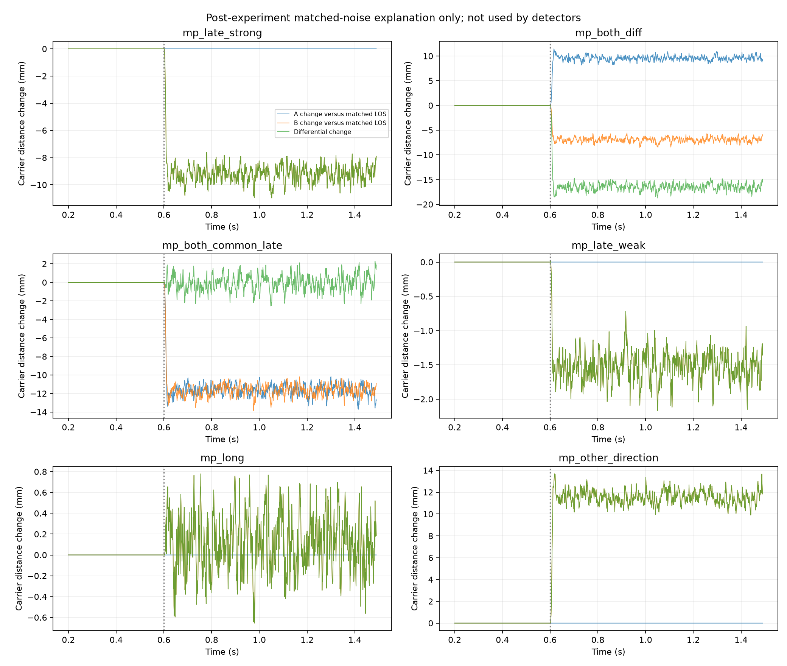
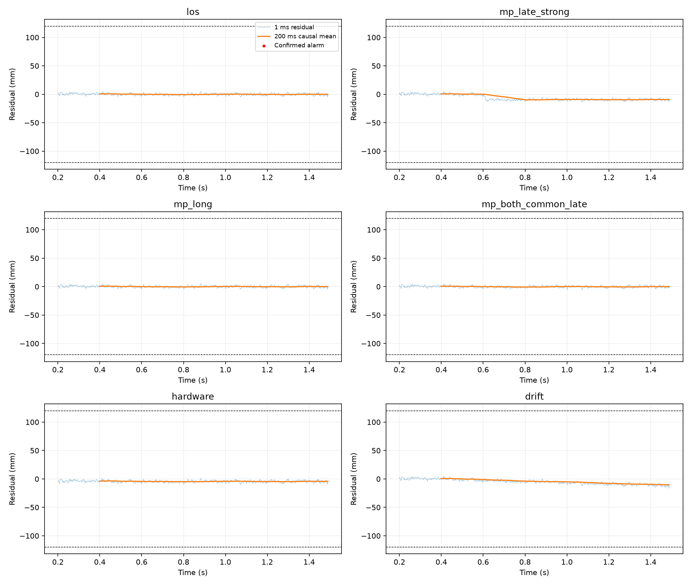

# 不接定位的 SDCP 多径检测验证报告

实验日期：2026-09-16。本文的结果以完整运行、独立复算后的记录为准。原始证据目录：[validation/sdcp_multipath_no_positioning_2026-09-16](validation/sdcp_multipath_no_positioning_2026-09-16/)。

**结论：本次证实了 SDCP 对部分中途差分多径变化的响应，但没有验证出可靠、通用的多径识别能力。** 原始 NCO 的绝对几何残差先受到 Costas 半周分支限制；相邻窗口变化判据可绕开固定偏置，却漏掉稳定启动多径，并对非多径慢漂移报警。全部 48 条测试与 3 条标定已运行完成；两种判据均经独立复算，相关 22 项测试通过。

**硬件覆盖范围：所有多径组都经过天线空间响应和 RF 增益、噪声、限幅、量化模型，但天线与 RF 的额外幅相失配在这些组中为零。** B 路天线 −1 dB/+5°、RF +1 dB/+3° 仅在独立的无多径 `hardware` 对照组加入；慢漂移也是单独对照。本轮尚未验证“多径＋天线幅相偏差＋RF 幅相偏差”同时存在时的检出与误报，不能将单项结果当作组合条件下的性能证据。

## 1. 要验证什么

本次直接检验“真实延迟回波进入现有接收链后，SDCP 能否报警”。它与前一份[双通道相位响应报告](SDCP_NO_POSITIONING_REPORT.md)不同：前次没有加入多径，只验证相位差的形成、响应和中断后的相位弧问题；本次在射频输入之前叠加延迟回波，经过 RF、DFE、捕获和独立跟踪，再评价检测输出。

链路为：同一 GPS L1 卫星 → 两天线的直达波/回波 → 两路 RF 加独立噪声、量化 → 两路相同 DFE → 两个独立 Costas/DLL 跟踪环路 → 同时刻载波单差 → 检测。没有调用位置解算，没有由定位残差反推多径。

离线程序顺序计算 A、B，但二者覆盖同一个 1.5 s 接收时间区间，各有独立 RF 噪声、捕获结果和环路状态；并非拿不同时段的单通道结果冒充双通道。在只改变 B 的配对场景里，复用完全相同输入、配置和噪声种子的正常 A 跟踪历史，以节约计算；双路回波场景会重新运行 A、B。

“不接定位”不等于“不需要几何先验”。绝对残差判据仍假定天线基线及卫星视线方向准确已知，本次直接使用配置给定的几何；这是一项明确的理想前提。信号源的回波标签仅用于场景构造和事后评分，不进入检测器。

## 2. 检测量及判据

### 2.1 原始载波单差

从每路跟踪历史取历元起点的累积 NCO 相位、频率，将相位外推到共同接收时刻 t：

`phi_m(t) = phi_m(t_k) + 2*pi*f_m(t_k)*(t-t_k)`。

沿用前次实验的符号定义：

`D(t) = -lambda/(2*pi) * [phi_B(t)-phi_A(t)]`；

`G = (r_B-r_A) dot u_LOS`；`r(t) = D(t)-G`。

L1 波长约 190.294 mm，已知几何单差约 32.866 mm。`r` 保留原始相位分支，不做波长取余、不减本记录均值、不用真值补整周或半周。它包含差分多径、硬件差、相位分支及跟踪噪声等成分，因此非零残差本身不等价于多径。

冻结配置中列出的 `controlled initial carrier branch` 是绝对判据要求的实验前提，**本次正常标定证明该前提没有成立**。现有独立 Costas 初始化没有实现跨天线半周分支对齐。本报告不能据配置中的这句话宣称模糊度已经解决，也不会通过修改冻结记录掩盖这个问题。

### 2.2 主实验：绝对残差平均

每条记录舍弃前 200 ms，在剩余的 1 ms 网格上取 200 点因果算术平均；每隔 10 ms 判定一次。连续 3 个判定点满足 `abs(mean(r)) > T_abs` 才报警。报警不锁存：后续不再连续超限时，报警状态会解除。

门限只由三条独立、无多径标定记录给出：

`T_abs = 1.25 * max(全部标定窗口的 abs(mean(r)))`。

1.25 是预定工程裕量，不是某个理论误报率对应的分位数。窗口终点为 399、409、419…1489 ms，首个可能确认报警的时刻为 419 ms。标定门限先写入文件并计算哈希，然后才运行测试场景。

### 2.3 补充实验：相邻窗口变化

主实验标定暴露出正常记录间的半周分支差。保留主实验不变，增加探索性对照：

`C(t) = mean(r[t-199ms:t]) - mean(r[t-399ms:t-200ms])`。

两窗各 200 ms、相邻且不重叠；仍每 10 ms 判定、连续 3 次超限确认，门限为同三条正常标定记录的 `1.25*max(abs(C))`。第一个可用判定为 599 ms，最早确认 619 ms。该补充方案在主实验标定之后提出，不能称为原先预注册的主验收。

这一做法没有把相位按波长取余，但在时间上消除了固定偏置。它能够研究“连续跟踪中是否发生变化”，不能证明“启动时已经存在的静态多径是否存在”。持续污染稳定后，变化量回零、报警消失，不代表多径消失。它也不能自动区分多径变化、硬件漂移或周跳。

## 3. 实验条件与信号来源

| 项目 | 本次设置 |
|---|---|
| 信号 | 仿真 GPS L1 C/A，PRN 1，1575.42 MHz，码率 1.023 MHz |
| RF/IF/DFE | RF 33 MHz；IF 4.092 MHz；降采样 5 倍至 6.6 MHz |
| DFE | 129 抽头 FIR，截止 1.8 MHz；原有量化流程 |
| 跟踪 | 两路独立环路，1 ms 积分，Costas；同一接收时间轴 |
| 天线 | TL/TR，75.9 mm 基线；默认理想方向/极化模型 |
| LOS | 方位 30°、仰角 60°；Doppler 1500 Hz；功率 −128.5 dBm |
| 额外通道时延 | 全部清零；没有加入温漂、时钟失配和群延迟失配 |
| 记录长度 | 每条 1.5 s；统计网格 200～1490 ms |
| 数据符号 | 重复合成 50 bps 符号，不是有效 LNAV 电文；回波与符号一起延迟 |
| 标定噪声 A/B | 11900/11901、11902/11903、11904/11905 |
| 测试噪声 A/B | 12000/12001、12002/12003、12004/12005 |
| 干扰/欺骗/定位 | 均未加入 |

信号由本地 `gnss.py` 生成，回波复用现有 `_multipath_scene`、`apply_channel_delays` 和天线方向响应；不是实测 IQ，也不是给最终相位直接加一条预设曲线。

回波模型执行额外分数时延、幅度衰减、反射相位和载波传播相位，再按其到达方向分别作用于两个天线。中途场景在 600 ms 开始，用 10 ms 升余弦包络进入；启动场景从记录一开始就有回波。回波 Doppler 偏移为零，不模拟运动反射物。

反射相位 0°/90°/180°只是反射系数相位。到达接收机的相对相位还包括 `-2*pi*(fc+fD)*tau` 和天线空间相位，不能把表内“90°”直接解释成接收点恰好正交。

## 4. 场景覆盖

| 场景标识 | 回波功率相对 LOS | 额外时延 chip | 反射相位 | 出现时刻 | 接收通道 | 回波方位/仰角 |
|---|---:|---:|---:|---:|---|---|
| los | 无 | — | — | — | — | — |
| hardware | 无；B 天线 −1 dB/+5°，RF +1 dB/+3° | — | — | 0 | B | — |
| drift | 无；B 相位从 400 ms 起按 20°/s 漂移 | — | — | 400 ms | B | — |
| mp_start_strong | −3 dB | 0.3 | 90° | 0 | B | 110°/15° |
| mp_late_strong | −3 dB | 0.3 | 90° | 600 ms | B | 110°/15° |
| mp_start_weak | −20 dB | 0.3 | 90° | 0 | B | 110°/15° |
| mp_late_weak | −20 dB | 0.3 | 90° | 600 ms | B | 110°/15° |
| mp_short | −6 dB | 0.05 | 90° | 600 ms | B | 110°/15° |
| mp_medium | −6 dB | 0.3 | 90° | 600 ms | B | 110°/15° |
| mp_long | −6 dB | 1.2 | 90° | 600 ms | B | 110°/15° |
| mp_phase0 | −6 dB | 0.3 | 0° | 600 ms | B | 110°/15° |
| mp_phase180 | −6 dB | 0.3 | 180° | 600 ms | B | 110°/15° |
| mp_other_direction | −6 dB | 0.3 | 90° | 600 ms | B | 210°/35° |
| mp_both_diff | −6 dB | 0.3 | 90° | 600 ms | A/B | 110°/15° |
| mp_both_common_late | −6 dB | 0.3 | 90° | 600 ms | A/B | 30°/60°，与 LOS 相同 |
| mp_both_common_start | −6 dB | 0.3 | 90° | 0 | A/B | 30°/60°，与 LOS 相同 |

功率为复信号幅度平方的相对值，例如 −6 dB 对应约 0.501 的电压幅度比。0.05/0.3/1.2 chip 的额外路径长度约为 14.65/87.92/351.66 m；这些是传播路径差，不是载波测距误差。

B 单路回波是可控差分污染试验，不声称一个自由空间平面回波会恰好只照到 B；它可代表天线附近不对称反射/遮挡，但本轮没有验证其具体物理实现。双路共同污染场景用于检查单差的共模盲区，不代表所有实际反射必然相同。

## 5. 统计口径和解释限制

每类三个种子的顺序均为 12000、12002、12004。“报警记录数/3”表示该记录在指定事件后至少有一次确认报警；不是大量随机环境下的检测概率。控制场景报警是误报，多径场景报警只是该已知试验条件下被检测到。

“报警判定数/判定数”是时间覆盖率的原始计数。相邻判定间只隔 10 ms，窗口高度重叠，不能把这些点当成独立试验来计算可信检测概率。启动场景的延迟从记录 0 时刻计，已包含初始化和窗口等待；中途场景从 600 ms 包络开始计，不是从包络完全建立计。

质量诊断使用两路 `phase_lock_metric >= 0.8` 且 `abs(pll_error_rad) < pi/2`；所有数据均保留，不用质量门限选择统计。质量通过只能说明这些内部量满足检查，不证明载波分支正确。

尾段载波变化通过与同种子无多径记录配对相减得到，只用于事后解释，**没有进入门限或检测器**。不同记录间若捕获到不同半周分支，配对变化也包含该分支，不能一律当成纯多径稳态误差。

## 6. 可复现与证据核查

在 `python_sim_simplified` 目录运行，输出目录必须是新目录：

```powershell
D:/Python/Python311/python.exe audit_sdcp_multipath_no_positioning.py --output validation/sdcp_multipath_repeat
D:/Python/Python311/python.exe audit_sdcp_window_change.py validation/sdcp_multipath_repeat
D:/Python/Python311/python.exe summarize_sdcp_multipath_no_positioning.py validation/sdcp_multipath_repeat
D:/Python/Python311/python.exe -m pytest tests/test_multipath.py tests/test_channel_delay.py tests/test_rf_dfe.py tests/test_tracking_initialization.py tests/test_sdcp_multipath_no_positioning.py tests/test_sdcp_no_positioning.py -q
```

`code/` 是本轮实际运行源码快照，`plan.json` 保存源码哈希和场景，`config.json` 保存接收机配置，`threshold.json` 保存冻结门限。`*_A/B.npz` 保存原始跟踪数组，`*_decision.npz` 保存残差、分数、报警和质量序列；`results.json` 是主实验统计，`verified_results.json` 增加事后配对解释量，`window_change/` 是补充判据。

独立复算入口从保存的 NCO 相位/频率重新计算共同时间相位，以显式逐窗求均值和逐点确认重新验证主实验分数、报警、质量及统计，而非只检查文件存在。单元检查覆盖因果性、大偏差不取余、确认延迟、相同方向回波的双路共模响应，以及变化判据对固定偏置的盲区。

## 7. 结果与结论

### 7.1 完成情况

16 类场景 × 3 组噪声，共 48 条双通道测试记录；另有 3 条独立双通道正常标定。实际调用接收链 66 次：标定 6 次、测试正常 A 3 次、全部测试 B 48 次、双路回波额外 A 9 次。每次均产生 1495 个跟踪历元，主仿真耗时 864.78 s，约 14.41 min。

48 条测试的统计区间均通过所定义的内部质量检查；不存在利用质量门限删除失败样本的情况。主实验 51 份判定数据（含标定）及补充实验 48 份判定数据完成独立核对；运行涉及的 16 份本地源码快照哈希一致。核验记录见 [verification.json](validation/sdcp_multipath_no_positioning_2026-09-16/verification.json)。

### 7.2 正常标定暴露了半周分支

| 标定 A 种子 | 原始几何残差均值 mm | 标准差 mm | 最大绝对 200 ms 均值 mm | 双路 Prompt 交叉相位 ° |
|---:|---:|---:|---:|---:|
| 11900 | −0.027883 | 1.504369 | 0.607965 | +0.063 |
| 11902 | −95.292922 | 1.728917 | 95.867762 | −179.964 |
| 11904 | −95.120075 | 1.551710 | 95.458414 | −179.981 |

约 −95.15 mm 对应 L1 半波长。两条偏置记录的 Prompt 输出近乎反相，支持 Costas 相位分支不同的解释；不是新增了 95 mm 物理通道时延。Prompt 诊断比较同编号积分窗，后两组起点分别相差 +1/−1 个 6.6 MHz 采样点（约 151.5 ns）；这里只用于确认近 180° 的分支现象。正式 SDCP 使用共同接收时刻插值，没有直接按数组编号相减。

标准差仍为约 1.5～1.7 mm，与此前正常噪声量级相近。标准差小与绝对偏置约 95 mm 可以同时成立，不能把标准差小解释成相位基准准确。此前另一组种子未暴露该分支，不能推广为所有初始化均已对齐。

按原先冻结规则，绝对门限为 **119.834702 mm**。本轮 39 条多径测试全部未报警；9 条非多径对照也全部未报警。这个“没有误报”的结果没有实用价值，因为门限同时吞掉了本次需要检测的信号。

这说明的是**当前原始 NCO 提取方式、未解决相位分支与绝对门限的组合不可直接使用**，并不证明经过正确模糊度处理的所有 SDCP 方法均无效。也不能把降低门限作为修复：若直接压到毫米级，那些正常的半周偏置记录就会持续报警。

### 7.3 主实验逐场景结果

以下尾段平均 SDCP 是 1.1 s 之后的 **200 ms 平均分数均值**，保留半周偏置。最后一列则是 1.1～1.49 s 原始载波距离相对同种子 LOS 的配对变化，格式为 `A,B`；两列统计对象不同，特别是漂移场景不能直接等同。每格三个值按种子顺序排列。

| 场景 | 报警记录数 | 事件后报警判定数/判定数 | 首次报警延迟 ms | 尾段平均 SDCP mm | A/B 配对载波变化 mm |
|---|---:|---:|---|---|---|
| los | 0/3 | 0/330 | — / — / — | -0.207 / 0.116 / -95.158 | 0.00,0.00 / 0.00,0.00 / 0.00,0.00 |
| hardware | 0/3 | 0/330 | — / — / — | -4.430 / -4.174 / -99.441 | 0.00,-4.22 / 0.00,-4.29 / 0.00,-4.26 |
| drift | 0/3 | 0/327 | — / — / — | -8.637 / -8.341 / -103.655 | 0.00,-9.45 / 0.00,-9.47 / 0.00,-9.50 |
| mp_start_strong | 0/3 | 0/330 | — / — / — | -9.406 / -9.074 / -104.384 | 0.00,-9.17 / 0.00,-9.14 / 0.00,-9.23 |
| mp_late_strong | 0/3 | 0/267 | — / — / — | -9.410 / -9.078 / -104.387 | 0.00,-9.17 / 0.00,-9.14 / 0.00,-9.23 |
| mp_start_weak | 0/3 | 0/330 | — / — / — | -1.731 / -1.451 / -96.707 | 0.00,-1.53 / 0.00,-1.57 / 0.00,-1.54 |
| mp_late_weak | 0/3 | 0/267 | — / — / — | -1.730 / -1.451 / -96.708 | 0.00,-1.53 / 0.00,-1.57 / 0.00,-1.54 |
| mp_short | 0/3 | 0/267 | — / — / — | -7.856 / -7.574 / -102.853 | 0.00,-7.63 / 0.00,-7.66 / 0.00,-7.69 |
| mp_medium | 0/3 | 0/267 | — / — / — | -7.142 / -6.798 / -102.097 | 0.00,-6.92 / 0.00,-6.88 / 0.00,-6.95 |
| mp_long | 0/3 | 0/267 | — / — / — | -0.082 / 0.175 / -95.039 | 0.00,0.10 / 0.00,0.08 / 0.00,0.15 |
| mp_phase0 | 0/3 | 0/267 | — / — / — | 6.864 / 7.208 / -88.118 | 0.00,7.08 / 0.00,7.15 / 0.00,7.05 |
| mp_phase180 | 0/3 | 0/267 | — / — / — | -9.907 / -9.562 / -104.878 | 0.00,-9.75 / 0.00,-9.73 / 0.00,-9.73 |
| mp_other_direction | 0/3 | 0/267 | — / — / — | 11.355 / 11.679 / -83.596 | 0.00,11.54 / 0.00,11.64 / 0.00,11.60 |
| mp_both_diff | 0/3 | 0/267 | — / — / — | -16.698 / -16.396 / -111.628 | 9.56,-6.92 / 9.58,-6.88 / 9.52,-6.95 |
| mp_both_common_late | 0/3 | 0/267 | — / — / — | -0.273 / 0.036 / -95.207 | -11.63,-11.63 / -11.60,-11.64 / -11.70,-11.73 |
| mp_both_common_start | 0/3 | 0/330 | — / — / — | -95.418 / -95.112 / -95.206 | 83.52,-11.63 / 83.54,-11.64 / -11.70,-11.73 |

`mp_both_common_start` 前两条 A 的配对变化约 +83.5 mm，不应解释成物理多径造成 +83.5 mm：其中包含与正常记录不同的半周分支。中途共同污染场景保持原有跟踪弧，更适合解释纯共同偏差。



图中三种颜色为三个种子，虚线为固定门限。大约半周的跨记录偏置与几毫米的记录内波动在同一图上保留，不做美化性平移。

### 7.4 相邻窗口变化的实际结果

三个正常标定记录的最大绝对变化分别为 0.761015、0.511994、0.601849 mm，固定门限为 **0.951269 mm**。

| 场景 | 报警记录数 | 报警判定数/判定数 | 首次报警延迟 ms | 最大绝对变化 mm |
|---|---:|---:|---|---|
| los | 0/3 | 0/270 | — / — / — | 1.110 / 0.922 / 0.666 |
| hardware | 1/3 | 1/270 | 659 / — / — | 1.162 / 0.870 / 0.666 |
| drift | 3/3 | 261/270 | 219 / 229 / 239 | 3.069 / 2.861 / 2.671 |
| mp_start_strong | 0/3 | 0/270 | — / — / — | 0.964 / 0.637 / 0.638 |
| mp_late_strong | 3/3 | 102/267 | 39 / 49 / 59 | 9.769 / 9.516 / 8.823 |
| mp_start_weak | 0/3 | 0/270 | — / — / — | 1.080 / 0.861 / 0.652 |
| mp_late_weak | 3/3 | 48/267 | 49 / 99 / 219 | 2.157 / 1.864 / 1.224 |
| mp_short | 3/3 | 99/267 | 39 / 49 / 59 | 8.154 / 7.986 / 7.256 |
| mp_medium | 3/3 | 97/267 | 39 / 49 / 69 | 7.497 / 7.202 / 6.488 |
| mp_long | 0/3 | 0/267 | — / — / — | 1.076 / 0.842 / 0.803 |
| mp_phase0 | 3/3 | 97/267 | 89 / 59 / 49 | 6.573 / 6.691 / 7.477 |
| mp_phase180 | 3/3 | 106/267 | 39 / 49 / 59 | 10.483 / 9.915 / 9.183 |
| mp_other_direction | 3/3 | 103/267 | 59 / 49 / 49 | 10.983 / 11.064 / 11.957 |
| mp_both_diff | 3/3 | 106/267 | 39 / 39 / 49 | 17.057 / 16.662 / 16.057 |
| mp_both_common_late | 1/3 | 2/267 | 169 / — / — | 1.126 / 0.891 / 0.705 |
| mp_both_common_start | 0/3 | 0/270 | — / — / — | 1.056 / 0.771 / 0.713 |

本批 8 类中途、具有明显差分载波变化的回波场景，每类均为 3/3 记录触发。强单路回波首次确认延迟 39～59 ms；弱回波为 49～219 ms。200 ms 平均窗并不意味着一定等待新的完整 200 ms 才能报警：检测器已在持续运行，新回波进入当前滚动窗口后即可使均值跨阈值。

**启动就存在的强、弱、共同回波共 9 条记录，全部没有触发变化判据。** 这与判据消除常数的数学性质一致，不能靠增加平均时间补回已被消除的信息。

1.2 chip 长时延回波为 0/3；中途共同污染为 1/3，且总共只有 2 个确认报警点，不能据这一次短暂触发宣称共同多径被可靠识别。

正常 LOS 为 0/3 误报；固定硬件偏差为 1/3，只有 1 个确认报警点；慢漂移为 3/3，报警判定数达 261/270。总体上，本批 39 条多径记录有 25 条至少触发一次，但场景是人为选取、类型不均匀的测试集合，**25/39 不是可泛化的多径检测概率**。

两种判据在所记录的事件前区间均未出现确认报警。需要注意，变化判据首次输出在 599 ms，而回波于 600 ms 进入，因此中途回波记录只有一个事件前变化判定点；不能用这个极短的事件前区间证明低误报，正常对照也只有三条 1.5 s 记录。



强回波进入后，变化分数先增大，再在回波稳定后回到零附近。因此中途强回波尽管 3/3 记录检出，事件后的报警点只有 102/267。这里的 38.2% 是重叠时间判定的覆盖比例，不是记录级检测概率；它揭示该算法只提示变化，不能持续标记污染状态。

### 7.5 为什么会检出，为什么会漏掉



这张图使用种子 12000，与同种子正常记录作事后配对；配对数据没有送入检测器。

1. **差分变化明显时能检出。** 中途强单路回波使 B 尾段载波距离改变约 −9.14～−9.23 mm，A 保持不变；−20 dB 弱回波仍产生约 −1.53～−1.57 mm 变化。两者都能进入变化统计量，但弱回波确认更慢且更依赖本条噪声。
2. **两路一起偏，单差可能几乎抵消。** 中途共同回波使 A、B 分别约偏 −11.6 mm；三组尾段差分配对变化均小于 0.05 mm。原始信号仍被污染，只是这个信息不在两路之差中。独立噪声及跟踪响应变化会留下波动，导致个别短暂报警，不能将其解释成稳定的共模识别能力。
3. **回波存在不等于载波一定明显偏。** 1.2 chip 场景的 B 尾段配对变化只有约 +0.08～+0.15 mm，远小于短/中时延场景。较远回波与 Prompt 相关主峰重叠较少，是合理解释；本轮未分解相关函数形状，不能将这一推断推广为所有长时延回波都无害，更没有验证码偏差或定位误差。
4. **反射相位、到达方向影响偏差符号和大小。** 同为 −6 dB、0.3 chip，0°/180° 反射相位分别得到约 +7.1/−9.7 mm 的单路配对变化；改变回波到达方向后约为 +11.6 mm。不能只用回波功率决定 SDCP 检出难度。双路不同响应案例，A 约 +9.5 mm、B 约 −6.9 mm，差分约 −16.5 mm，因而变化更明显。
5. **非多径也能产生同类告警。** 20°/s 的单路相位漂移等效约 −10.572 mm/s 的距离斜率，相邻 200 ms 窗口的中心相隔 0.2 s，理想变化分数约为 −2.114 mm，已经超过 0.951 mm 门限。这是可预期的混淆，并不是多径检出成功。

固定硬件组的那一次误报也必须保留。其固定相位本身会被相邻窗相减消去；该案例同时改变了增益及实际跟踪噪声表现，且标定样本只有三条。本轮没有进一步做因素分离，不能强行断言究竟哪一项导致越阈值。它至少说明当前门限并未保证硬件条件变化后的误报水平。



### 7.6 当前能说到什么程度

| 判断 | 本轮证据 |
|---|---|
| 不接定位，能否形成双路相位观测并测试多径 | 可以，已跑完整 RF/DFE/独立跟踪链并保存原始数据 |
| 当前绝对 SDCP 门限能否直接使用 | 不可以，正常初始化的半周分支尚未解决 |
| 相邻窗能否发现部分中途差分变化 | 可以，本批明确差分回波的 8 类场景均 3/3 触发 |
| 能否识别启动时已经存在的稳定多径 | 未实现，本批 9 条相关记录全部未触发变化判据 |
| 能否可靠识别两路相似的共同污染 | 未证明；约 11.6 mm 的单路偏差能在单差中抵消 |
| 能否仅凭告警区分多径与硬件变化 | 不可以，无多径慢漂移同样触发 |
| 是否证明定位收益 | 没有，本次没有定位，也未评价伪距误差 |
| 是否达到商用或长期可靠性要求 | 没有，1.5 s/记录、3 个种子不足以评价长期误报和真实环境覆盖 |

## 8. 后续处理建议与尚未覆盖的条件

当前适合将 SDCP 变化作为**辅助异常证据**，还不适合单独输出“该卫星有多径”的确定判断，更不能将“没有报警”当成无多径证明。

优先应把观测定义及跨通道相位弧说明清楚，区分 Costas 半周、整周、固定硬件相位与实际传播相位。后续若做分支对齐，需要独立的可观测依据，例如一致的数据符号/载波跟踪关系或真实校准信息，并用未知启动偏置、已存在多径及重捕获负例验证；本轮未实现，不能通过对残差按波长取余来冒充完成。

其次应为“发生变化”和“持续污染”使用不同的状态含义。若需要识别启动静态污染或共同污染，还需要独立信息，例如相关函数形状、额外空间/频率观测或可信硬件/几何约束；这些是后续候选，不是本轮已经验证有效的方案。

本轮没有覆盖多反射路径叠加、真实天线方向图/极化转换、反射材料、移动反射物、卫星方向或基线误差、温度变化、采样时钟失配、群延迟失配、弱信号范围扫描、长时间重捕获以及多卫星实测。回波使用配置中的 RHCP 有效分量，不能替代完整电磁反射模型。选取三个种子能暴露反例，但不能形成商用可靠性概率承诺。

本次未修改核心 RF、DFE、捕获和跟踪算法，新增的是实验与复算入口。失败、漏检、误报和半周分支均留在证据中；没有为得到漂亮结果而改门限、重选种子、取余或删除异常记录。
