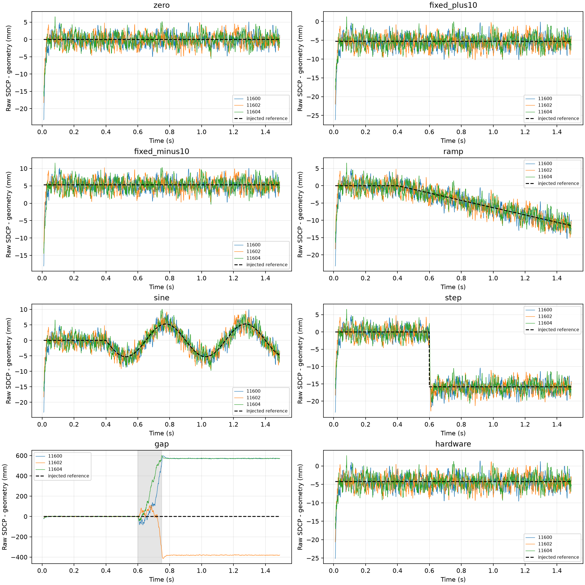
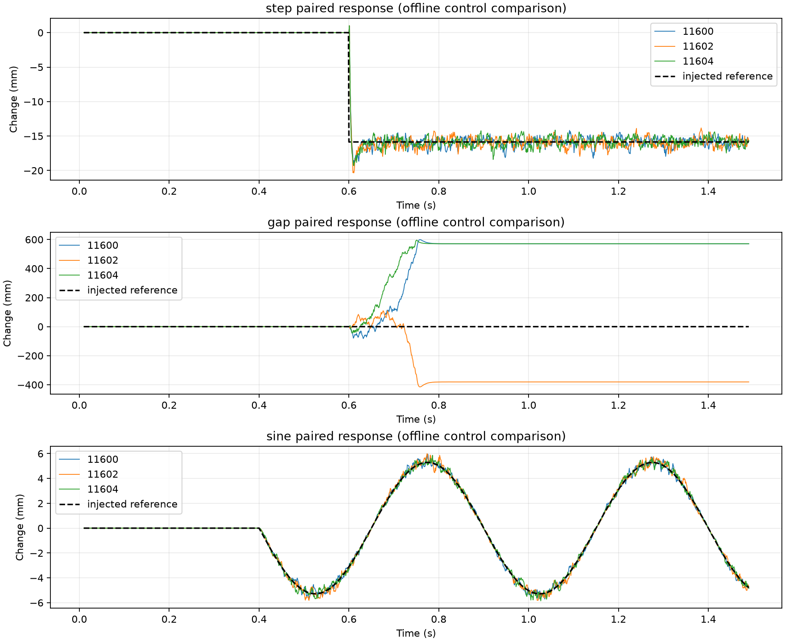

# 不接定位的双通道 SDCP 验证报告

日期：2026-09-16。本文验证同一颗卫星、两根天线、两个独立接收通道的载波相位单差。实验不调用定位、星历传播、伪距构造或位置反馈。结论仅覆盖本文指定的仿真条件。

**结论：不接定位，已经能够验证 SDCP 的相位响应与失效边界。** 本轮完成八类场景 × 三组噪声，共 24 条双通道对照记录、27 次独立 RF/DFE/捕获/跟踪处理，每次 1.5 秒。正常连续跟踪时，几何残差标准差为 **1.543～1.697 mm**；固定和缓变相位能够在输出中体现。但 150 ms 单路中断后，即使质量指标恢复，仍留下约 **+3、−2、+3 周**的偏移。由此可支持继续研究连续跟踪下的 SDCP，不能支持直接把恢复后的 SDCP 当成可信异常检测输入。

## 1. 要验证的问题

本轮先回答三个观测层问题：

1. 输入两路信号的相位关系已知时，经过 RF、DFE 和两个独立跟踪环，能否在同一时刻恢复相位差？
2. 固定偏置、缓慢变化和阶跃是否会保留到 SDCP，误差有多大？
3. 一路信号中断后，跟踪质量恢复是否意味着原相位差参考仍然有效？

本轮没有设计多径/欺骗检测器，没有用定位改善来反推观测可信度，也没有估计检测概率和误报率。识别异常来源属于下一层问题；相同相位变化可能由硬件、几何变化或信号污染引起。

## 2. 接收结构与配置

```text
共同 GPS L1 C/A 波形 + 相同的 50 bps 测试符号
       ├─ TL 天线几何相位 ─ RF A/ADC ─ DFE A ─ 捕获 A ─ DLL/FLL/Costas PLL A
       └─ TR 天线几何相位 + 本轮注入 ─ RF B/ADC ─ DFE B ─ 捕获 B ─ DLL/FLL/Costas PLL B
                                                                  ↓
                                           两路累积 NCO 在共同时间轴上重建
                                                                  ↓
                                                   未取余 SDCP 及事后误差评估
```

两路对应同一段物理时间，各有独立噪声、捕获结果和环路状态。仿真程序按顺序计算两路，以控制内存；这不是两次不同时间的卫星观测。同一噪声组的 A 路结果复用于八个场景，因为其输入和配置完全相同。

| 项目 | 设置 |
|---|---|
| 信号 | GPS L1 C/A，PRN 1，载波 1575.42 MHz |
| 源端采样/中频/多普勒 | 33 MHz / 4.092 MHz / +1500 Hz |
| 记录长度 | 每场景 1.5 s |
| 接收信号功率 | 每路理想天线输入 −128.5 dBm；硬件幅相场景另有指定衰减 |
| 天线 | TL、TR，理想方向响应；75.9 mm 基线沿本地 x 轴 |
| 入射方向 | 本地坐标方位 30°、仰角 60°；基线与方向均准确已知 |
| 通道额外延迟 | 两路均为零 |
| RF/ADC | 复用现有等效级联、独立热噪声、软限幅、10 位 ADC |
| DFE | 两路相同的 129 抽头 FIR，1.8 MHz 截止频率，5 倍抽取，6.6 MHz 输出；8 位量化、二进制移位 2 |
| 跟踪 | 两套独立 DLL/FLL/Costas PLL，1 ms 积分；PLL 比例系数 0.30，频率积分系数 4.0 Hz；其他参数见配置 |
| 导航符号 | 20 ms/符号，重复 `[+1,+1,−1,+1,−1,−1,+1,−1]`，两路相同；不是有效 LNAV 帧，不涉及电文解码 |
| 噪声组 | A/B：11600/11601、11602/11603、11604/11605；三组互相独立 |
| 多径、干扰、欺骗 | 本轮均未加入 |
| 本振与时钟 | 理想共同参考；未加入相噪、频率漂移、采样偏斜或真实温度模型 |

默认配置中保留的分集、定位相关研究字段未被本轮入口使用。实际调用路径只有信号生成、RF、DFE、捕获和跟踪。运行结束检查没有导入 `positioning` 或 `run_gps_spp` 模块。

## 3. SDCP 的计算口径

### 3.1 先对齐物理时间，再相减

设通道 i 的当前跟踪历元起点是 tᵢ，起点累积 NCO 相位是 φᵢ，起点 NCO 频率是 fᵢ。在该历元内：

`φᵢ(t) = φᵢ + 2π fᵢ (t − tᵢ)`

本轮距离单位的 SDCP 定义为：

`D(t) = −λ [φ_B(t) − φ_A(t)] / (2π)`

其中 L1 波长约为 190.293673 mm。使用的是每个历元反馈更新前保存的 NCO 相位与频率，既不是 Prompt 剩余相位，也不是反馈后的频率直接拼接。评估网格为 10～1490 ms，步长 1 ms。独立复核会检查每个网格点确实落在两通道各自的有效历元内。

不减去 200～400 ms 的参考均值，不减去每条记录自身均值，不做波长取余，不做相位展开或整周对齐。已有跟踪器内部鉴相、码周期和 NCO 的必要模运算属于算法本身，与对最终 SDCP 取余是不同的操作。

### 3.2 几何项和注入真值仅用于评分

本地源采用空间相位 `exp(−j k b·u)`，而本轮载波距离采用负相位约定，因此对应几何项为：

`G = b·u = 32.865664 mm`

在 B 路额外加入相位 θ(t) 时，预期的距离变化为：

`I(t) = −λ θ(t) / (2π)`

绘图中的几何补偿残差是 `D−G`；针对注入模型的评分误差是 `E=D−G−I`。这些真值只进入事后分析，没有输入捕获或跟踪，也没有拿来修正整数分支。若实际应用没有准确的几何与通道校准信息，就不能把该仿真评分条件视为已满足。

### 3.3 原始误差与配对误差分开

同组场景与零注入基线使用相同 RF 噪声种子，定义离线配对变化 `P=D_case−D_zero`。它用于检查改变输入之后的响应是否符合预期；配对误差为 `P−I`。

这相当于控制变量实验。两条记录噪声高度相关，配对误差通常比单次 SDCP 的误差小。实际接收机并没有同时获得“同样噪声但未受污染的另一条记录”，所以不能把配对误差当成实际测量精度，也不能据此直接设置检测门限。

## 4. 实验场景与统计区间

| 场景 | B 路注入 | 想检查的问题 |
|---|---|---|
| zero | 无额外相位或幅度偏差 | 正常噪声、量化、跟踪误差基线 |
| fixed_plus10 | 从开始就有 +10° | 启动固定相位偏差是否被保留，理论变化 −5.285935 mm |
| fixed_minus10 | 从开始就有 −10° | 反向固定偏差与符号约定，理论变化 +5.285935 mm |
| ramp | 0.4 s 后以 +20°/s 增长 | 慢漂移是否被跟踪输出反映；此为等效相位扰动，不是真实温度曲线 |
| sine | 0.4 s 后、10°幅度、2 Hz 正弦 | 周期相位变化的幅值和相位响应 |
| step | 0.6 s 加入 +30° | 突变响应及过渡误差；理论变化 −15.857806 mm |
| gap | 0.6～0.75 s 将 B 路信号置零，RF 热噪声持续存在 | 中断后旧环路是否保留原相位弧 |
| hardware | 天线端 −1 dB/+5°；RF +1 dB/+3° | 幅度看似补偿后，固定相位偏差是否仍然存在；理论变化 −4.228748 mm |

硬件场景在源端对 B 路电压施加等效天线幅相响应，再通过现有 RF 模型施加 RF 幅相响应。这不是实测天线或温漂模型；RF 增益作用于信号和 RF 噪声，所以与前级天线 −1 dB 并不构成噪声性能上的完全抵消。

统计区间在运行前固定：

- `all`：10～1490 ms，1481 点，含启动过程。
- `settled`：200～1490 ms，1291 点；名称仅指固定舍去前 200 ms，不是自动锁定认证。
- `before_event`：200～549 ms，350 点。
- `event`：600～799 ms，200 点。
- `tail`：1100～1490 ms，391 点。

均值保留正负号；标准差为总体标准差 `ddof=0`；RMS 包含固定偏差；最大绝对值是本批有限采样的最大值，不是硬件保证上界。

断信号期间没有有效输入载波相位：仍保存和显示 NCO 输出，但在真值误差评分中排除已知的 600～749 ms；恢复后的数据全部保留。这个排除依据是实验设定，不是接收机自动检测结果，也没有依据信号质量筛选数据。

质量诊断沿用 `phase_lock_metric≥0.8` 且 `|PLL误差|<π/2`，只统计不筛选。Costas 鉴相误差本来就被限制在约 ±π/2，第二个条件不能提供独立的整周连续性证据；这个诊断也不是完整的锁定或可信认证。

## 5. 实验结果

### 5.1 正常基线：原始相位差与残差分开看

200～1490 ms 的结果如下。原始 SDCP 约 32.9 mm 是天线几何路径投影，不是噪声；残差是减去已知几何项后的事后误差。

| A/B 噪声种子 | 原始 SDCP 均值 mm | 原始 SDCP 最大绝对值 mm | 残差均值 mm | 残差标准差 mm | 残差 RMS mm | 残差最大绝对值 mm |
|---|---:|---:|---:|---:|---:|---:|
| 11600/11601 | 32.640340 | 37.963066 | -0.225324 | 1.542672 | 1.559040 | 5.097402 |
| 11602/11603 | 32.638255 | 37.809125 | -0.227409 | 1.696835 | 1.712006 | 4.943461 |
| 11604/11605 | 32.878159 | 38.036869 | 0.012495 | 1.629109 | 1.629156 | 5.557546 |

本批基线残差标准差为 **1.543～1.697 mm**，均值 −0.227～+0.012 mm，最大绝对误差最高 **5.558 mm**。三组均有 1291/1291 个统计点通过上述质量诊断，但这不是长期概率保证。与早期约 1.6 mm 的实验量级相近；本轮长度、种子与 Costas/测试符号配置不同，不能据此宣称算法改进。

启动过程没有删除：在完整 10～1490 ms 统计区间，三组残差标准差分别为 2.092、1.925、2.016 mm，最大绝对误差分别为 23.230、18.288、16.446 mm。因此上面的 5.558 mm 只适用于固定的 200 ms 后区间，不能当作从启动开始的最大误差。

### 5.2 固定相位偏差与幅相组合

下表为配对变化 P 的均值，不是把原始 SDCP 去均值后再报告。统计区间仍为 200～1490 ms。

| 场景 | 理论变化 mm | 11600 配对变化 mm | 11602 配对变化 mm | 11604 配对变化 mm |
|---|---:|---:|---:|---:|
| fixed_plus10 | -5.285935 | -5.283178 | -5.301353 | -5.272506 |
| fixed_minus10 | 5.285935 | 5.302876 | 5.320738 | 5.285538 |
| hardware | -4.228748 | -4.227257 | -4.243735 | -4.206814 |

±10° 固定相位场景的配对均值误差绝对值不超过 **0.035 mm**；幅相组合不超过 **0.022 mm**。这支持“当前仿真链路能保留小固定相位变化”的判断。它不是 0.035 mm 的实用测量精度：各场景的单次残差仍有毫米级噪声。

幅相组合的残差标准差为 **1.645～1.788 mm**。前级 −1 dB 与后级 +1 dB 没有消除 +8° 的总相位偏置，也没有消除前级衰减造成的噪声性能影响。

### 5.3 缓变和周期响应

拟合区间为 550～1490 ms，先把配对变化换算回相位。斜坡用含截距的一阶拟合；正弦用 2 Hz 的正弦、余弦及常数项最小二乘拟合。只用于响应诊断，不修改原始观测。

| 噪声组 | 斜坡输入 °/s | 拟合斜率 °/s | 正弦输入幅度 ° | 拟合幅度 ° | 拟合相位折算时间偏移 ms |
|---|---:|---:|---:|---:|---:|
| 11600 | 20 | 19.941634 | 10 | 10.082769 | -0.294927 |
| 11602 | 20 | 20.015401 | 10 | 10.168199 | 0.108358 |
| 11604 | 20 | 19.746980 | 10 | 10.036293 | 0.263111 |

斜坡拟合为 **19.747～20.015°/s**，最大相对斜率差约 **1.27%**；2 Hz 正弦拟合幅度为 **10.036～10.168°**，最大幅度差约 **1.68%**。这说明指定的慢变输入在本轮环路输出中基本得到保留。未扫描其他变化频率，不能外推带宽或高速动态能力。

表内时间偏移由拟合相位除以 2π×2 Hz 得到，正数表示滞后，负数表示拟合中的轻微超前。本批 −0.295～+0.263 ms 小于 1 ms 观测网格，且受噪声、有限周期数、NCO 时间定义和环路相位响应影响；不应解读为测出了可靠的亚毫秒传播时延，也不代表接收机提前知道未来信号。

### 5.4 相位阶跃

0.6 s 的 +30° 相位阶跃对应 −15.857806 mm。后段 1100～1490 ms 的配对变化均值如下：

| 噪声组 | 后段配对变化 mm | 相对理论变化的均值误差 mm | 200 ms 后含过渡的最大绝对真值误差 mm |
|---|---:|---:|---:|
| 11600 | -15.839036 | 0.018770 | 15.301620 |
| 11602 | -15.947991 | -0.090185 | 14.217816 |
| 11604 | -15.755200 | 0.102606 | 18.360868 |

阶跃最终被保留，但变化刚发生时 NCO 仍沿用之前的估计，因此过渡误差明显大于稳定段噪声。本批 200 ms 后、包含阶跃过渡的区间内，最大绝对误差为 **14.218～18.361 mm**。不能用尾段较小的误差掩盖瞬态，也没有据此宣布任何阶跃检测率。

### 5.5 单路中断：质量恢复而相位弧错误

B 路信号在 600～750 ms 消失，独立热噪声仍进入 RF；旧环路继续运行。本轮未调用自动重捕，也未启用 `loss_confirm_epochs` 停止参数，目的是直接观察同一环路的相位弧行为。恢复后未用真值修分支。

| 噪声组 | 后段相对几何的均值 mm | 后段标准差 mm | 相对零注入对照的变化 mm | 折合整周量级 | 后段质量通过点数 |
|---|---:|---:|---:|---:|---:|
| 11600 | 570.678025 | 1.604600 | 570.880214 | +2.999996 | 391/391 |
| 11602 | -380.657951 | 1.686109 | -380.589361 | -2.000011 | 391/391 |
| 11604 | 571.009049 | 1.622963 | 570.882109 | +3.000006 | 391/391 |

**这是本轮最关键的反例：三组后段质量诊断全部通过，噪声标准差也恢复到 1.60～1.69 mm，但原始相位差分别留下约 +3、−2、+3 周偏移。** 这些是同一旧环路相对配对基线的分支变化，不是新建跟踪器的任意初始整数起点。

按照 L1 波长，+3 周约 +570.881 mm，−2 周约 −380.587 mm。表中周数只是事后解释，没有从数据中扣掉，也没有用于修复结果。三次均出现分支变化，不等于真实设备中断后必然如此，更不等于已估计出周跳发生概率。

### 5.6 24 条记录的主要统计

除 gap 使用 tail 区间外，其他行使用 settled 区间。单位均为 mm。误差 E 是 D−G−I；“配对误差均值”属于控制变量分析。完整五个区间及原始 SDCP 统计见 `summary.json`。

| 种子 | 场景 | E 均值 | E 标准差 | E RMS | E 最大绝对值 | 配对误差均值 |
|---|---|---:|---:|---:|---:|---:|
| 11600 | zero | -0.225324 | 1.542672 | 1.559040 | 5.097402 | 0.000000 |
| 11600 | fixed_plus10 | -0.222567 | 1.544305 | 1.560261 | 5.149308 | 0.002758 |
| 11600 | fixed_minus10 | -0.208383 | 1.538190 | 1.552241 | 5.027811 | 0.016941 |
| 11600 | ramp | -0.216406 | 1.535445 | 1.550621 | 4.968857 | 0.008918 |
| 11600 | sine | -0.220109 | 1.540495 | 1.556141 | 4.853503 | 0.005215 |
| 11600 | step | -0.229352 | 1.737295 | 1.752369 | 15.301620 | -0.004028 |
| 11600 | gap | 570.678025 | 1.604600 | 570.680281 | 575.936134 | 570.880214 |
| 11600 | hardware | -0.223833 | 1.645152 | 1.660309 | 5.622909 | 0.001491 |
| 11602 | zero | -0.227409 | 1.696835 | 1.712006 | 4.943461 | 0.000000 |
| 11602 | fixed_plus10 | -0.242827 | 1.678198 | 1.695675 | 5.036757 | -0.015418 |
| 11602 | fixed_minus10 | -0.192606 | 1.696389 | 1.707288 | 5.001270 | 0.034803 |
| 11602 | ramp | -0.252634 | 1.688713 | 1.707506 | 5.016792 | -0.025225 |
| 11602 | sine | -0.228858 | 1.702114 | 1.717431 | 5.054500 | -0.001449 |
| 11602 | step | -0.282021 | 1.802228 | 1.824161 | 14.217816 | -0.054612 |
| 11602 | gap | -380.657951 | 1.686109 | 380.661685 | 384.636065 | -380.589361 |
| 11602 | hardware | -0.242395 | 1.787536 | 1.803896 | 5.405150 | -0.014986 |
| 11604 | zero | 0.012495 | 1.629109 | 1.629156 | 5.557546 | 0.000000 |
| 11604 | fixed_plus10 | 0.025925 | 1.626857 | 1.627063 | 5.215670 | 0.013429 |
| 11604 | fixed_minus10 | 0.012098 | 1.613224 | 1.613270 | 5.616391 | -0.000397 |
| 11604 | ramp | 0.028287 | 1.631176 | 1.631422 | 5.162799 | 0.015792 |
| 11604 | sine | 0.019159 | 1.615798 | 1.615912 | 5.004001 | 0.006663 |
| 11604 | step | 0.029114 | 1.827117 | 1.827349 | 18.360868 | 0.016618 |
| 11604 | gap | 571.009049 | 1.622963 | 571.011355 | 575.380886 | 570.882109 |
| 11604 | hardware | 0.034429 | 1.725346 | 1.725690 | 5.483103 | 0.021934 |

## 6. 图示



上图保留未取余输出。虚线是注入相位对应的距离变化；gap 面板灰色区间为断信号。该区间不存在可评价的输入载波相位，虚线零值仅表示没有额外相位注入，不能解释成断信号期间仍有正确相位参考。



下图是同种子反事实对照，不能作为实际接收机可直接获得的第二条观测。相位弧偏移未修正，因此中断曲线不会因为恢复后波动变小而归零。

## 7. 可以和不可以得出的结论

这组实验可以判断当前配置下 SDCP 对已知输入相位的响应、有限时间的噪声散布，以及中断前后原始相位差是否发生分支变化。没有接定位也能完成这些检查。

本轮不能证明：

- 任意 RF/天线硬件经过校准后都达到本报告毫米级噪声水平。此次没有真实方向图、温漂、群延迟失配、LO/ADC 相噪、采样失步或安装变化。
- 单个 SDCP 异常能唯一判断为欺骗或多径。本轮没有加入这些信号，更没有验证可靠的来源分类。
- 任意初始化都能得到相同整数/半周分支。本轮正负固定偏差较小，几何和初始相位固定；Costas 固有半周不确定性仍然存在。
- 1.5 秒、三组噪声足以支持长期稳定性、概率检测指标、跨设备一致性或商用可靠性声明。相邻毫秒样本受环路相关性影响，不能视为独立试验。
- 质量指标恢复代表可以延续旧参考。是否连续必须另行建立证据。
- 几何真值补偿已经实现了在线标定、自检测或导航恢复。

后续若继续，优先研究不依赖真值的相位弧准入与中断后参考重建，再用已校准的双通道硬件/真实相干录波检验稳定性。当前不需要先引入定位才能研究这些问题。

## 8. 复现、源码与核验

工作代码：[实验入口](audit_sdcp_no_positioning.py)、[独立核验](verify_sdcp_no_positioning.py)、[公共时间与整周保持测试](tests/test_sdcp_no_positioning.py)。精确运行版本在数据目录的 [code](validation/sdcp_no_positioning_2026-09-16/code/) 中，包含当时工作区接收核心的源码快照。未修改其他研究已有的接收核心改动。

在 `python_sim_simplified` 目录运行：

```powershell
D:/Python/Python311/python.exe -m pytest tests/test_sdcp_no_positioning.py tests/test_dual_tracking_phase.py tests/test_hardware_bias.py tests/test_real_gnss.py -q
D:/Python/Python311/python.exe audit_sdcp_no_positioning.py --output results/sdcp_no_positioning_rerun
D:/Python/Python311/python.exe verify_sdcp_no_positioning.py validation/sdcp_no_positioning_2026-09-16
```

若需要严格使用归档接收代码复现，在 `validation/sdcp_no_positioning_2026-09-16/code` 目录运行其中的入口，另选一个不存在的输出目录。程序直接暴露失败，不添加自动重试、默认值替代或失败场景跳过。

数据包括：完整配置 `config.json`；实验条件与源码哈希 `manifest.json`；每路原始跟踪数组 `*_A.npz` / `*_B.npz` 及接收元数据；公共时间数组 `aligned.npz`；分区统计 `summary.json`；运行完成记录 `completion.json`；两张图和 `sha256.json`。未存储巨大的原始 IQ，源可由固定配置、符号序列及种子重建。

本次完成的核验：

- 相关测试 **14 项通过**，覆盖新增公共时间/整周保持检查及原有双通道、幅相偏差、真实接收相关测试；没有以本轮范围替代整个工作区的全部回归。
- 从保存的原始 NCO 独立重建 **24 条双通道记录**，公共时间点全部位于各自历元内。
- **1440 项统计值**与汇总一致，另用正规方程复核 **15 个动态拟合参数**，均通过数值一致性检查。
- **77 项证据文件哈希**核验通过；运行所用的 **15 个本地源码文件**在整个实验期间未变化。
- 两张图已逐图检查；报告本地链接存在，未以空白图、取余图或去均值结果代替原始输出。
- 正式运行耗时约 **417.54 秒**。27 个通道处理均输出 1495 个跟踪历元；24 条公共时间记录各包含 1481 点。`tracking` 状态仅说明本轮跟踪处理执行完成，不构成相位弧可信认证。

本轮新增实验脚本、独立核验、一个针对观测重建的测试、计划、报告和数据，并在精简版 README 增加入口。没有修改现有 RF、DFE、跟踪核心或其他研究代码；没有新增自动保护、重捕、默认值回退或定位流程。
